# 第一周 · 基本工具安装：在 VS Code 里跑通第一个 C 程序

> **参考文献**
> [《VS Code 配置 C/C++ 编程运行环境（保姆级教程）》](https://blog.csdn.net/qq_42417071/article/details/137438374) —— 作者 Grayson_Zheng，发布于 CSDN，抓取日期 2026-10-12
>
> 本文操作步骤依据该教程整理；文中截图除注明外均来自该文，版权归原作者所有。
> **注意：该文的 GCC 安装方式（MSYS2）与本课程实际下发的安装包（mingw-builds）不同**，第 1 节会专门讲清区别，**一切以本文档为准**。

---

## 0. 本节目标

学完并动手做完本文档，你应该能够：

- 在 VS Code 里**独立**跑通一个 C 语言程序，看到自己写的字样输出在终端里；
- 说清 GCC、MinGW-w64、MSYS2 之间的关系，以及本课程用的是哪一种；
- 找到自己电脑上 GCC 编译器所在的目录，并知道它为什么必须加入 PATH；
- 会用 VS Code 打断点，让程序停下来，一步一步执行；
- 遇到 `gcc 不是内部或外部命令` 这类报错时，知道从哪几个方向排查。

> [!IMPORTANT]
> 这一周**不需要**你写复杂的代码。本周唯一的核心目标是把"工具链"打通：代码写出来 → 能编译 → 能运行 → 能调试。这套环境配好之后，后面十几周都靠它。

---

## 1. 课前准备

开始之前，确认你手上有/能拿到这三样东西：

| 需要的东西 | 从哪来 | 大概多大 |
|---|---|---|
| VS Code 安装包 | 官网下载（本文第 2 节给了链接） | 约 100 MB |
| **MinGW-w64 免安装包（.7z）** | 课程群下发，或按本文第 4 节自己下 | 约 103 MB |
| 解压工具 | Windows 11（23H2 及以上）自带；Windows 10 需装 7-Zip / WinRAR | — |

> [!WARNING]
> **解压路径和安装路径里都不要出现中文、空格。**
> 例如 `D:\我的文件\C语言\` 这种路径会导致后面编译失败或调试器找不到文件。请用 `C:\mingw64`、`D:\Code` 这类纯英文路径。

---

## 2. 先搞懂名词：GCC、MinGW、MinGW-w64、MSYS2 到底啥关系

很多同学装环境失败，不是因为手笨，而是因为**没搞清这些名词谁是谁**。它们经常被混着叫"GCC"，但其实是四样东西：

| 名词 | 是什么 |
|---|---|
| **GCC** | GNU Compiler Collection，**编译器本体**。它是从 Linux 世界来的，天生不认识 Windows。 |
| **MinGW** | Minimalist GNU for Windows。把 GCC 搬到 Windows 上能跑的移植项目。 |
| **MinGW-w64** | MinGW 的**升级分支**，支持 64 位 Windows，是目前 Windows 上的主流选择。 |
| **MSYS2** | 一个 Windows 上的"软件包管理环境"，像个小型 Linux 终端。它里面**也可以装** MinGW-w64 工具链。 |

再说清楚一件最关键的事：**"GCC 工具链"不是单个程序，而是一整套**。装好之后你会得到：

- `gcc.exe` —— C 语言编译器（把 `.c` 变成 `.exe` 的就是它）
- `g++` —— C++ 编译器（本课程用不上，但通常一起装）
- `gdb.exe` —— 调试器（VS Code 里打断点调试就靠它）

### 2.1 两种装法：参考文献用的 vs 本课程用的

参考文献走的是 **MSYS2 路线**（先装 MSYS2，再用它的包管理器联网下载工具链）。
**本课程下发给你的，是现成打包好的 MinGW-w64 免安装压缩包**，来自 [niXman/mingw-builds-binaries](https://github.com/niXman/mingw-builds-binaries/releases)。

两者**目的相同**（都是让你得到 gcc/g++/gdb），但过程完全不同：

| 对比项 | 参考文献：MSYS2 方式 | **本课程：mingw-builds 方式** |
|---|---|---|
| 下载的东西 | `msys2-x86_64-xxxx.exe` 安装器 | `x86_64-16.2.0-...-rt_v14-rev1.7z` 压缩包 |
| 本质 | 一个类 Linux 的包管理环境 | **已编译好的 GCC 工具链** |
| 怎么装 | 双击安装 → 打开 MSYS2 终端 → 敲 `pacman -S ...` 联网下载 | **解压即用，不需要安装** |
| 是否需要联网 | 安装时必须联网下载，几百 MB，比较慢 | 只需下载压缩包一次 |
| 占用空间 | 较大（含包管理器、终端、多套工具链） | 较小，就是一个文件夹 |
| **gcc 所在路径** | `C:\msys64\ucrt64\bin` | **`C:\mingw64\bin`** |
| 卸载 | 走卸载程序 | **直接删文件夹** |
| 适合谁 | 需要长期折腾 Linux 工具链的人 | 只要一个能用的 C 编译器 —— **就是本课程** |

> [!IMPORTANT]
> 本课程**只走 mingw-builds 路线**。下文所有步骤都以它为准。
> 你在网上看到的其他教程如果让你装 MSYS2、或者让你去下 `mingw-get-setup.exe`（那是很老的 MinGW）、或者去下 Dev-Cpp 自带的编译器，**都不要照做**，否则你机器上会有好几套 gcc，后面会互相打架。

---

## 3. 下载并安装 VS Code

> [!NOTE]
> 下文界面截图来自参考文献，作者当时用的是 VS Code 1.87。**你的版本号会不一样**（当前最新已是 1.9x），界面细节可能略有出入，但操作流程完全一致，不影响。

1. 打开官网 <https://code.visualstudio.com/>，点击页面上蓝色的 **Download for Windows** 按钮。

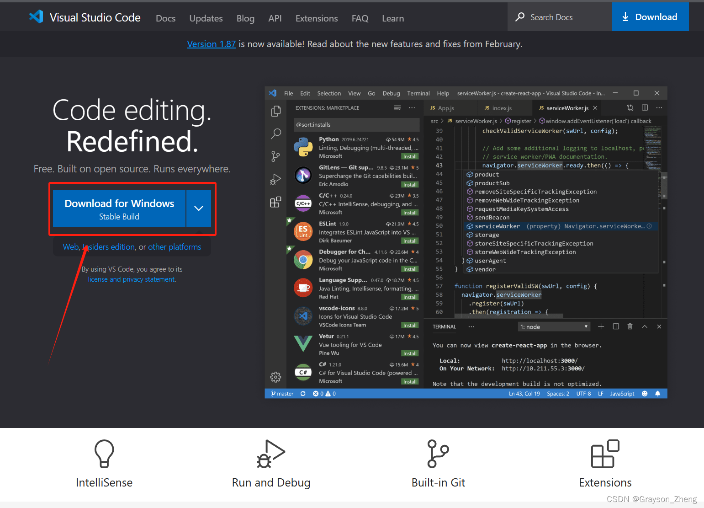
*图 1：点击 "Download for Windows"（Stable Build，稳定版）*

> [!TIP]
> 下载下来的文件名类似 `VSCodeUserSetup-x64-1.9x.x.exe`。认准 `UserSetup` 和 `x64` 就行。

2. 找到下载好的安装包，**双击运行**。

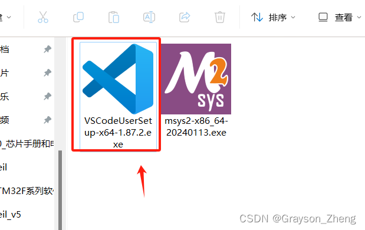
*图 2：双击运行安装程序*

3. 如果弹出"用户帐户控制"窗口询问是否允许，点击**是 / 运行**。

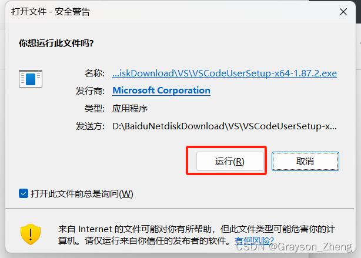
*图 3：弹出权限询问窗口，点"是"*

4. 在许可协议界面，勾选 **我同意此协议**，点击**下一步**。

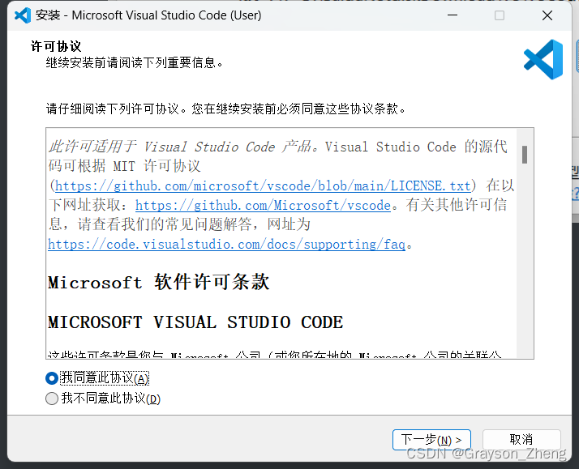
*图 4：勾选"我同意此协议"，点"下一步"*

5. 选择安装位置。**建议直接用默认路径**，点击**下一步**。

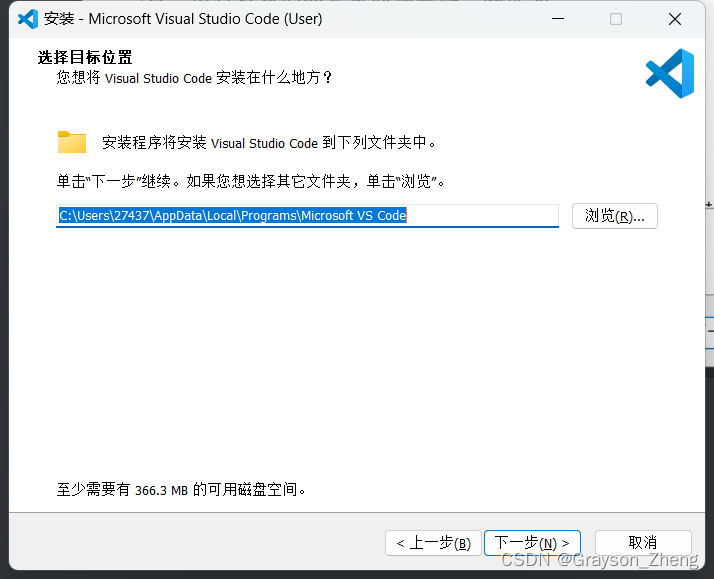
*图 5：安装位置，默认即可*

> [!WARNING]
> 如果你要改安装路径，**路径里不要有中文和空格**。

6. 开始菜单文件夹名称，**保持默认**，点击**下一步**。

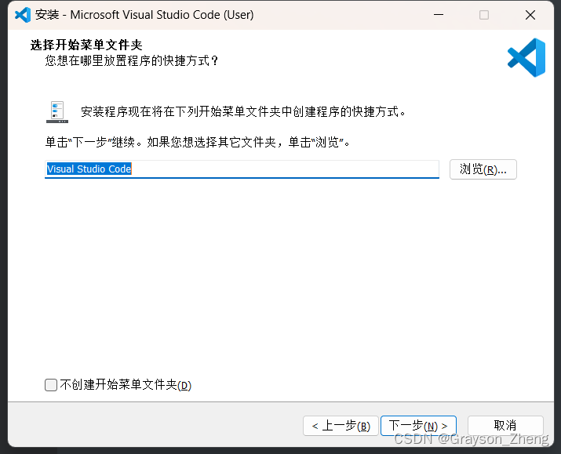
*图 6：开始菜单名称，默认即可*

7. 在"选择附加任务"界面，把复选框**全部勾选**，点击**下一步**。

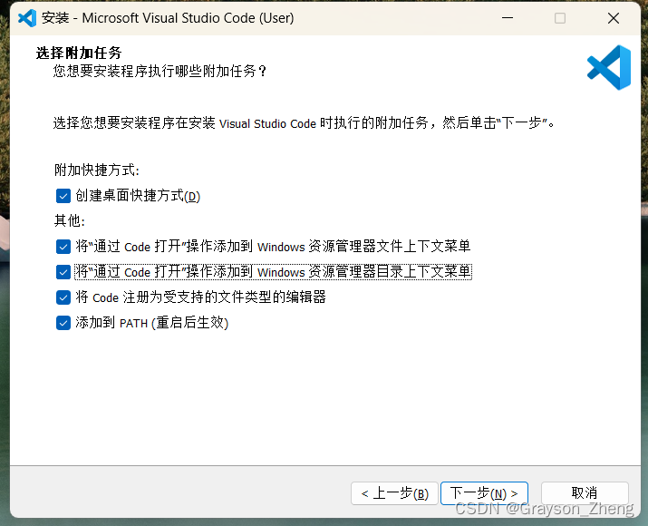
*图 7：五个附加任务全部勾选*

> [!TIP]
> 其中"**添加到 PATH**"这一项必须勾选，它让你以后能在终端里直接用 `code` 命令打开 VS Code。
> 而"**将'通过 Code 打开'操作添加到 Windows 资源管理器文件/目录上下文菜单**"勾上之后，你就能右键文件夹直接"用 Code 打开"，非常好用。

8. 确认安装信息，点击**安装**。

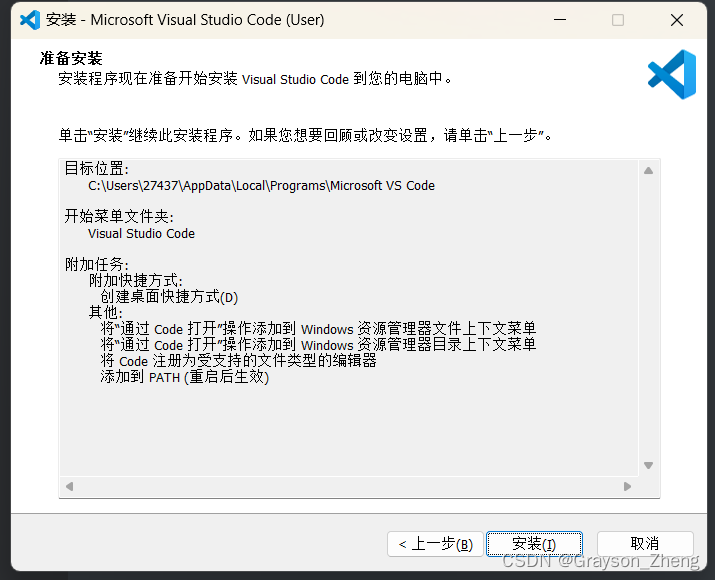
*图 8：确认信息后点击"安装"*

9. 等待安装完成，大约一分钟。

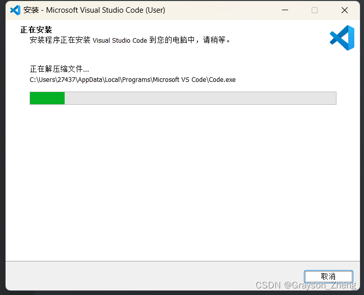
*图 9：安装进度条*

10. 安装完成。此处可以**去掉"运行 Visual Studio Code"的勾选**，点击**完成**。

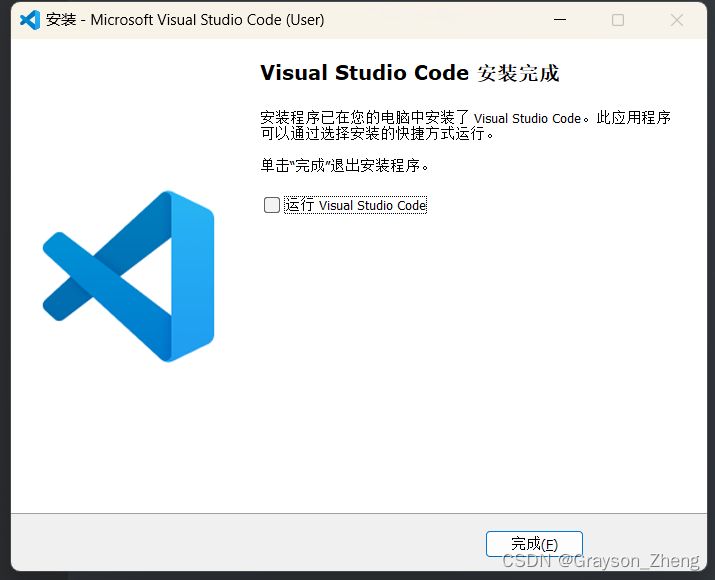
*图 10：安装完成界面*

> [!NOTE]
> 这里先不打开 VS Code，是为了先把编译器装好再一起配置，避免中间状态让你困惑。
> 如果你手快已经打开了，也不要紧，关掉等会儿再开就行。

---

## 4. 下载 MinGW-w64 免安装包

1. 打开下载页：<https://github.com/niXman/mingw-builds-binaries/releases>

2. 页面左侧的 **Release list** 里，最上面一项就是**最新版本**。本文写作时为 `16.2.0-rt_v14-rev1`（对应 GCC 16.2.0）。点击它，右侧就会显示这个版本的全部文件。

> [!TIP]
> **GitHub 打不开或下载很慢怎么办？**
> 这是国内网络常见问题，不是你的错。可以：换个时间再试（凌晨通常很快）、换成手机热点、或者直接用课程群里下发的同一个压缩包（内容完全一样）。

3. 在 **Assets**（资产）列表里找到下面这一个，点击它下载：

```
x86_64-16.2.0-release-posix-seh-ucrt-rt_v14-rev1.7z
```

大小约 **103 MB**（列表里会显示）。

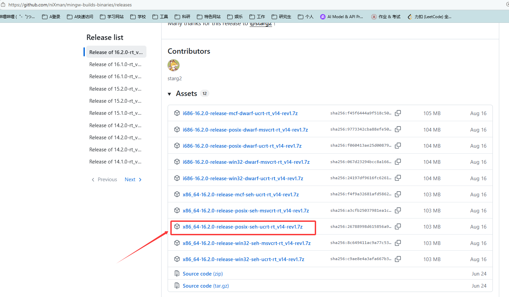
*图 11：红框里就是你要下载的那个文件*

> [!IMPORTANT]
> `Assets` 里有 **10 个** `.7z` 文件，名字长得很像，**只有红框里那个是对的**。
> 区分要点见下面的 4.1 节。下错了会导致编译或调试出问题。

### 4.1 文件名里那一长串是什么意思？

这个文件名不是乱码，每一段都有含义。**看懂了你就不会再下错文件**：

以 `x86_64-16.2.0-release-posix-seh-ucrt-rt_v14-rev1.7z` 为例：

| 片段 | 含义 | 本课程选择 |
|---|---|---|
| `x86_64` | 目标架构：64 位 | ✅ 64 位电脑选这个 |
| `i686` | 目标架构：32 位 | ❌ 不要选 |
| `16.2.0` | GCC 版本号 | 越高越新，不必纠结 |
| `release` | 正式发布版 | ✅ |
| `posix` | 线程模型：用 winpthreads 实现 | ✅ 选 `posix`（兼容性最好） |
| `win32` | 线程模型：直接用 Windows 原生线程 | ❌ 不提供完整的 `pthread`／`std::thread` 支持 |
| `mcf` | 线程模型：用 mcfgthread 实现 | ❌ 较新、性能更好，但兼容性还在完善中，本课程不用 |
| `seh` | 异常处理模型（64 位用） | ✅ 64 位选这个 |
| `dwarf` | 异常处理模型（32 位用） | ❌ 配 `i686` 时才会用到 |
| `ucrt` | 使用通用 C 运行时（Windows 10 及以上） | ✅ 选 `ucrt` |
| `msvcrt` | 使用老式运行时 | ❌ 老旧 |
| `rt_v14` | runtime 版本 | — |
| `rev1` | 修订号 | — |

**结论：认准 `x86_64` + `posix` + `seh` + `ucrt` 这四个词就够了。**
换句话说，在 10 个文件里，你要的都是 `x86_64` 开头、`posix` 在中间、`ucrt` 在结尾的那一个。

---

## 5. 解压（注意：是解压，不是安装）

> [!WARNING]
> 这一步是**压缩包解压，不是安装**。不需要双击什么 setup，也不需要"下一步"。
> 如果你电脑上找不到解压工具，先装一个 [7-Zip](https://www.7-zip.org/)（免费）。

1. 在下载目录里**右键**那个 `.7z` 文件，选择解压。

   - **Windows 11**（23H2 及以上）：直接右键 → **全部解压缩**，系统自带支持 `.7z`。
   - **Windows 10**：需要先装 7-Zip / WinRAR / Bandizip，然后右键 → **解压到当前文件夹** / **Extract Here**。

2. 选一个**纯英文、无空格**的目录来解压。推荐解压到 `C:\`，这样路径最短、最好记。

   压缩包里**自带一层 `mingw64` 文件夹**，所以无论你解压到哪，结构都是这样：

   ```
   <你选的解压目录>\
   └── mingw64\          ← 压缩包里自带的这一层
       ├── bin\          ← ★ 关键目录：gcc.exe / g++.exe / gdb.exe 都在这里
       ├── include\
       ├── lib\
       ├── share\
       └── ...
   ```

   > [!WARNING]
   > **不同解压工具的行为不一样，多说一句能帮你少走弯路：**
   >
   > - 解压路径填 **`C:\`** → 最终得到 `C:\mingw64\bin` ✅（本文档后面都按这个写）
   > - 用 7-Zip 的「**解压到 "文件名\"**」→ 它会多生成一层以压缩包命名的文件夹，得到类似
   >   `D:\Environment\x86_64-16.2.0-release-posix-seh-ucrt-rt_v14-rev1\mingw64\bin`（图 12 就是这种情况）
   >
   > **这两种都是对的**，只是路径长短不同而已。真正要记住的只有一条：
   > **后面往 PATH 里填的，必须是"直接放着 `gcc.exe` 的那个 `bin` 文件夹"的路径。**
   > 千万不要把外面那层文件夹填进去 —— 这是最常见的错误。

3. **验证一下**：打开那个 `bin` 文件夹，确认里面有 `gcc.exe`、`g++.exe`、`gdb.exe` 这三个文件。

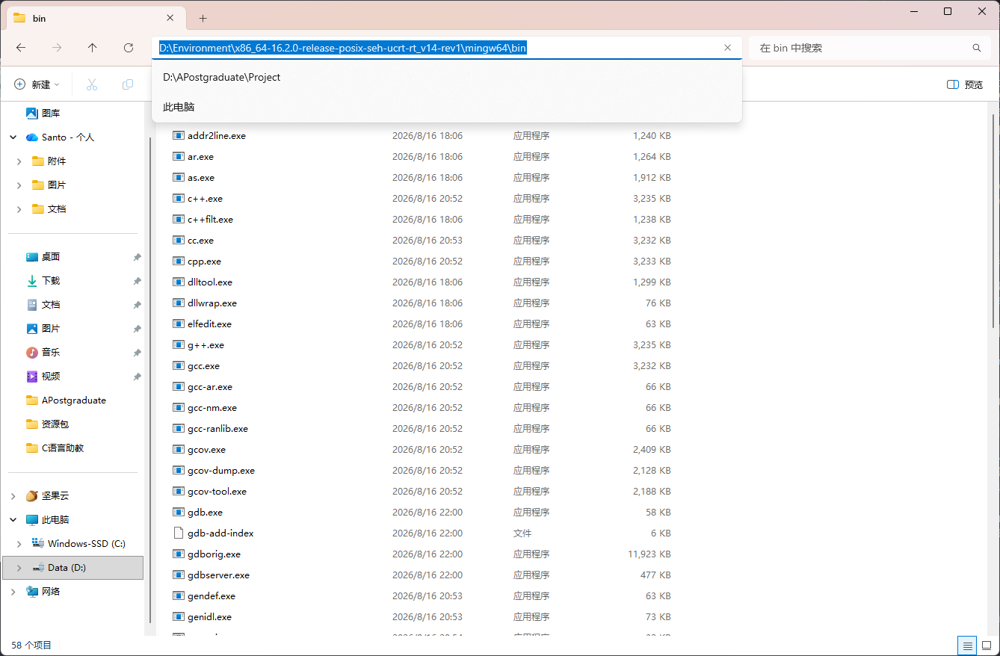
*图 12：`bin` 目录里能看到 `gcc.exe`、`g++.exe`、`gdb.exe`，地址栏里那条就是待会儿要复制的路径*

> [!TIP]
> 图里只截到了 `a` 到 `g` 开头的文件，你往下滚动**一直到底**才是完整的。总数约 58 个文件。

---

## 6. 把 GCC 加入 PATH 环境变量

### 6.1 为什么必须做这一步？

你刚才把 gcc 解压到了某个 `bin` 文件夹里（例如 `C:\mingw64\bin`），但**Windows 并不知道那里有个编译器**。

PATH 是 Windows 的一份"常用程序目录清单"：你在终端敲 `gcc`，系统会去 PATH 列出的每个目录里找有没有 `gcc.exe`。**不把那个 `bin` 文件夹加进 PATH，终端就永远找不到 gcc。**

### 6.2 操作步骤

1. 打开文件资源管理器，进入那个 `bin` 文件夹（就是图 12 里那个），**点击地址栏**让路径变蓝，按 `Ctrl + C` 复制整条路径。

> [!IMPORTANT]
> 复制的路径**以你自己电脑上的为准**。
> 本文后面统一按 `C:\mingw64\bin` 来写；如果你是按图 12 那样解压的，你的路径可能是
> `D:\Environment\x86_64-16.2.0-...\mingw64\bin`。**只要它指向那个装着 `gcc.exe` 的 `bin` 文件夹就是对的。**

2. 按 `Win + S` 打开搜索，输入**编辑系统环境变量**，点击打开。

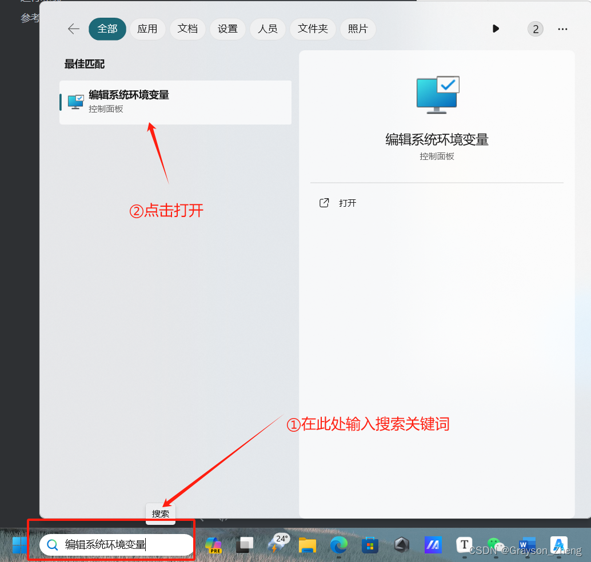
*图 13：搜索"编辑系统环境变量"*

3. 在弹出的"系统属性"窗口中，点击右下角的**环境变量**按钮。

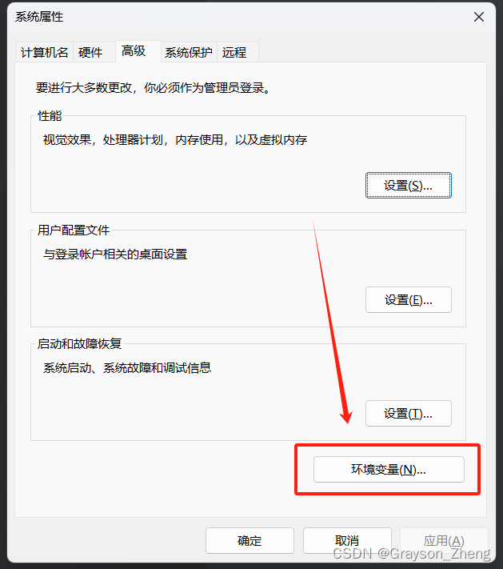
*图 14：点击"环境变量"*

4. 在"环境变量"窗口的**上半部分（用户变量）**里找到 **Path**，选中后点击**编辑**（或直接双击）。

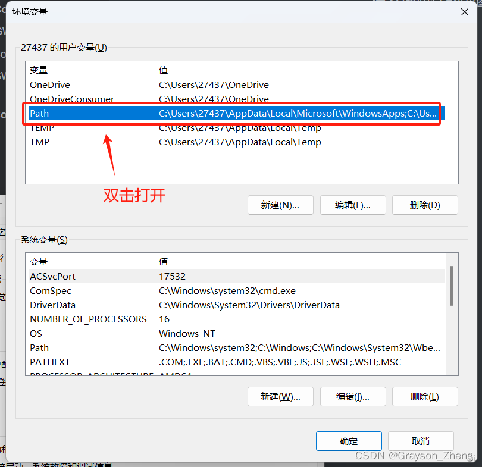
*图 15：选中用户变量里的 Path，点"编辑"*

> [!NOTE]
> 用户变量和系统变量里都有 Path，**改哪一个都行**。改"用户变量"不需要管理员权限，更省事，推荐它。

5. 点击**新建**，在出现的空白行里**粘贴**刚才复制的路径 `C:\mingw64\bin`，然后点击**确定**。

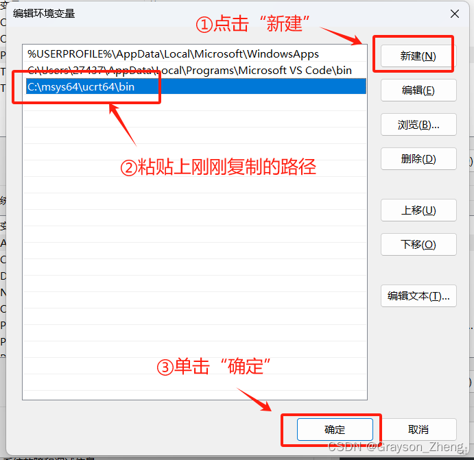
*图 16：点"新建"后粘贴 `C:\mingw64\bin`*

> [!WARNING]
> **只点"新建"再加一行，不要删掉或覆盖原有的任何条目！**
> 那些是系统和其他软件要用的路径，删了会导致别的程序出问题。

6. 一路点击**确定**，逐层关闭所有窗口。

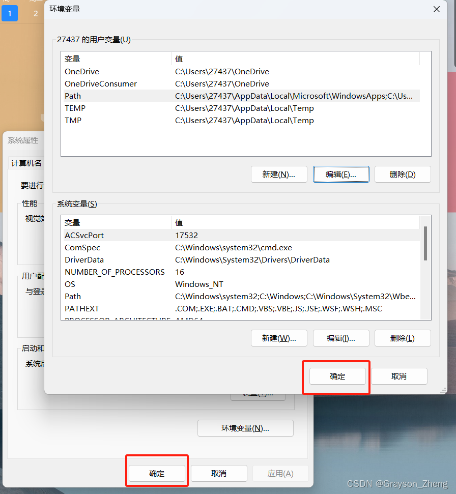
*图 17：逐层点"确定"退出（共三层）*

> [!IMPORTANT]
> **环境变量改完之后，已经打开的终端和 VS Code 不会自动生效**，必须**关掉重开**。
> 如果你后面验证时仍提示找不到 gcc，先想想是不是还开着旧窗口。

---

## 7. 验证编译器是否装好

1. 按 `Win + R`，输入 `cmd`，回车。

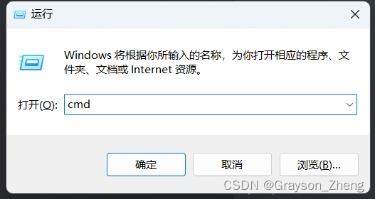
*图 18：Win + R 输入 cmd 打开命令行*

2. 在黑色窗口里，依次输入下面三条命令，**每输入一条按一次回车**：

```bash
gcc --version
```

```bash
g++ --version
```

```bash
gdb --version
```

3. 如果三条命令都打印出了版本信息，**恭喜，编译器环境已经装好了**。

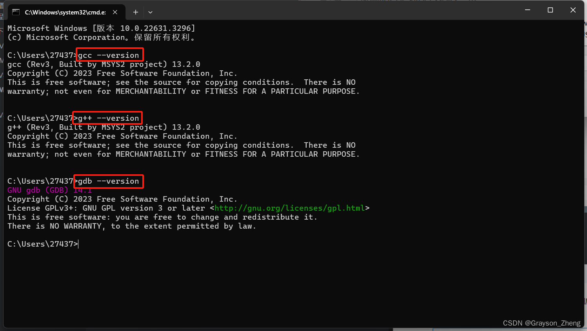
*图 19：三条命令都能输出版本信息，说明装好了*

> [!IMPORTANT]
> 图 19 里显示的是 GCC 13.2.0，且写着 `Built by MSYS2 project`，**这是参考文献作者的环境**。
> 你的会显示 **GCC 16.2.0** 之类的版本号，字样也可能不同。**只要能看到类似结构的版本信息，就说明成功了，不要纠结数字。**

> [!WARNING]
> **如果提示 `'gcc' 不是内部或外部命令，也不是可运行的程序或批处理文件`**，说明 PATH 没生效，按顺序排查：
> 1. 是不是**没关掉旧的命令行窗口**？关掉重新 `Win + R` → `cmd` 再试；
> 2. 环境变量里粘贴的路径**是不是写错了**？确认是 `C:\mingw64\bin`（**结尾的 `\bin` 必须有**）；
> 3. 路径**是不是 `C:\mingw64\mingw64\bin`**？如果是，说明第 5 节解压时多套了一层，把 PATH 里的路径改成实际位置即可；
> 4. 打开 `C:\mingw64\bin` 看看，**里面到底有没有 `gcc.exe`**。

---

## 8. 配置 VS Code

### 8.1 汉化界面（选做）

如果你不习惯全英文界面，可以装官方中文语言包。**想练英文环境的同学可以跳过这一节。**

1. 启动 VS Code，按 `Ctrl + Shift + X` 打开扩展面板（或点击左侧边栏第五个图标）。

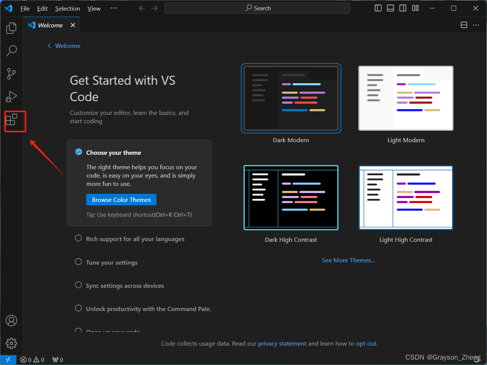
*图 20：左侧第五个图标是扩展面板*

2. 在搜索框里输入 `Chinese`，在列表里找到中文语言包，点击 **Install**。

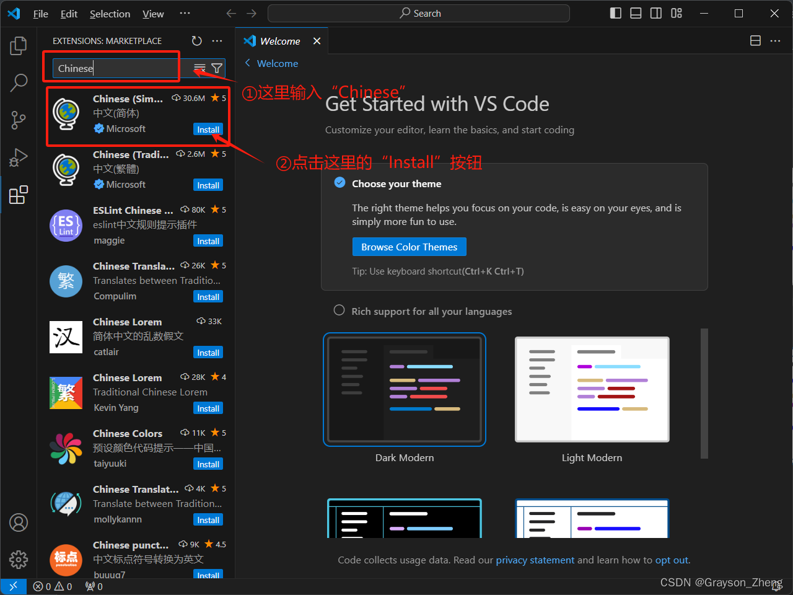
*图 21：搜索 Chinese，点 Install*

3. 安装完成后，右下角会弹出通知，点击 **Change Language and Restart** 重启。

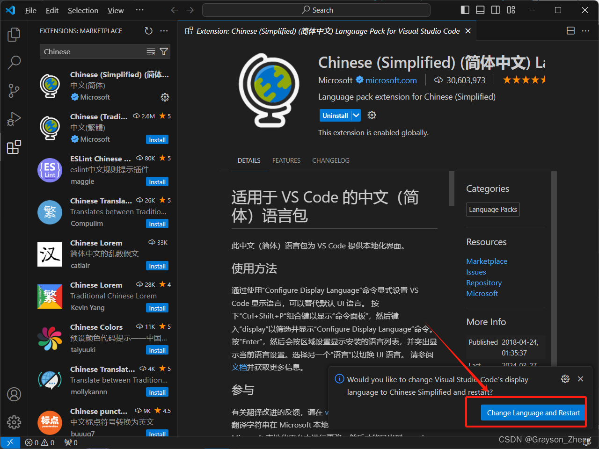
*图 22：点"Change Language and Restart"*

4. 重启之后，界面就变成中文了。

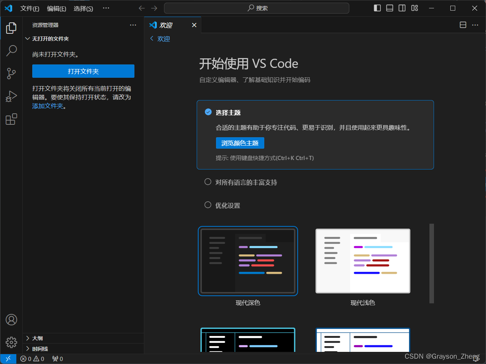
*图 23：汉化后的界面*

### 8.2 安装 C/C++ 扩展（**必做**）

这个扩展提供语法高亮、代码补全、错误提示，以及"一键编译运行"的按钮。**不装它，后面第 9 节的运行按钮就不会出现。**

1. 在扩展面板的搜索框里输入 `C++`，找到微软官方的 **C/C++** 扩展，点击 **安装**。

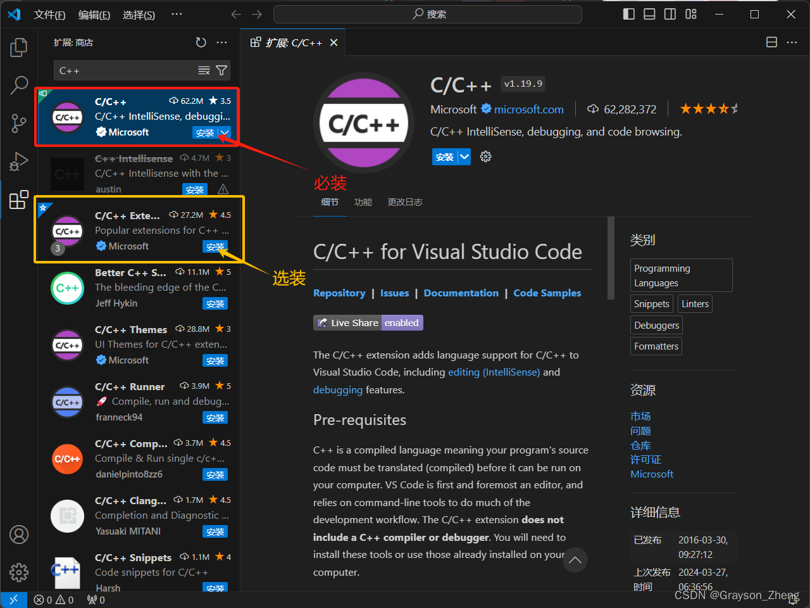
*图 24：安装第一个（Microsoft 出品的 C/C++）*

> [!TIP]
> 列表里第一个就是我们要的。图 24 里还能看到一个 "C/C++ Extension Pack"，那是个扩展合集，**不是必需的**，本课程不用装。

---

## 9. 跑通第一个程序：Hello, World!

### 9.1 建好文件夹

> [!NOTE]
> VS Code 是**以文件夹为单位**管理代码的（和记事本不一样）。所以第一件事是建一个专门放代码的文件夹，再用 VS Code 打开它。

1. 在文件资源管理器里，新建一个文件夹，比如 `D:\Code`，里面再建一个放 C 代码的子文件夹。

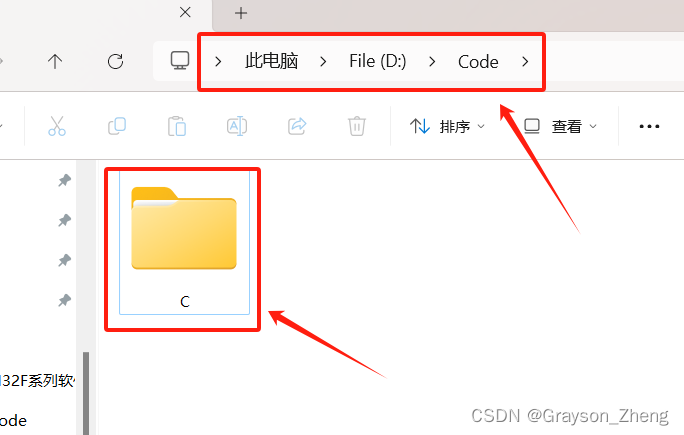
*图 25：新建一个专门放代码的文件夹*

> [!WARNING]
> 再说一次：**这个路径里不要有中文**，否则会出现编译失败等莫名其妙的问题。

2. 打开 VS Code，点击欢迎页上的 **打开文件夹**。

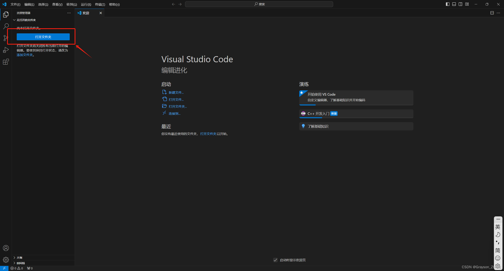
*图 26：点击"打开文件夹"*

3. 在弹窗中找到刚才建的文件夹，选中后点击**选择文件夹**。

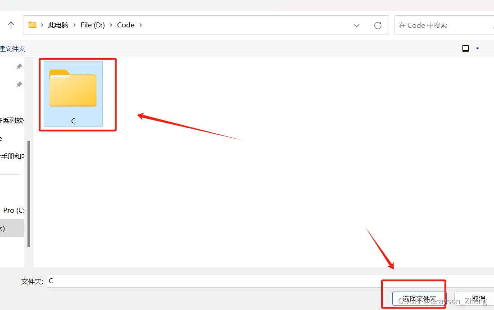
*图 27：选中文件夹后点"选择文件夹"*

4. 弹出"是否信任此文件夹作者"时，勾选信任并点击**是，我信任此作者**。

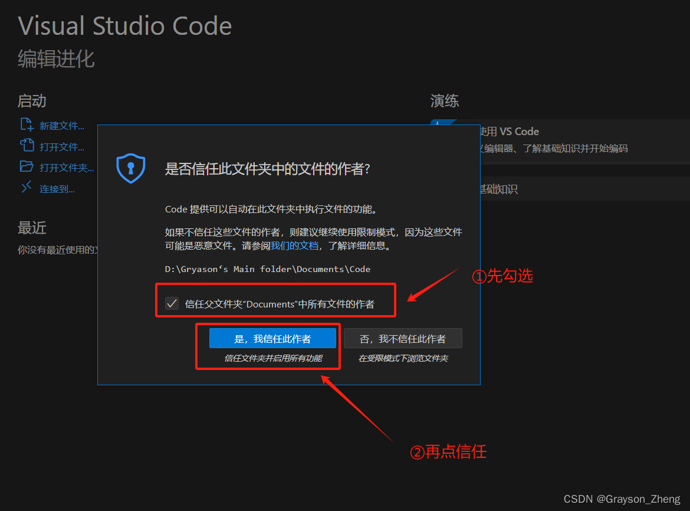
*图 28：勾选信任，点"是，我信任此作者"*

> [!NOTE]
> VS Code 的这个安全提示是防止你不小心运行了来路不明的代码，自己建的文件夹放心信任即可。

5. 打开之后，左侧的**资源管理器**（第一个图标）里就能看到你的文件夹了。把鼠标悬停在文件夹名上，会出现四个小图标。

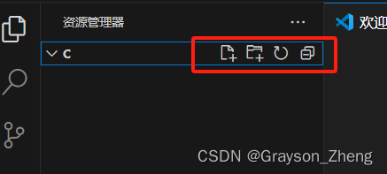
*图 29：四个图标依次是"新建文件""新建文件夹""刷新""折叠"*

### 9.2 新建并运行 .c 文件

1. 选中你的代码文件夹，点击**新建文件夹**图标，建一个子文件夹，命名为 `test`。

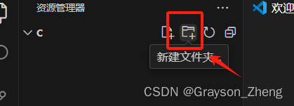
*图 30：点击"新建文件夹"图标*

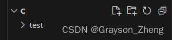
*图 31：输入文件夹名 test*

2. **右键** `test` 文件夹，在菜单中选择**新建文件**。

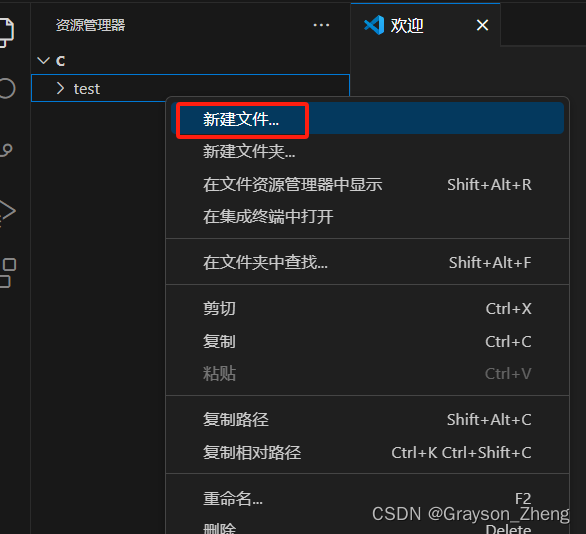
*图 32：右键 → 新建文件*

3. 输入文件名 **`test.c`**，回车确认。

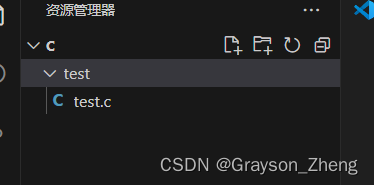
*图 33：文件名必须以 `.c` 结尾*

> [!IMPORTANT]
> **后缀名必须是 `.c`**（小写）。
> 写成 `test.txt` 或 `test`，VS Code 就不知道这是 C 代码，不会给你编译运行。

4. 在 `test.c` 里输入下面这段代码。**建议手敲一遍**，不要复制：

```c
#include <stdio.h>

int main(void)
{
    printf("Hello, World!\n");
    return 0;
}
```

5. 点击编辑器**右上角的运行/调试按钮**（▶ 旁边带一个小虫子的图标）。随后上方会弹出一个下拉列表，**点击第一项** —— 也就是检测到的 gcc 那一项。

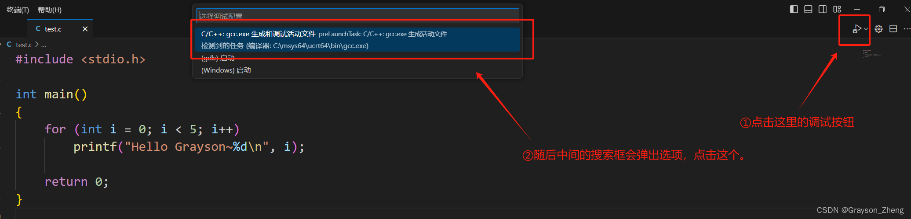
*图 34：① 点击右上角的运行/调试按钮；② 在弹出列表里点第一项*

> [!IMPORTANT]
> 图 34 的列表里写的是 `C:\msys64\ucrt64\bin\gcc.exe`，**那是参考文献作者的 MSYS2 路径**。
> 你的这里应该显示 **`C:\mingw64\bin\gcc.exe`**。只要列表里出现的是路径里带 `mingw64` 的那一项，就选它。

6. 如果右下角弹出询问窗口，点击**是**（允许它生成配置等文件）。

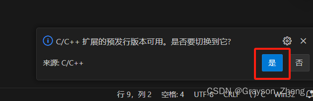
*图 35：点"是"允许*

7. 终端里出现输出结果：

```
Hello, World!
```

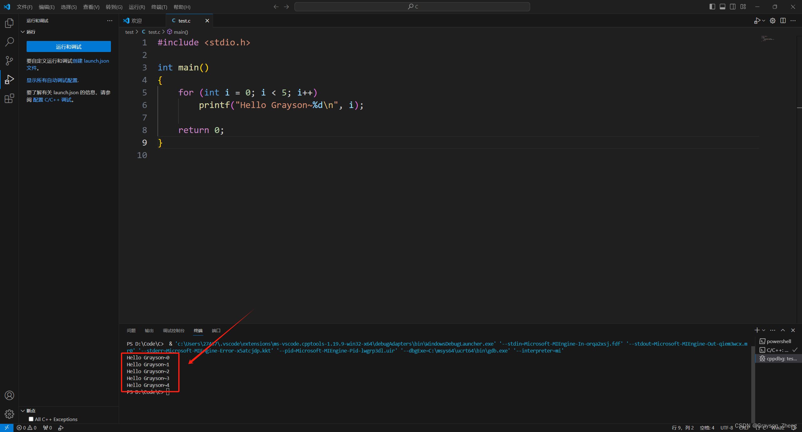
*图 36：程序成功运行，终端打印出结果*

> [!IMPORTANT]
> 图 36 里输出的内容是 `Hello Grayson~0` 到 `Hello Grayson~4`，那是参考文献作者写的一个循环程序，**不是 Hello World**。
> 你只要看到**自己写的 `Hello, World!` 出现在终端里**，就说明成功了。

> [!TIP]
> 第一次运行之后，你会发现左侧多了一个 **`.vscode` 文件夹**，里面有 `tasks.json`。
> 这是 VS Code 自动生成的编译配置，**不要删**。它的作用是告诉 VS Code："编译 C 文件时去调用 `C:\mingw64\bin\gcc.exe`"。

### 9.3 这几行代码是什么意思？

环境跑通了，顺便认识一下这几行（第 2 周会展开讲）：

| 代码 | 含义 |
|---|---|
| `#include <stdio.h>` | 引入"标准输入输出库"的头文件。`printf` 这个函数就声明在里面 |
| `int main(void)` | 主函数。**每个 C 程序都必须有且只有一个 `main`**，程序从这里开始执行 |
| `{ }` | 函数体，里面写具体要做的事 |
| `printf("Hello, World!\n");` | 在屏幕上打印一行字。`\n` 表示换行。**注意结尾的分号** |
| `return 0;` | 告诉操作系统"程序正常结束" |

---

## 10. 让程序停下来：断点调试入门

光是"跑出结果"还不够。程序出错时，你需要让它**停在某一行**，看看每个变量当前是多少。这就是调试。

先把代码换成一个带循环的版本，这样才有东西可看：

```c
#include <stdio.h>

int main(void)
{
    for (int i = 0; i < 5; i++)
    {
        printf("Hello, World! %d\n", i);
    }
    return 0;
}
```

1. **打断点**：用鼠标左键点击行号**左边的空白处**，会出现一个红点。

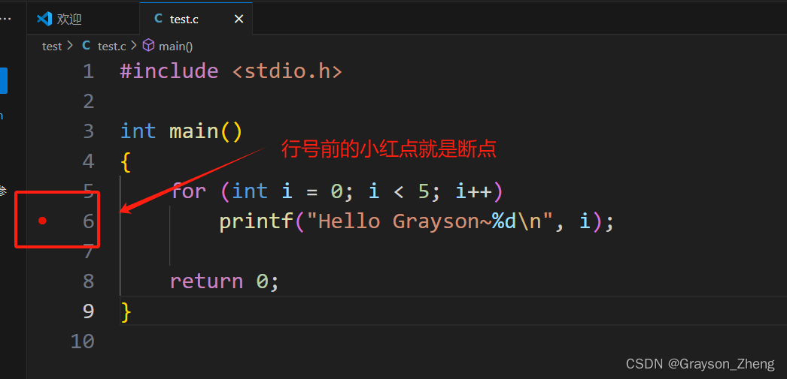
*图 37：在行号左侧单击即可打断点，再点一次取消*

2. 点击运行按钮（或按 `F5`）开始调试。程序会**停在断点那一行**，左侧出现调试面板。

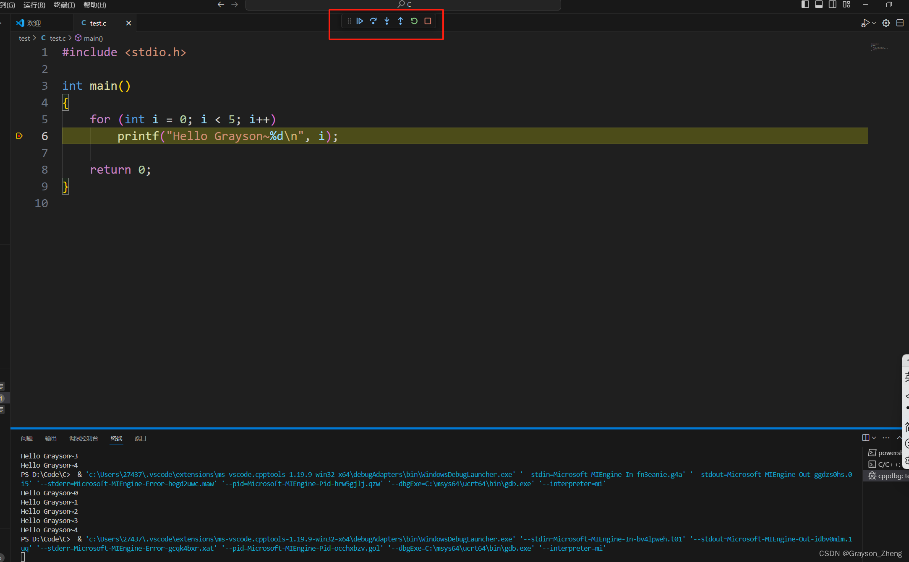
*图 38：程序停在第 6 行，左侧出现调试工具条*

3. 调试面板上这几个按钮，**这一周先混个脸熟，后面会反复用到**：

| 按钮 | 名称 | 作用 |
|---|---|---|
| ▶ | **继续**（Continue） | 一直执行到下一个断点或程序结束 |
| ⤵ | **逐过程**（Step Over） | 执行当前行；若该行是函数调用，**不进去**，直接执行完 |
| ⬇ | **单步调试**（Step Into） | 执行当前行；若该行是函数调用，**进入函数内部**，停在第一行 |
| ⬆ | **单步跳出**（Step Out） | 把当前函数剩下的部分执行完，回到调用它的下一行 |
| ↻ | **重启**（Restart） | 重新开始调试 |
| ■ | **停止**（Stop） | 结束调试 |

> [!TIP]
> **动手试一下**：在断点停下时，把鼠标悬停在 `i` 上，就能看到它当前的值。连点几次"逐过程"，看 `i` 是怎么从 0 变到 4 的 —— 这就是循环的本质。

---

## 11. 选做：多文件编译与调试

> [!NOTE]
> 这一节是**进阶内容**。本周不会用到这里的东西，后面写多个文件的项目时再回来看。
> 如果你现在还没走通前面的 Hello World，**先跳过这一节**。

### 11.1 问题在哪

默认配置每次只编译**当前打开的那一个 `.c` 文件**。当你的程序分成 `main.c`、`max.c`、`max.h` 三个文件时，默认配置就编不过了 —— 它只认识一个文件。

### 11.2 改 tasks.json

1. 第一次运行之后，项目里会出现 `.vscode/tasks.json`。

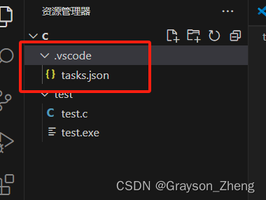
*图 39：`.vscode` 文件夹下的 tasks.json*

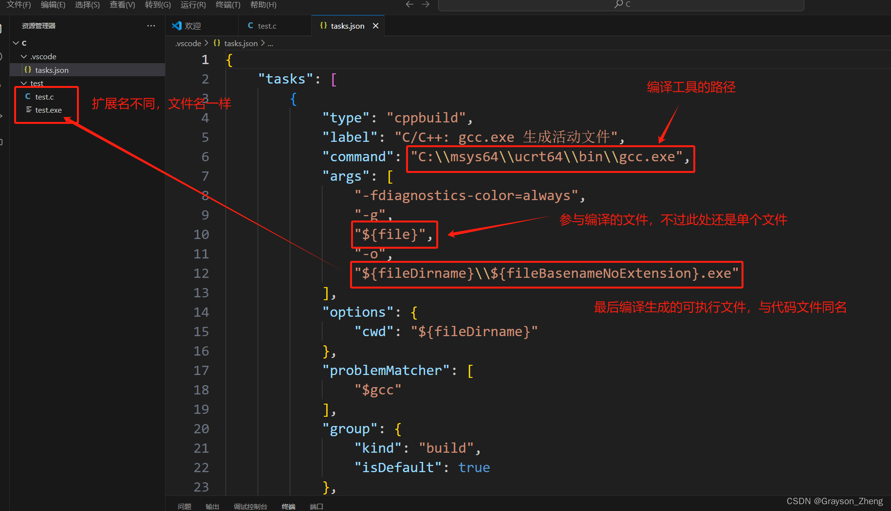
*图 40：tasks.json 各字段的含义*

2. 打开它，做**两处修改**：

```json
"args": [
    "-fdiagnostics-color=always",
    "-g",
    "*.c",                                    // ← 原来是 "${file}"
    "-o",
    "${fileDirname}\\program.exe"             // ← 原来是 "${fileDirname}\\${fileBasenameNoExtension}.exe"
],
```

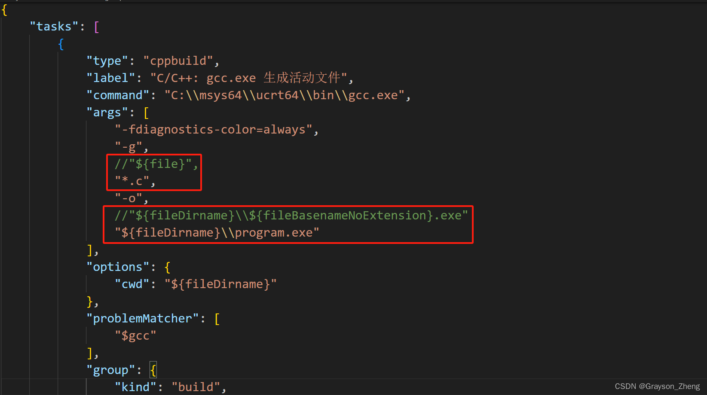
*图 41：把 `${file}` 改成 `*.c`，输出名改成 `program.exe`*

- 改 `"${file}"` → `"*.c"`：表示编译**当前文件夹下所有** `.c` 文件，而不只是某一个。
- 改输出名 → `program.exe`：多个文件编译后统一生成一个可执行文件。

3. 按 `Ctrl + S` 保存。

### 11.3 建 launch.json

4. 点击左侧的**运行与调试**图标，再点击**创建 launch.json 文件**。

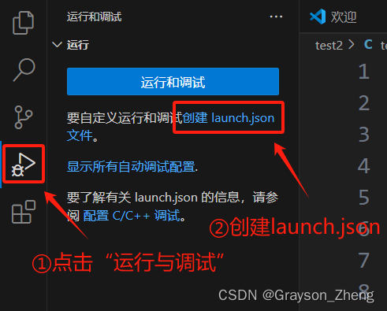
*图 42：点击"创建 launch.json 文件"*

5. 在弹出的选项里选择 **C++ (GDB/LLDB)**。

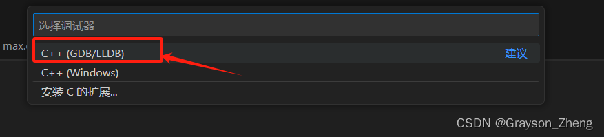
*图 43：选择 C++ (GDB/LLDB)*

6. 点击右下角的**添加配置**，在下拉菜单中选择 **C/C++: (gdb) 启动**。

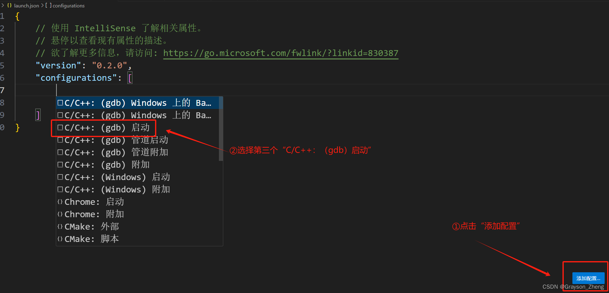
*图 44：添加 C/C++: (gdb) 启动配置*

7. 修改两处：

```json
"program": "${fileDirname}\\program.exe",        // 要和 tasks.json 里的输出名一致
"miDebuggerPath": "C:\\mingw64\\bin\\gdb.exe",   // ← 指向你机器上的 gdb.exe
```

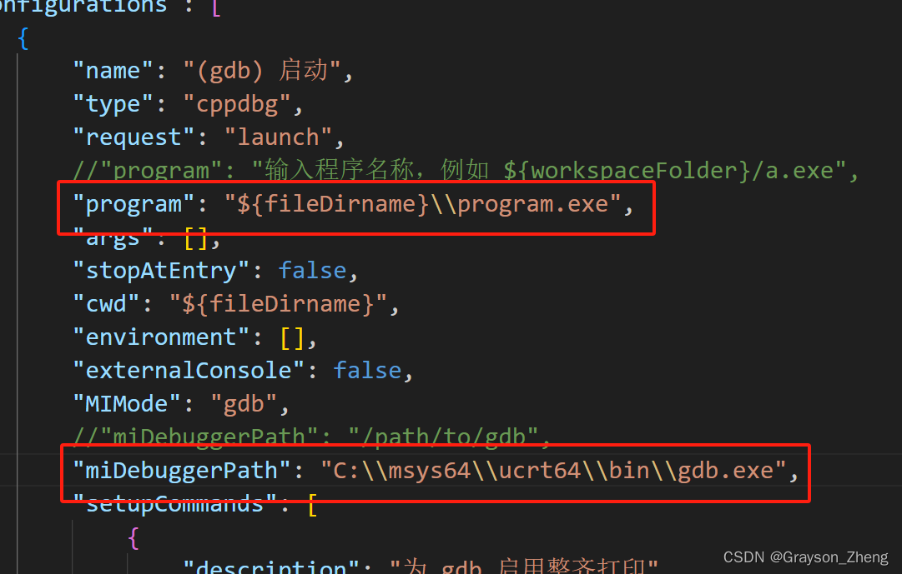
*图 45：修改 program 与 miDebuggerPath*

> [!WARNING]
> **路径里的反斜杠要写两个！**
> JSON 里 `\` 是转义字符，所以写 `C:\mingw64\bin\gdb.exe` 会报错，必须写成 `C:\\mingw64\\bin\\gdb.exe`。
> 这是新手最容易踩的坑之一。

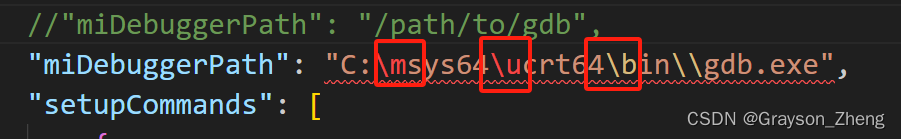
*图 46：正确写法是双反斜杠*

> [!IMPORTANT]
> 图 45、图 46 里 `miDebuggerPath` 显示的是 `c:\\msys64\\ucrt64\\bin\\gdb.exe`（参考文献的 MSYS2 路径）。
> **你的应该写成 `C:\\mingw64\\bin\\gdb.exe`。**

### 11.4 试试多文件

8. 新建文件夹 `test2`，里面建三个文件：

```
test2/
├── test.c      ← 主程序
├── max.h       ← 函数声明
└── max.c       ← 函数定义
```

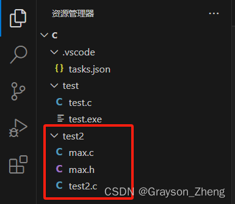
*图 47：三个文件的结构*

**max.h**

```c
#ifndef __MAX_H__
#define __MAX_H__

#include <stdio.h>

int findMaxNum(int num1, int num2);

#endif // __MAX_H__
```

**max.c**

```c
#include "max.h"

int findMaxNum(int num1, int num2)
{
    return num1 > num2 ? num1 : num2;
}
```

**test.c**

```c
#include <stdio.h>
#include "max.h"

int main(void)
{
    int a = 10;
    int b = 20;
    int c = findMaxNum(a, b);
    printf("%d\n", c);
    return 0;
}
```

> [!TIP]
> 注意两种 `#include` 的区别：
> - `#include <stdio.h>` 用尖括号，找的是**系统自带**的头文件；
> - `#include "max.h"` 用双引号，找的是**你自己写的**头文件。

9. 运行调试，观察三种单步执行的区别：

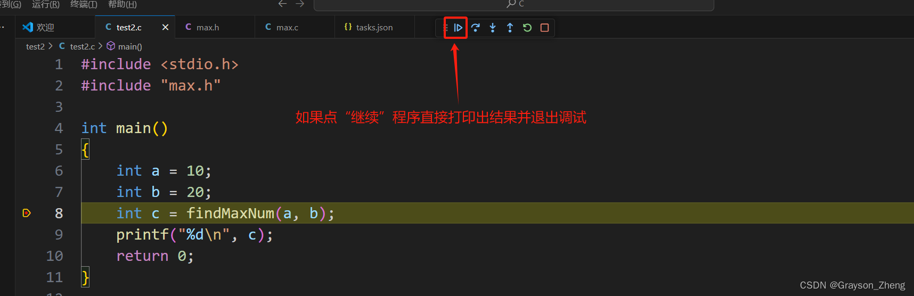
*图 48：点"逐过程"，不进入函数内部，直接得到结果*

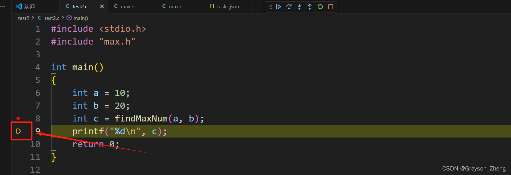
*图 49：点"单步调试"，会进入 findMaxNum 函数内部*

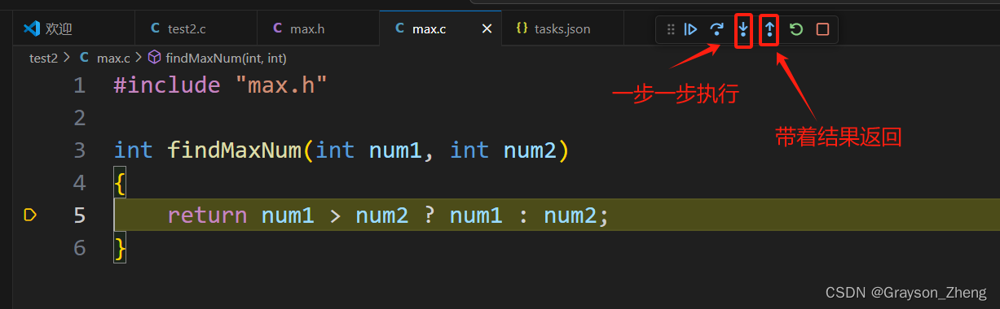
*图 50：点"单步跳出"，带着函数结果返回调用处*

---

## 12. 常见问题（FAQ）

**Q1：终端提示 `'gcc' 不是内部或外部命令`**

最典型的 PATH 问题。依次排查：

1. 是不是**改完环境变量没关掉旧窗口**？关掉命令行和 VS Code 重新打开；
2. PATH 里加的是不是 `C:\mingw64\bin`？**结尾的 `\bin` 不能少**；
3. 是不是写成了 `C:\mingw64\mingw64\bin`（解压时多套了一层）？
4. 打开 `C:\mingw64\bin` 肉眼确认里面有没有 `gcc.exe`。

**Q2：下载的 `.7z` 文件双击打不开 / 提示找不到打开方式**

你的系统没有解压 `.7z` 的工具。Windows 11（23H2 及以上）自带；Windows 10 需要装 [7-Zip](https://www.7-zip.org/)（免费）或 WinRAR。装完再右键解压。

**Q3：解压出来了，但找不到 `gcc.exe`**

多半是多套了一层目录。压缩包**自带**一层 `mingw64` 文件夹：

- 解压到 `C:\` → 得到 `C:\mingw64\bin` ✅
- 解压到 `C:\mingw64` → 得到 `C:\mingw64\mingw64\bin` ❌

如果已经套错了，要么把里层 `mingw64` 文件夹剪切到 `C:\` 下覆盖，要么把 PATH 里的路径改成实际的 `C:\mingw64\mingw64\bin`。

**Q4：点运行按钮，什么都没发生 / 没有输出**

- 确认当前打开的文件**后缀是 `.c`**，且已经**保存**（`Ctrl + S`，未保存的文件标题上有个小圆点）；
- 确认代码里**有 `int main(void)`**，程序必须从 main 开始；
- 第一次运行如果弹出编译器选择列表，**必须选 gcc**，选错或没选就没有输出。

**Q5：代码明明对，却编译报错**

先看三条：

1. **路径里有中文或空格**？这是最常见的原因，把项目挪到 `D:\Code` 这类纯英文路径；
2. **语句结尾漏了分号**？`printf(...)` 后面的 `;` 必须有；
3. **括号没配对**？`{` 和 `}`、`(` 和 `)` 要成对出现。

**Q6：VS Code 里 `#include <stdio.h>` 下面有红色波浪线**

多半是没装 C/C++ 扩展（第 8.2 节），或者扩展开着但还没有选编译器。装好扩展、用 gcc 成功编译一次之后，红线一般会消失。

**Q7：程序输出的中文变成乱码**

属于编码问题，本课程的示例都只用英文输出，暂时不会遇到。后面需要输出中文时再统一处理。

**Q8：`gdb --version` 提示找不到命令，但 `gcc` 能正常用**

说明 `C:\mingw64\bin` 本身在 PATH 里，但那个目录下**没有 `gdb.exe`**。打开该目录确认一下。本课程下发的 mingw-builds 版本是自带 gdb 的；如果你是从别处下载的编译器，可能不含 gdb，需要重新下载本文第 4 节给出的那个文件。

---

## 13. 课后作业

1. **交截图**：把你自己电脑上 `Hello, World!` 的运行结果截图提交（要能看到终端里的输出）。
2. **改一改**：把 `printf` 里的内容改成 `Hello, 你的名字!`，重新运行，确认输出跟着变了。
3. **看循环**：用第 10 节带循环的那段代码，在第 7 行（`printf` 那一行）打一个断点，然后连续点"逐过程" 5 次，把每次停下时 `i` 的值记下来，说明 `i` 是怎么变化的。
4. **故意犯错**：把 `printf` 结尾的分号删掉，运行一次，把终端里的**报错信息原文**复制提交，并说说你怎么理解这条报错。

---

## 14. 自检清单

做完之后逐条打勾。**全部打上勾，才算本周过关**：

- [ ] 我的电脑上 `gcc --version`、`g++ --version`、`gdb --version` 三条命令都能输出版本信息
- [ ] 我能说出我电脑上 GCC 装在哪个目录（例如 `C:\mingw64\bin`）
- [ ] 我知道 PATH 是干什么用的，以及为什么必须把 bin 目录加进去
- [ ] 我能说清 MSYS2 方式和 mingw-builds 方式的区别，以及本课程用的是哪个
- [ ] 我的 VS Code 装好了 C/C++ 扩展
- [ ] 我能新建一个 `.c` 文件并成功运行，在终端看到输出
- [ ] 我知道 `.vscode/tasks.json` 是谁生成的、大概管什么
- [ ] 我会打断点，并能让程序停在断点处
- [ ] 我能说出"逐过程""单步调试""单步跳出"三个按钮的区别
- [ ] 我的项目路径里**没有中文和空格**

---

## 图片来源

本文截图有两个来源：

**一、来自参考文献**（图 1–图 10、图 13–图 50）
[《VS Code 配置 C/C++ 编程运行环境（保姆级教程）》](https://blog.csdn.net/qq_42417071/article/details/137438374)（作者 Grayson_Zheng，CSDN），版权归原作者所有，仅用于教学。

其中以下截图（**图 19、图 34、图 36、图 45、图 46**）显示的是参考文献作者环境中的 MSYS2 路径或版本号，**已在对应位置加注说明**，请以你自己电脑上的实际情况为准。

**二、由本课程助教补充**（图 11、图 12）
这两张是 **mingw-builds 路线专用的截图**，参考文献中没有对应内容：

- 图 11（第 4 节）：GitHub Releases 页面的 Assets 列表，红框标出应下载的文件
- 图 12（第 5 节）：解压后 `bin` 目录的内容与地址栏路径

> [!IMPORTANT]
> 因为参考文献并没有覆盖 mingw-builds 这条路线，文中凡涉及**下载哪个文件、解压到哪、gcc 路径是什么**的地方，**一律以本文档（和助教补充的图）为准**，不要拿参考文献里的 MSYS2 路径去对照。
