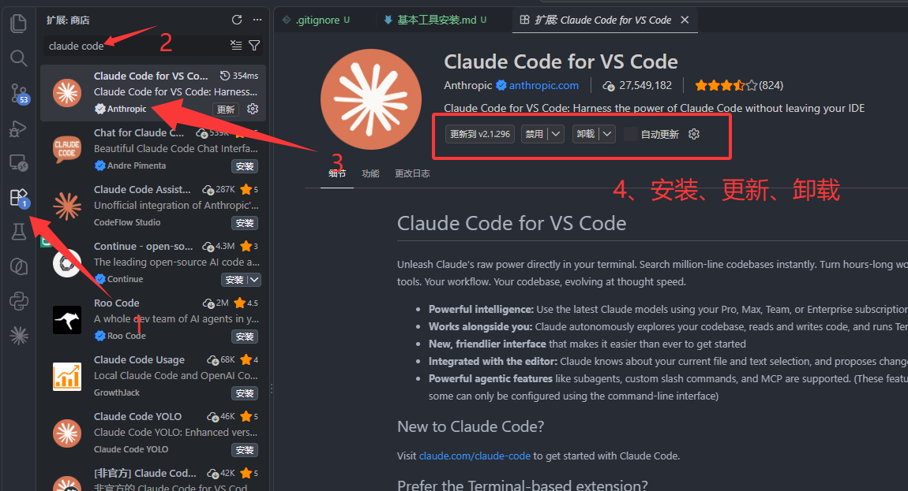
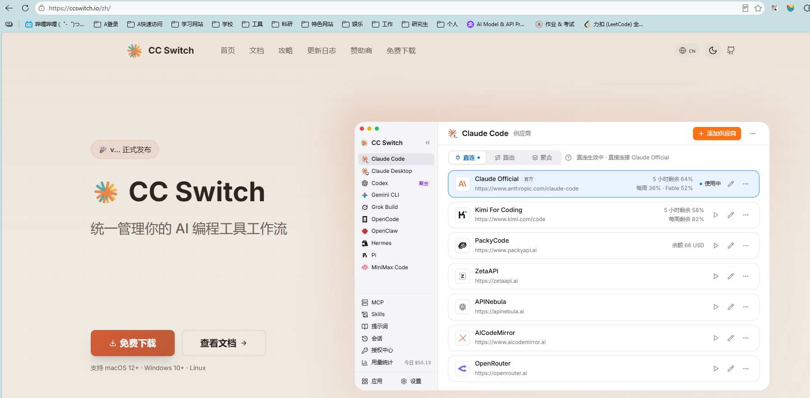
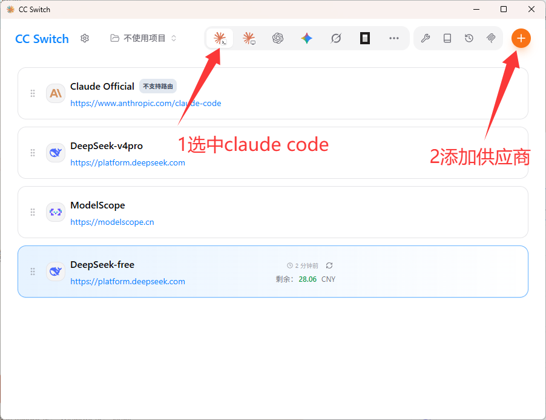
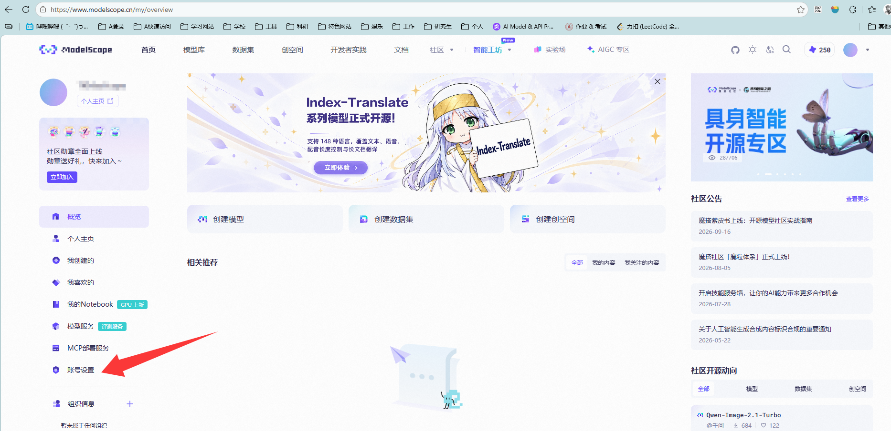
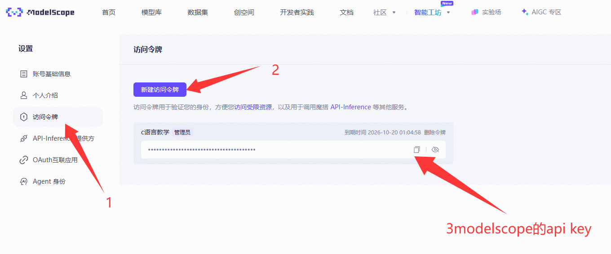
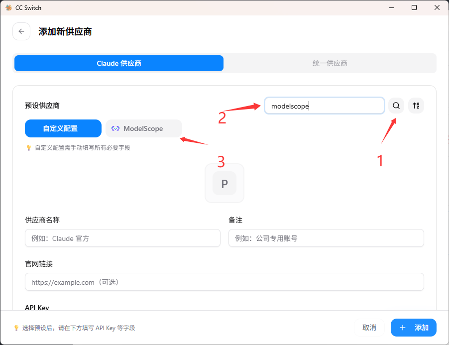
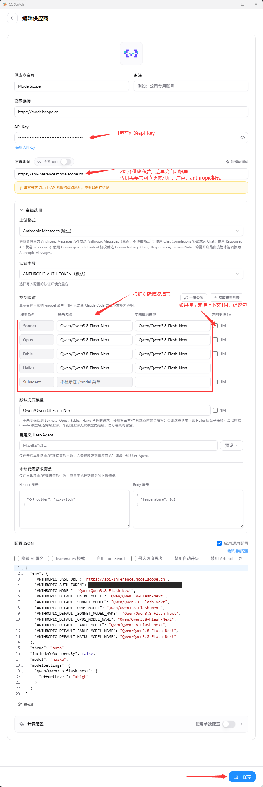
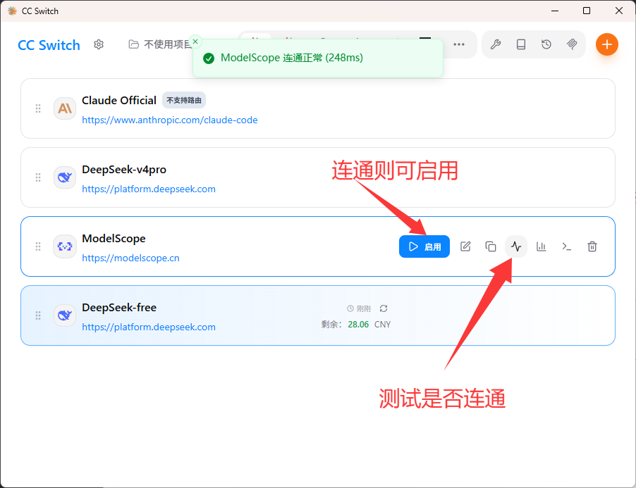
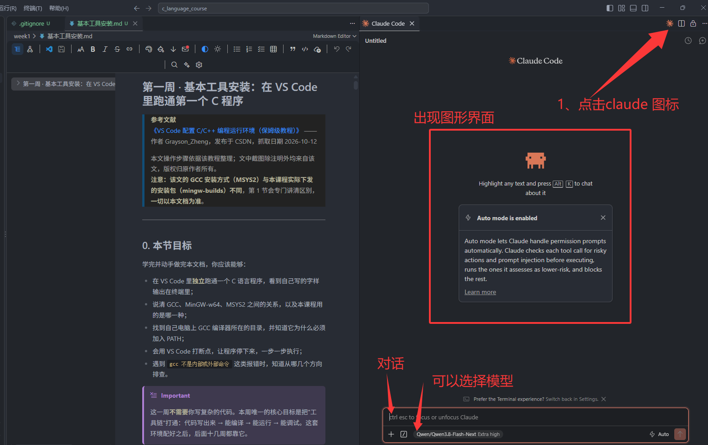

# 第二周 · Claude Code 安装与配置：在 VS Code 里用上 AI 编程助手

> **参考文献**
> [《2.1 添加供应商》](https://github.com/farion1231/cc-switch/blob/main/docs/user-manual/zh/2-providers/2.1-add.md) —— CC Switch 官方用户手册，发布于 GitHub，抓取日期 2026-10-12
> [《Use Claude Code in VS Code》](https://docs.claude.com/en/docs/claude-code/vs-code) —— Anthropic 官方文档，抓取日期 2026-10-12
> [《API 推理介绍》](https://www.modelscope.cn/docs/model-service/API-Inference/intro) —— ModelScope（魔搭社区）官方文档，抓取日期 2026-10-12
> [《claude code安装和remote ssh》](https://github.com/Golden-Promise/vscode-cc-switch) —— github开源资料，抓取日期 2026-10-19
>
> 本文操作步骤依据以上官方文档整理。
> **文中 9 张截图全部由本课程助教补充**，**不是**来自上述文献；上述文献只作"操作步骤与事实核对"之用。
> **注意：官方文档教的路线（用 Anthropic 付费账号）和本课程实际用的路线（ModelScope 免费额度）不一样**，第 2.2 节会专门讲清区别，**一切以本文档为准**。

---

## 0. 本节目标

学完并动手做完本文档，你应该能够：

- 在 VS Code 里**独立**装好 Claude Code 插件，并让它正常回话；
- 说清 Claude Code、VS Code 插件、CLI、API Key、供应商这几个词分别是什么，谁依赖谁；
- 说清"为什么光装插件不够，还要装 CC Switch"，以及 CC Switch 到底替你改了什么；
- 自己去 ModelScope 拿到一串访问令牌（API Key），并知道它为什么不能乱发；
- 在 CC Switch 里添加 ModelScope 供应商、测试连通、启用，并在 VS Code 里切换使用；
- 遇到"一直提示登录""连不通""模型不存在"这类问题时，知道从哪几个方向排查。

> [!IMPORTANT]
> 这一周**不需要**你写复杂的代码。本周的核心目标是：**把 AI 编程助手接到你自己电脑上，并且是免费的**。
> 接入成功之后，从第三周开始，你可以让它帮你解释报错、帮你读代码、帮你补全函数——但**作业里的代码必须你自己先写一遍**。

---

## 1. 课前准备

开始之前，确认你手上有/能拿到这几样东西：

| 需要的东西                         | 从哪来                              | 大概多大 / 多久        |
| ---------------------------------- | ----------------------------------- | ---------------------- |
| 已经装好的 VS Code                 | 第一周装的，直接沿用                | —                     |
| Claude Code 插件                   | VS Code 扩展面板里搜（本文第 3 节） | 几十 MB，联网下载      |
| **CC Switch 安装包（.msi）** | 官网下载（本文第 5 节给了链接）     | 约 15.8 MB             |
| ModelScope 账号                    | 官网注册（本文第 6 节）             | 免费，需绑定阿里云账号 |
| 手机                               | 注册 / 绑定阿里云时要收验证码       | —                     |

> [!WARNING]
> 本周的操作**全程需要联网**。如果你在校园网里下不动 GitHub 上的安装包，换手机热点试一次。

> [!TIP]
> 第一周你已经把 VS Code 装好、能跑通 Hello World 了，所以本周**不用**重新装 VS Code，也不用碰 GCC 和 PATH。如果第一周的环境还有问题，先回去补完再看本周。

---

## 2. 先搞懂名词

很多同学接入失败，不是因为手笨，而是因为**打开文档就开始点，根本没搞清这些东西谁是谁**。先把下面这张表看完，后面会顺很多。

| 名词                           | 是什么                                                                                                                                                  |
| ------------------------------ | ------------------------------------------------------------------------------------------------------------------------------------------------------- |
| **Claude Code**          | Anthropic 公司出的 **AI 编程助手**。它不是"聊天框"，而是一个能读你项目里的文件、能改代码、能执行命令的**智能体（agent）**。                 |
| **CLI**                  | Command Line Interface，命令行界面。Claude Code 的 CLI 就是你可以在终端里敲 `claude` 启动的那个版本。                                                 |
| **VS Code 插件（扩展）** | 给 VS Code 增加功能的组件。本周我们要装的插件，就是给 Claude Code 套了一个**图形界面**，这样你就不用记命令了。                                    |
| **API**                  | Application Programming Interface，应用程序接口。这里理解成"**模型服务对外开的接口**"就行：你的电脑通过它把问题发给模型，模型通过它把答案发回来。 |
| **API Key / 访问令牌**   | 一串**密码性质**的字符串。接口靠它认出"这次请求是你发的"，并据此计费、限流。泄露了就等于别人可以拿你的额度用。                                    |
| **供应商（Provider）**   | 谁在给你提供模型算力。Anthropic 官方是一个供应商，本课程用的 ModelScope 也是一个供应商。                                                                |
| **CC Switch**            | 一个**图形化的供应商配置管理器**。它本身不是 AI，它只是帮你把"用哪个供应商"这件事写进 Claude Code 的配置文件里。                                  |

### 2.1 这三样东西是怎么串起来的

一句话说清依赖关系：

- **VS Code 插件**负责"界面"——你在哪打字、在哪看结果；
- **Claude Code**负责"干活"——理解你的话、决定改哪个文件、执行什么命令；
- **供应商 + API Key**负责"提供大脑"——真正生成回答的那个模型，以及证明你有权调用它的凭证；
- **CC Switch**负责"把大脑接到 Claude Code 上"——因为它不提供界面来换供应商，只能靠配置文件。

> [!NOTE]
> 打个比方：VS Code 插件是**方向盘和仪表盘**，Claude Code 是**车**，供应商是**加油站**，API Key 是**加油卡**，CC Switch 是**帮你把加油卡插对位置的服务员**。少任何一样，车都动不了。

### 2.2 两条路线：官方文档走的 vs 本课程走的

Anthropic 官方文档教的是**官方路线**。它没错，但对本课程的同学来说有两个现实障碍：**要付费**、**国内网络访问不稳定**。
所以本课程走的是**ModelScope 免费路线**，用魔搭社区提供的免费接口顶替 Anthropic 官方接口。

| 对比项           | 官方文档：Anthropic 官方路线                        | **本课程：ModelScope 免费路线**      |
| ---------------- | --------------------------------------------------- | ------------------------------------------ |
| 谁提供模型       | Anthropic 官方                                      | ModelScope（魔搭社区，阿里旗下）           |
| 要花钱吗         | 要。需要一个付费订阅（Pro / Max 等）或 Console 账号 | **不要**，有每日免费调用次数         |
| 要不要填 API Key | **不要**，插件里点登录即可                    | **要**，自己去魔搭申请一串访问令牌   |
| 需要额外装工具吗 | 不需要                                              | **要装 CC Switch**，用它写入配置     |
| 国内网络         | 访问不稳定，容易卡在登录页                          | 国内直连，速度快                           |
| 能用的模型       | Claude 系列（Sonnet / Opus / Haiku）                | 魔搭上的开源模型（Qwen、DeepSeek、GLM 等） |

> [!IMPORTANT]
> **以本文档（ModelScope 免费路线）为准，官方文档仅供参考。**
> 你在网上看到的其他教程如果让你去买 API 中转、去订阅 Claude，或者让你手动改一堆 JSON，**都不要照做**。跟着本文档走就能跑通。

> [!NOTE]
> 你可能会问：那官方文档里说的"需要一个 Anthropic 账号"还算数吗？
> 算数 —— 那是**官方路线的**前置条件。本课程用 CC Switch 把配置指向了 ModelScope，**绕开了登录这一步**，所以你不需要 Anthropic 账号。

---

## 3. 在 VS Code 里安装 Claude Code 插件

> [!NOTE]
> 下文界面截图来自助教，截取时插件版本是 **2.1.296**（2026-10-09 更新）。
> **你的版本号会不一样**（这个插件几乎每周都在更新），界面细节可能略有出入，但操作流程完全一致，不影响。

1. 打开 VS Code，按快捷键 **Ctrl + Shift + X** 打开左边的**扩展**面板。
2. 在扩展面板顶部的搜索框里输入 `claude code`。

> [!WARNING]
> 搜索结果里会冒出**一大排名字很像的插件**，比如「Claude Code YOLO」「[非官方] Claude Code」「Claude Code Assist」等等。
> **只认下面这两条**：
>
> - 名字：**Claude Code for VS Code**
> - 发布者：**Anthropic**（名字后面带蓝色认证勾）
>
> 装错了会出现"界面能打开但连不上"的各种怪问题，而且有安全风险。

3. 在右侧详情页确认无误后，点击 **安装**。


*图 1：箭头 2 处搜索框输入 claude code；箭头 3 指向发布者是 Anthropic（带蓝色认证勾）的那一条；标注 4 处红框圈出的就是安装 / 更新 / 卸载按钮区*

> [!NOTE]
> 图 1 是助教**已经装过**插件之后截的，所以红框里显示的是「更新到 v2.1.296 / 禁用 / 卸载」。
> **你第一次安装时，这个按钮写的是「安装」**，其他完全一样。另外图 1 里 `Anthropic` 那一行没有星级和安装量，是因为它是你还没装的官方插件；下面那些带星级的都是第三方插件，**别装它们**。

4. 安装完成后，VS Code 右下角可能弹出提示，让你**重新加载**窗口。点击**重新加载**；如果没弹提示，按 **Ctrl + Shift + P** 打开命令面板，输入 `Developer: Reload Window` 回车。

> [!TIP]
> 怎么确认装好了？看左边活动栏（最左边那一竖条图标）有没有多出来一个**星芒样式的图标**。这个图标就是 Claude Code 的入口。

> [!WARNING]
> 插件要求 **VS Code 1.94.0 或更高版本**。
> 你第一周装的是当时的最新版，肯定满足；但如果你用的是别人电脑上很老的 VS Code，先升级 VS Code。查版本：**帮助 → 关于**。

> [!NOTE]
> **不用额外去装 Claude Code 的 CLI**。官方文档写明：这个插件**自带一份 CLI**，供它自己的对话面板使用。
> 只有当你想要在 VS Code 的**终端里**直接敲 `claude` 命令时，才需要另外单独装 CLI——本课程用不到。

---

## 4. 为什么装完插件还不能用？——为什么要装 CC Switch

### 4.1 问题的根源

插件装好了，但你**一点开它，它会让你登录 Anthropic 账号**。这就是官方路线：它默认去 Anthropic 官方服务器要模型。

我们要让它改去 ModelScope。但 Claude Code **没有提供"填个表单换供应商"的界面**——它靠读一个配置文件来决定连哪里：

```
C:\Users\你的用户名\.claude\settings.json
```

这个文件里的 `env` 段长这样（**下面是示意，不用你现在手写**）：

```json
{
  "env": {
    "ANTHROPIC_BASE_URL": "https://api-inference.modelscope.cn",
    "ANTHROPIC_AUTH_TOKEN": "你的访问令牌",
    "ANTHROPIC_MODEL": "Qwen/Qwen3.8-Flash-Next"
  }
}
```

意思是：

| 配置项                   | 作用                                   |
| ------------------------ | -------------------------------------- |
| `ANTHROPIC_BASE_URL`   | 去哪找模型服务。改掉它就等于换供应商。 |
| `ANTHROPIC_AUTH_TOKEN` | 你的访问令牌，证明"是我在调用"。       |
| `ANTHROPIC_MODEL`      | 默认用魔搭上的哪个模型。               |

### 4.2 那为什么不让你直接手改这个 JSON？

因为它是 JSON 格式，**一个标点写错整个文件就失效**：少一个逗号、多一个引号、路径里的反斜杠没转义，都会让 Claude Code 直接不认配置。而且这个文件在隐藏目录里，找起来也麻烦。对零基础的同学来说，这是最容易劝退的一步。

**CC Switch 就是来解决这件事的**：它提供一个图形界面，你把 API Key 粘进去、点几下，它负责把上面那段 JSON **正确地**写进 `settings.json`。

| 对比项         | 手动改 `settings.json`                  | **用 CC Switch**         |
| -------------- | ----------------------------------------- | ------------------------------ |
| 操作方式       | 找到隐藏目录 → 打开 JSON → 手写键名和值 | 界面上粘一个 Key，点保存       |
| 出错风险       | 高（少逗号、引号、转义都可能出错）        | 低（表单帮你校验）             |
| 换供应商       | 重新改一遍 JSON，重启                     | 点一下「启用」，卡片切换       |
| 测连通性       | 得自己去跑命令试                          | 内置测速按钮，直接告诉你通不通 |
| 管理多个供应商 | 很麻烦，容易互相覆盖                      | 每个供应商一张卡片，随便切     |

> [!IMPORTANT]
> CC Switch **不是**模型服务，也不提供 AI 能力。它只是一个**配置文件管理器**，装它纯粹是为了少踩坑。
> 它也**完全免费、开源**。任何要你付费、充值、或者索要你账号密码的"CC Switch"网站，**都是仿冒的**。

---

## 5. 下载并安装 CC Switch

> [!NOTE]
> 下文截图截取时 CC Switch 版本是 **v4.0.9**（2026-10-11 发布）。
> **你下载到的版本号可能更高**，界面细节可能略有不同，结构一致即可。

1. 打开官网 [https://ccswitch.io/zh/](https://ccswitch.io/zh/)，点击页面上的 **免费下载** 按钮。


*图 2：官网首页，点红色的「免费下载」按钮。右侧展示的是 macOS 版界面，Windows 版长得不一样，功能相同*

> [!WARNING]
> **只从这两个地方下载**：官网 `ccswitch.io`，或它的 GitHub Releases 页面。
> 这个软件免费开源，官网明确声明**不收取任何费用**。遇到要你付费 / 充值的同名软件，一律是仿冒。

2. 下载页面里选择 Windows 版本。**认准这一个文件名**：

```
CC-Switch-v4.0.9-Windows.msi
```

| 文件名                                     | 是什么                       | 选不选                           |
| ------------------------------------------ | ---------------------------- | -------------------------------- |
| **`CC-Switch-v4.0.9-Windows.msi`** | 安装版，约 **15.8 MB** | **选它**，支持自动更新     |
| `CC-Switch-v4.0.9-Windows-Portable.zip`  | 绿色免安装版，约 16 MB       | 需要解压即用、不想装到系统里时选 |
| `CC-Switch-v4.0.9-Windows-arm64.msi`     | 给 ARM 架构电脑的版本        | 普通 x64 电脑**不要**选    |

> [!TIP]
> 不确定自己电脑是不是 ARM？绝大多数同学的笔记本是 **x64**（Intel / AMD 处理器），选 `Windows.msi` 就对了。
> 那串 `v4.0.9` 是版本号，**你下载时可能已经是 v4.1.x 甚至更高**，数字更大是正常的。

3. 双击下载好的 `.msi` 文件，一路**下一步**完成安装。如果弹出"用户帐户控制"窗口询问是否允许，点**是**。
4. 安装完成后启动 CC Switch，你会看到主界面：


*图 3：CC Switch 主界面。顶部一排图标是各个 AI 工具，箭头 1 指向 Claude Code 的图标（要先选中它），箭头 2 指向右上角的 + 按钮（用来添加供应商）*

界面上几个你要认得的地方：

- **顶部那排小图标**：切换你要配置哪个 AI 工具。本周**只关心那一个星芒图标（Claude Code）**，点一下让它变成选中状态。
- **右上角的 `+`**：添加供应商。下一节就用它。
- **中间一条条卡片**：每个卡片是一个供应商。截图里的「Claude Official」「DeepSeek-v4pro」等是助教演示时留下的，**你的界面可能是空的，这完全正常**。

---

## 6. 获取 ModelScope 的访问令牌（API Key）

现在去魔搭社区拿"加油卡"。

1. 打开 [https://www.modelscope.cn](https://www.modelscope.cn)，注册并登录。

> [!IMPORTANT]
> 魔搭每天的免费推理额度由阿里云提供算力，所以**必须绑定阿里云账号**（需要实名认证）。这一步建议用手机完成。
> 如果你没绑定，后面接口会调用失败，而且报错信息不会提示你"没绑阿里云"，很难查。

2. 登录后，点击右上角的头像，进入个人中心。
3. 在个人中心左侧菜单里，点击 **账号设置**。


*图 4：个人中心页面，箭头指向左下角菜单里的「账号设置」*

4. 在左侧菜单里选择 **访问令牌**，然后点击 **新建访问令牌**。


*图 5：箭头 1 点左侧「访问令牌」，箭头 2 点「新建访问令牌」，箭头 3 指向生成出来的那串令牌*

5. 生成出来的令牌形如 `ms-` 开头的一长串字符。点击**复制**图标把它复制走，待会儿要用。

> [!WARNING]
> 访问令牌**等于你的密码**。
>
> - **不要**发给别人，**不要**截图发到课程群里，**不要**传上 GitHub；
> - 如果你不小心泄露了（比如截图里带上了），立刻回这个页面**删除该令牌**并重新新建一个；
> - 本文档的截图中，助教的令牌已经**打码处理**。

> [!NOTE]
> **免费额度**：魔搭对免费推理有每日次数限制，目前公开的说法是**每天约 2000 次、单个模型每天最多 500 次**。
> 这个数字会调整，以官方文档为准：[https://www.modelscope.cn/docs/model-service/API-Inference/limits](https://www.modelscope.cn/docs/model-service/API-Inference/limits)
> 对本课程的作业量来说，这个额度**绰绰有余**。

---

## 7. 在 CC Switch 里添加 ModelScope 供应商

回到 CC Switch。

1. 先确认顶部**已经选中 Claude Code 的图标**（就是图 3 里箭头 1 指的那个星芒图标）。
2. 点击右上角的 **`+`** 按钮，打开「添加新供应商」面板。
3. 确认面板顶部选中的是 **Claude 供应商** 页签。然后在 **预设供应商** 区域右侧的搜索框里输入 `modelscope`，再点搜索图标。


*图 6：箭头 1 点搜索，箭头 2 输入 modelscope，箭头 3 选中「ModelScope」这个预设标签*

4. 点中 **ModelScope** 标签后，下面的表单会被**自动填好大部分内容**。你只需要填一样东西：**API Key** —— 把刚才在魔搭复制的令牌粘进去。


*图 7：完整表单。箭头 1 处粘贴你的 api_key，箭头 2 处请求地址已自动填为 https://api-inference.modelscope.cn，红框内是模型映射表*

表单里你**需要看懂**的三处：

| 字段               | 该填什么                                | 说明                                   |
| ------------------ | --------------------------------------- | -------------------------------------- |
| **API Key**  | 你从魔搭复制来的令牌                    | 唯一需要你手动填的                     |
| **请求地址** | `https://api-inference.modelscope.cn` | **选中预设后自动填好，不要动它** |
| **模型映射** | 默认为 `Qwen/Qwen3.8-Flash-Next`      | 预设已填好，一般不用改                 |

**「模型映射」是什么？** Claude Code 内部会按"角色"去要模型：日常任务找 **Sonnet**、难题找 **Opus**、小事找 **Haiku**。这张表就是告诉它："你要 Sonnet 的时候，实际去魔搭调 `Qwen/Qwen3.8-Flash-Next` 这个模型。"

> [!WARNING]
> **请求地址不要加 `/v1`，也不要以斜杠 `/` 结尾。**
> 正确的写法是 `https://api-inference.modelscope.cn`，一字不差。多一个字符都可能连不通。

> [!NOTE]
> 表单里的模型名（`Qwen/Qwen3.8-Flash-Next`）**可能会变** —— 魔搭上的模型更新很快，CC Switch 的预设也会跟着更新。
> **以预设自动填好的为准**，不要照着本文档去手改。如果你想让某个角色用别的模型，在模型库里查到它的 Model ID 再填。

5. 填好后点击右下角的 **保存**。

> [!TIP]
> **关于令牌的 `ms-` 前缀**：网上有教程说要把开头的 `ms-` 去掉再填。**本课程不需要这么做** —— 直接粘贴完整的令牌即可（助教的截图就是这么填的，测试正常连通）。
> 如果你后面真遇到 401 认证失败，再试一次去掉 `ms-` 的版本。

---

## 8. 测试连通并启用

配置填完还不算完，**要先测一下能不能通**再启用，否则你会以为是插件的问题。

1. 在供应商卡片上，把鼠标移到右侧那一排小按钮上，找到**折线图标**（图 8 里箭头指的那个），点它开始测试连通。
2. 顶部会弹出一条绿色提示：**ModelScope 连通正常 (248ms)**，说明配置可用。
3. 点击卡片上的 **启用** 按钮。启用后卡片会显示「使用中」。


*图 8：连通测试通过后会出现绿色的「连通正常」提示（箭头：测试是否连通）；确认没问题再点「启用」*

> [!NOTE]
> 图中的 `248ms` 是**这次测试的网络延迟**，你的数字会不一样。**500ms 以内都属于正常**，不必追求和别人一样。

> [!WARNING]
> **如果测试不通，先别往下走。** 回到第 6、7 节检查这几件事：
>
> - API Key 是不是复制完整了（前后不要带空格）；
> - 请求地址是不是 `https://api-inference.modelscope.cn`（没有 `/v1`，没有末尾斜杠）；
> - 魔搭账号有没有**绑定阿里云**。
>   排查完再回来测一次。

---

## 9. 在 VS Code 中使用 Claude Code

1. **把 VS Code 完全关掉再重新打开**。

> [!IMPORTANT]
> 这一步不能省。Claude Code 是在**启动的时候**读配置文件的，你开着 VS Code 改配置，它是不会当场生效的。

2. 重新打开 VS Code，点左边活动栏上的**星芒图标**（Claude Code 入口），或者点编辑器右上角的星芒图标。
3. 如果一切正常，你会直接看到对话界面，**不会再让你登录 Anthropic 账号**。


*图 9：箭头 1 点星芒图标打开 Claude Code；红框内是它的图形界面；底部可以切换模型（读作 Qwen/Qwen3.8-Flash-Next），按 Ctrl + Esc 聚焦输入框*

界面上你要认得的几个地方：

- **中间的大输入区**：在这里用中文描述你想要它做什么；
- **底部的模型选择**：显示当前用的模型。**如果这里显示的是 Qwen 之类的魔搭模型，说明配置成功接上了**；
- **`Ctrl + Esc`**：不管你光标在哪，按这个快捷键都能把焦点切回输入框；
- **Auto mode**：自动接受权限的模式。它会让 Claude 自动判断哪些操作低风险并直接执行。**本周先了解即可，不要盲目开**。

4. 试一个最简单的任务来验证。在输入框里打字：

```
你好，请用一句话介绍你自己，并告诉我你现在用的是哪个模型。
```

按回车发送。如果它能正常回话，**本周的环境就算搭好了**。

> [!TIP]
> 找不到星芒图标？官方文档给了排查顺序：
>
> 1. **打开的必须是一个文件**，光打开文件夹不够；
> 2. VS Code 版本要 ≥ 1.94.0；
> 3. 从命令面板执行 `Developer: Reload Window`；
> 4. 暂时禁用其他 AI 插件（如 Cline、Continue），它们可能冲突；
> 5. 直接点 **右下角状态栏**的「Claude Code」，这条路径不要求打开文件。

> [!WARNING]
> 它生成的代码**必须自己看懂再交**。
> 本周之后，它会越来越多地出现在你的作业流程里，但课程考察的是**你能不能写出并解释代码**，不是"能不能让 AI 写出来"。

---

## 10. 常见问题（FAQ）

### 1. 现象：扩展面板搜 `claude code`，出来一堆插件，我装了但用不了

**原因**：装成了第三方仿冒插件（如「Claude Code YOLO」「[非官方] Claude Code」等），或者装的是另一个叫 "Claude Code Chat" 的插件。

**解决**：回到扩展面板，把装错的插件**卸载**，重新搜一次，只认**名字是 `Claude Code for VS Code`、发布者是 `Anthropic`** 的那一个。

---

### 2. 现象：插件装好了，打开却一直让我登录 Anthropic 账号

**原因**：CC Switch 的配置**没有生效**。Claude Code 没读到 `settings.json`，就退回默认的官方路线，于是弹出登录页。

**解决**：按顺序检查这四条——

1. CC Switch 里，ModelScope 卡片是不是**真的点了「启用」**（卡片要显示「使用中」）；
2. 顶部是不是选中了 **Claude Code** 的图标（选成 Codex 或 Gemini，配置就写到别的文件里去了）；
3. VS Code 是不是**完全重启过**（不是最小化，是彻底退出）；
4. 用记事本打开 `C:\Users\你的用户名\.claude\settings.json`，看里面有没有 `ANTHROPIC_BASE_URL` 这一行。没有就说明第 1、2 步没做对。

---

### 3. 现象：CC Switch 里点测试，提示连不通 / 一直转圈

**原因**：令牌、地址、账号三者之一有问题。

**解决**：

1. 检查 API Key 是否复制完整（**前后不要有空格**，很容易多复制一个空格）；
2. 检查请求地址**严格**是 `https://api-inference.modelscope.cn` —— 没有 `/v1`，末尾没有 `/`；
3. 登录魔搭，确认账号**已绑定阿里云**；
4. 换手机热点再测一次，排除校园网问题。

---

### 4. 现象：提示 401 / 认证失败 / 无权访问

**原因**：令牌不对、令牌已过期，或者令牌被删掉了。

**解决**：去魔搭的**访问令牌**页面重新新建一个，复制完整后回 CC Switch 覆盖掉旧的那个。
另外，如果你之前的令牌**在截图里暴露过**，务必先把它删掉再新建。

---

### 5. 现象：能连上，但一提问就报"模型不存在"或 404

**原因**：模型映射里填的模型名，魔搭上不存在（模型下架），或者**该模型当天的免费次数用完了**。

**解决**：到魔搭的**模型库**里查一个当前可用的模型 ID，回 CC Switch 编辑供应商，把模型映射里的名称换成它，保存后启用。
如果是"当天某模型 500 次用完"，换一个模型即可，第二天额度会刷新。

---

### 6. 现象：前几天还能用，今天突然不能用了

**原因**：常见三种——免费额度当天用完了；令牌过期或被删；魔搭调整了模型列表。

**解决**：先去魔搭的访问令牌页面确认令牌还在、没过期；再看模型是否还在架上；最后考虑换一个模型。
免费额度是**每天刷新**的，可以第二天再试。

---

### 7. 现象：找不到星芒图标 / 点了图标没反应

**原因**：可能是没打开文件、VS Code 版本太低，或和其他 AI 插件冲突。

**解决**：按第 9 节末尾的排查顺序逐条试。最直接的一招是点**右下角状态栏**的「Claude Code」，它不要求先打开文件。

> [!TIP]
> 如果你想让 Claude Code 在**终端里**也能用（敲 `claude` 启动），那还需要**另外单独安装 CLI**。
> 插件自带的 CLI 只服务它自己的图形面板，终端里用不了。本课程用不到，先不管。

---

## 11. 课后作业

> 以下作业都要**交截图**，截图里要能看出是你自己做的。

**第 1 题（必做）**：完成全部环境搭建后，在 VS Code 的 Claude Code 面板里问它一句"请用一句话介绍你自己，并告诉我你现在用的是哪个模型"，**截图**对话结果。
要求：截图里底部要能看出**当前使用的模型名**。

**第 2 题（必做）**：打开 CC Switch，对 ModelScope 供应商做一次**连通测试**，**截图**测试结果。
要求：在提交的文字里写下你这次的**延迟毫秒数**，并说明它属于快还是慢（参考：500ms 以内正常）。

**第 3 题**：用记事本打开 `C:\Users\你的用户名\.claude\settings.json`，找到 `env` 这一段。
用一句话回答：`ANTHROPIC_BASE_URL` 这一项指向的是哪个网址？它和第一周你配的 PATH 有什么本质区别？

**第 4 题**：把第一周写的 `hello.c` 拖进 VS Code，让 Claude Code "逐行解释这个程序的每一行在做什么，并说明 `return 0;` 是什么意思"。
把它的回答和第 3 题写的答案一起提交，**并自己核对一遍它说得对不对**（提示：它也可能说错，这正是你要学会判断的地方）。

---

## 12. 自检清单

做完之后，逐条打勾。有任何一条打不上，回到对应章节重做。

- [ ] 我的 VS Code 扩展面板里，「Claude Code for VS Code」的发布者是 **Anthropic**
- [ ] 我左边的活动栏能看到 Claude Code 的**星芒图标**
- [ ] 我从**官网 ccswitch.io** 或它的 GitHub Releases 下载了 CC Switch（不是从别的网站）
- [ ] 我下载的文件名是 `...-Windows.msi`，不是 arm64 版
- [ ] 我在魔搭注册了账号，并**绑定了阿里云**
- [ ] 我在魔搭「访问令牌」页面新建并复制了令牌，形如 `ms-` 开头
- [ ] 我**没有**把令牌发给别人、截进图里、或传到任何仓库
- [ ] CC Switch 顶部选中了 **Claude Code** 图标，ModelScope 卡片显示「使用中」
- [ ] CC Switch 里 ModelScope 的**请求地址**是 `https://api-inference.modelscope.cn`（无 `/v1`、无末尾斜杠）
- [ ] 我点过**连通测试**，看到绿色的「连通正常」
- [ ] 我**完全重启**过 VS Code，打开插件后**没有**让我登录 Anthropic 账号
- [ ] 我在对话面板里问了一句话，它**正常回话**了
- [ ] 我知道遇到问题时可以在 CC Switch 里先测连通，再排查

---

## 图片来源

本文共 **9 张**截图（`images/01` – `images/09`），**全部由本课程助教补充**：

| 图号 | 内容                             | 出现位置 |
| ---- | -------------------------------- | -------- |
| 图 1 | VS Code 扩展面板安装 Claude Code | 第 3 节  |
| 图 2 | CC Switch 官网首页               | 第 5 节  |
| 图 3 | CC Switch 主界面                 | 第 5 节  |
| 图 4 | 魔搭个人中心 → 账号设置         | 第 6 节  |
| 图 5 | 魔搭新建访问令牌                 | 第 6 节  |
| 图 6 | CC Switch 选择 ModelScope 预设   | 第 7 节  |
| 图 7 | CC Switch 供应商完整配置表单     | 第 7 节  |
| 图 8 | CC Switch 连通测试与启用         | 第 8 节  |
| 图 9 | VS Code 中的 Claude Code 面板    | 第 9 节  |

**说明**：

- 本文**没有使用来自参考文献的截图**。参考文献（CC Switch 官方用户手册、Anthropic 官方文档、魔搭官方文档）仅用于核对操作步骤与事实，版权归各原作者所有。
- 图 7 中助教的 ModelScope 访问令牌**已在图片上打码遮盖**；其余截图不涉及任何凭证。
- 界面上显示的工具版本（Claude Code 插件 2.1.296、CC Switch v4.0.9）为助教截图时的版本，**你的版本号可能不同**，结构一致即可。
