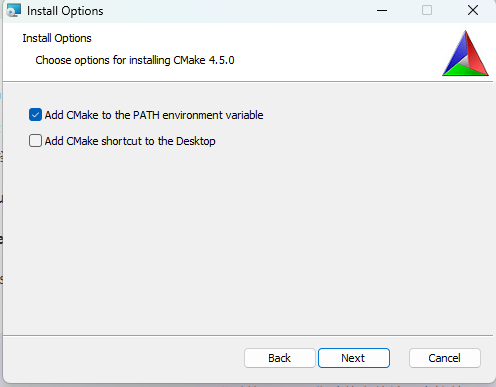
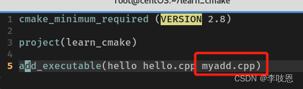
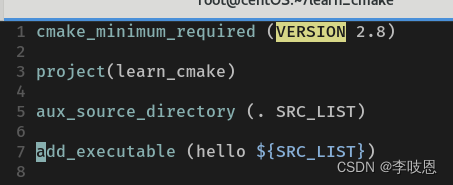
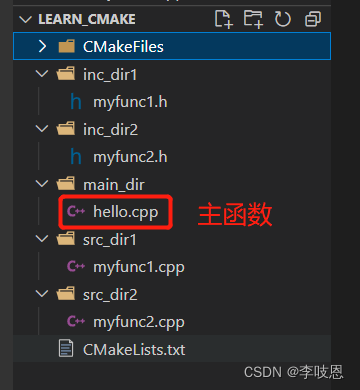
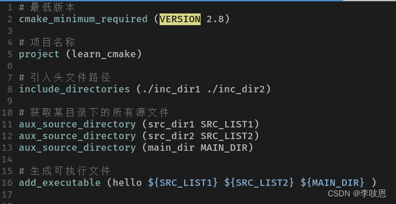
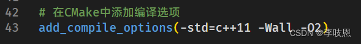
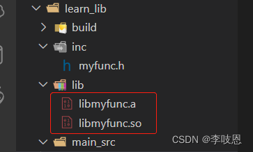

# 第三周 · CMake 安装与使用：用 CMakeLists.txt 构建多文件 C 程序

> **参考文献**
> [《cmake使用详细教程（日常使用这一篇就足够了）》](https://blog.csdn.net/iuu77/article/details/129229361) —— 作者 李吱恩（CSDN @iuu77），发布于 CSDN（2023-02-27），抓取日期 2026-10-17
>
> 本文操作步骤依据该教程整理；**文中 7 张截图：图 1 由本课程助教补充，图 2–图 7 来自该文**，版权归原作者所有。
> **注意：该文是 Linux（CentOS）+ C++ 环境，本课程是 Windows + C 环境**；安装方式、命令、CMake 最低版本写法都不同，第 2.2 节会列表对比，**一切以本文档为准**。

---

## 0. 本节目标

学完并动手做完本文档，你应该能够：

- 说清 **GCC、Make、CMake** 各自负责什么，以及为什么多文件项目要用 CMake；
- 在 Windows 上**独立**装好 CMake，并用 `cmake --version` 验证；
- 写出 `CMakeLists.txt`，用 **CMake 4.5.0 + 第一周的 MinGW-w64 GCC** 编译单文件、多文件 C 程序；
- 用 `build/` 目录做**外部构建**，知道怎么清理、怎么重新构建；
- 把头文件放进 `inc/`、源文件放进 `src/`，用 `include_directories` 和 `aux_source_directory` 管好目录；
- 遇到 `cmake 不是内部或外部命令`、`No CMAKE_C_COMPILER`、`undefined reference` 这类报错时，知道从哪几个方向排查。

> [!IMPORTANT]
> 本周的目标不是"学一门新语言"，而是**把第一周的编译流程自动化**。
> 第一周你用 `gcc hello.c -o hello.exe` 编译一个文件；本周学的是：文件一多，怎么让别人（和未来的你）一条命令就能重新编译整个项目。

---

## 1. 课前准备

| 需要的东西 | 从哪来 | 大概多大 / 多久 |
|---|---|---|
| 第一周的 VS Code + MinGW-w64 GCC 16.2.0 | 第一周已经装好，直接沿用 | — |
| **CMake Windows x64 安装包（.msi）** | 官网下载（本文第 3 节） | 约 **39 MB** |
| 一个纯英文、无空格的练习目录 | 自己建，如 `D:\Code\cmake-demo` | — |
| 联网 | 下载安装包、第一次配置编译器时要用 | — |

> [!WARNING]
> **项目路径里不要出现中文和空格。**
> 例如 `D:\我的文件\C语言\` 这种路径，在 `MinGW Makefiles` 生成器下容易出各种奇怪问题。请用 `D:\Code\cmake-demo` 这类纯英文路径。

> [!TIP]
> 本周依赖第一周的环境。先打开一个**新的**终端（VS Code 里按 **Ctrl + 反引号**（键盘左上角 Esc 下面那个键）），确认下面两条命令都有输出，再往下做：
> ```powershell
> gcc --version
> mingw32-make --version
> ```
> `mingw32-make` 是 MinGW 附带的 make 程序，就在第一周的 `C:\mingw64\bin` 里。如果提示找不到，说明第一周的 PATH 没配好，先回去补完。

---

## 2. 先搞懂名词：GCC、Make、CMake 谁是谁

很多同学装完 CMake 还是一头雾水，是因为把"编译器"和"构建工具"混为一谈了。先把下面这张表看完：

| 名词 | 是什么 | 在本课程里的具体样子 |
|---|---|---|
| **编译器** | 把源代码翻译成机器能执行的程序。C 语言的编译器是 GCC。 | `gcc.exe`，第一周装在 `C:\mingw64\bin` |
| **Make** | 一个**构建工具**：读 `Makefile` 里的规则，决定先编译哪个文件、后链接哪个文件、哪些文件不用重编。 | Windows 上叫 `mingw32-make.exe`，随 MinGW 一起装好 |
| **Makefile** | 写给 Make 看的"施工图纸"，里面是一条条规则。手写很麻烦，而且不同平台写法不同。 | 本课程**不手写**，由 CMake 生成 |
| **CMake** | 一个**构建文件生成器**：读 `CMakeLists.txt`，替你生成对应平台的 `Makefile`（或其他构建文件）。 | 本周要装的 `cmake.exe` |
| **CMakeLists.txt** | 你写的**项目说明书**：项目叫什么、用哪个语言、要生成哪个可执行文件、由哪些源文件组成。 | 每个项目一份，放在项目根目录 |
| **生成器（Generator）** | CMake 把说明书翻译成哪种构建文件。本课程用 **MinGW Makefiles**，产出的就是 `mingw32-make` 能读的 `Makefile`。 | `-G "MinGW Makefiles"` |
| **build 目录** | 存放 CMake 和 Make 生成的中间文件、Makefile、`.exe`。和源码分开放，叫**外部构建**。 | 项目根目录下的 `build/` |

一句话说清依赖关系：

- **CMake 不编译代码**，它只负责"生成构建文件"；
- **Make 也不编译代码**，它按 `Makefile` 去**调用 GCC**；
- 真正把 `.c` 变成 `.obj`、把 `.obj` 链接成 `.exe` 的，始终是 **GCC**。

用一张图表示它们的关系：

```text
 hello.c  +  CMakeLists.txt
                  │
                  │  cmake -S . -B build -G "MinGW Makefiles"
                  ▼
            build/Makefile
                  │
                  │  cmake --build build
                  │  （内部实际调用 mingw32-make）
                  ▼
            build/hello.exe
```

### 2.1 为什么不直接敲 gcc？——CMake 解决什么问题

第一周编译一个文件，命令很短：

```powershell
gcc hello.c -o hello.exe
```

但如果项目有 20 个 `.c` 文件，命令会变成这样：

```powershell
gcc main.c add.c sub.c mul.c div.c file1.c file2.c file3.c file4.c -o app.exe
```

问题有三个：

1. **命令太长**，漏一个文件就链接失败；
2. **每次都全部重编**，改一行代码也要等所有文件重新编译；
3. **换一台电脑 / 换一个编译器**，命令可能就不一样了。

CMake + Make 解决的正是这三件事：

- 源文件列表写在 `CMakeLists.txt` 里，**只维护一份**；
- Make 会看时间戳，**只重新编译改动过的文件**；
- CMake 根据平台生成对应的构建文件，**命令统一**。

> [!NOTE]
> 你可以把 CMake 理解成"**项目说明书的翻译官**"：你只写一份 `CMakeLists.txt`，它负责翻译成 Windows 上 MinGW 能用的 `Makefile`。以后若换到 Linux，同一份说明书还能翻译成 Linux 的构建文件。

### 2.2 参考文献的环境 vs 本课程的环境

参考文献是一篇很完整的 CMake 教程，但它面向的是 **Linux（CentOS）+ C++**。本课程是 **Windows 11 + C**。差异如下，**以本文档为准**：

| 对比项 | 参考文献的做法 | **本课程的实际做法** |
|---|---|---|
| 操作系统 | Linux（CentOS） | Windows 11 |
| 安装方式 | `wget` 下载 `.sh` 脚本 → `bash` 执行 → 软链接到 `/bin` | 下载 `.msi` 安装包，双击安装 |
| CMake 版本 | 3.26.0-rc4（2023 年的候选版） | **4.5.0**（2026-10 最新稳定版） |
| 编译器 | GNU `g++`（C++） | 第一周的 MinGW-w64 `gcc`（C） |
| make 命令 | `make` | `cmake --build build`（内部调用 `mingw32-make`） |
| 构建位置 | 前几节在源码目录直接 `cmake .` | **统一在 `build/` 目录外部构建** |
| 最低版本写法 | `cmake_minimum_required(VERSION 2.8)` | **`VERSION 3.20`**（写 2.8 在 CMake 4.x 会直接报错） |
| 示例代码 | C++（`.cpp`、`cout`） | C（`.c`、`printf`） |
| 截图 | Linux 终端 / C++ 代码 | 图可以照用，但**图注会注明差别** |

> [!IMPORTANT]
> **以本文档（Windows + C + CMake 4.5.0）为准，参考文献仅供参考。**
> 网上很多 CMake 教程还停留在 `VERSION 2.8`、`cmake .`、`make` 的写法，照抄到 CMake 4.x 上会直接报错。原因第 10 节 FAQ 第 2 条会讲。

### 2.3 两个必须记住的版本问题

1. **`cmake_minimum_required` 不能写 `2.8`。**
   CMake 4.0 起移除了对 3.5 以下版本的兼容。写 `VERSION 2.8` 会报：
   `Compatibility with CMake < 3.5 has been removed from CMake.`
   本课程统一写 **`VERSION 3.20`**。

2. **本课程不用 `cmake .`，也不用 `make`。**
   我们在源码目录外建 `build/`，用 `cmake -S . -B build` 配置、用 `cmake --build build` 构建。这样源码目录永远是干净的。

---

## 3. 安装 CMake（Windows）

> [!NOTE]
> 本文更新时（2026-10-18），CMake 最新稳定版是 **4.5.0**。
> **你下载时版本号可能更高**，安装界面和命令基本一致，不影响学习；只要版本 ≥ 3.20 即可。

### 3.1 下载安装包

1. 打开 CMake 官网下载页：<https://cmake.org/download/>

2. 找到 **Latest Release** 这一栏（本文更新时为 4.5.0），在 **Windows x64 Installer** 处点击下载：

```text
cmake-4.5.0-windows-x86_64.msi
```

文件约 **39 MB**（以官网下载页显示的为准）。同页面还有几个长得很像的文件，别下错：

| 文件名 | 是什么 | 选不选 |
|---|---|---|
| **`cmake-4.5.0-windows-x86_64.msi`** | 64 位 Windows 安装版 | **选它**，会自动处理 PATH |
| `cmake-4.5.0-windows-x86_64.zip` | 免安装压缩包，约 54 MB | 不想装进系统时选；但**要自己配 PATH** |
| `cmake-4.5.0-windows-i386.msi` | 32 位 Windows 版 | 现在几乎没人用，**不要选** |
| `cmake-4.5.0-windows-arm64.msi` | ARM 架构电脑版 | 普通 Intel / AMD 笔记本**不要选** |

> [!WARNING]
> 不要下载 **Release Candidate**（文件名里带 `-rc` 的版本）。那是测试版，可能不稳定。
> 认准页面上的 **Latest Release** 字样。

> [!TIP]
> 不确定自己电脑是不是 ARM？绝大多数同学的笔记本是 **x64**（Intel / AMD 处理器），选 `windows-x86_64.msi` 就对了。

### 3.2 安装

1. 双击下载好的 `.msi` 文件。如果弹出"用户帐户控制"窗口询问是否允许，点**是**。

2. 欢迎页点 **Next**；许可协议页勾选 **I accept the terms in the License Agreement**，点 **Next**。

3. 到了 **Install Options**（安装选项）页，你会看到两个复选框：

   - **Add CMake to the PATH environment variable**：**必须勾选**；
   - **Add CMake shortcut to the Desktop**：可选，不勾不影响使用。

   勾选第一个复选框后，点 **Next**。

   
   *图 1：CMake 4.5.0 安装向导的 Install Options 页面。勾选第一个复选框「Add CMake to the PATH environment variable」；桌面快捷方式可选*

   > [!IMPORTANT]
   > **Add CMake to the PATH environment variable 必须勾选。** 它会把 `C:\Program Files\CMake\bin` 写进 PATH，你才能在终端里直接敲 `cmake`。
   > 如果没勾，后面就得像第一周配 GCC 那样，手动把 `C:\Program Files\CMake\bin` 加进 PATH。

4. 安装路径保持默认的 `C:\Program Files\CMake`，点 **Next** → **Install**，等待进度条走完，点 **Finish**。

### 3.3 验证安装

> [!IMPORTANT]
> **先关掉所有已经打开的终端和 VS Code，再重新打开。**
> PATH 是程序启动时读取的，已经开着的窗口不会自动更新。

1. 打开 VS Code，按 **Ctrl + 反引号**（键盘左上角 Esc 下面那个键）打开终端。

2. 输入：

```powershell
cmake --version
```

3. 应该看到类似下面的输出（版本号可能不同）：

```text
cmake version 4.5.0

CMake suite maintained and supported by Kitware (kitware.com/cmake).
```

4. 再确认 CMake 的安装位置：

```powershell
where.exe cmake
```

应该输出：

```text
C:\Program Files\CMake\bin\cmake.exe
```

5. 顺便确认 make 也能用：

```powershell
mingw32-make --version
```

应该看到 `GNU Make 4.4.1` 之类的信息（版本号可能不同）。

> [!TIP]
> 三条命令都有输出，说明 **CMake + GCC + Make** 这条链条齐了，可以开始写项目。
> 如果 `cmake` 提示"不是内部或外部命令"，先看第 10 节 FAQ 第 1 条。

---

## 4. 第一个 CMake 项目：单文件

### 4.1 建目录和文件

在 `D:\Code\cmake-demo` 下建一个 `hello` 文件夹，最终结构如下：

```text
cmake-demo/
└── hello/
    ├── hello.c
    └── CMakeLists.txt
```

操作：

1. 打开 VS Code，点 **文件 → 打开文件夹**，选择 `D:\Code\cmake-demo`。
2. 在左侧**资源管理器**里，点新建文件夹图标，创建 `hello`。
3. 在 `hello` 上右键，新建文件 `hello.c`。
4. 再新建文件 `CMakeLists.txt`（**大小写必须一模一样**，不能写成 `CMakeList.txt` 或 `cmakelists.txt`）。

`hello.c` 的内容：

```c
#include <stdio.h>

int main(void)
{
    printf("Hello, CMake!\n");
    return 0;
}
```

`CMakeLists.txt` 的内容：

```cmake
cmake_minimum_required(VERSION 3.20)

project(hello C)

add_executable(hello hello.c)
```

逐行解释：

| 行 | 作用 | 注意 |
|---|---|---|
| `cmake_minimum_required(VERSION 3.20)` | 声明这个项目至少需要 CMake 3.20 | **不要写成 2.8**，CMake 4.x 会报错 |
| `project(hello C)` | 项目名叫 `hello`，使用的语言是 **C** | 写 `C` 可以避免 CMake 去找 C++ 编译器 |
| `add_executable(hello hello.c)` | 生成一个叫 `hello` 的可执行文件，源文件是 `hello.c` | 在 Windows 上最终产物是 `hello.exe` |

> [!NOTE]
> CMake 的命令名**不区分大小写**（`PROJECT` 和 `project` 都行），但 **`CMakeLists.txt` 这个文件名区分大小写**。本课程统一用小写命令，方便阅读。

### 4.2 配置（configure）

1. 在 VS Code 里按 **Ctrl + 反引号**（键盘左上角 Esc 下面那个键）打开终端，确认提示符所在的目录是 `...\cmake-demo\hello`。
   如果不是，用 `cd` 切过去，例如：

```powershell
cd D:\Code\cmake-demo\hello
```

2. 执行配置命令：

```powershell
cmake -S . -B build -G "MinGW Makefiles"
```

三个参数分别是什么意思：

| 参数 | 含义 |
|---|---|
| `-S .` | **S**ource：源码目录是当前目录（`.`） |
| `-B build` | **B**uild：构建目录是 `build`，不存在会自动创建 |
| `-G "MinGW Makefiles"` | 指定**生成器**为 MinGW Makefiles，也就是用第一周的 GCC + mingw32-make |

> [!IMPORTANT]
> `-G` 后面的值里有空格，**引号不能省**。写成 `-G MinGW Makefiles` 会被当成两个参数，直接报错。

3. 第一次配置需要十几秒（CMake 要探测编译器），你会看到很多行输出。**只要最后出现下面三行，就算成功**：

```text
-- Configuring done (1.5s)
-- Generating done (0.1s)
-- Build files have been written to: D:/Code/cmake-demo/hello/build
```

此时 VS Code 左侧会多出一个 `build` 文件夹，里面是 `Makefile`、`CMakeCache.txt` 等生成物。

> [!TIP]
> `build/` 是**生成物**，不属于源代码。如果这个项目用 Git 管理，在 `.gitignore` 里加一行 `build/`，避免把几十个中间文件提交上去。

> [!WARNING]
> 如果报错 `The source directory ... does not appear to contain CMakeLists.txt`，说明你**不在 `hello` 目录里**，或者文件名拼错了。回到 4.1 检查。

### 4.3 构建（build）

在同一个终端里执行：

```powershell
cmake --build build
```

输出类似：

```text
[ 50%] Building C object CMakeFiles/hello.dir/hello.c.obj
[100%] Linking C executable hello.exe
[100%] Built target hello
```

这条命令的意思是："让 CMake 去构建 `build` 目录里的项目。" CMake 会自动调用对应的 make 程序（这里是 `mingw32-make`），你**不需要**自己 `cd build` 再敲 `make`。

### 4.4 运行

在 PowerShell 里执行：

```powershell
.\build\hello.exe
```

看到：

```text
Hello, CMake!
```

不同终端的写法略有区别：

| 终端 | 运行命令 |
|---|---|
| **PowerShell**（VS Code 默认） | `.\build\hello.exe` |
| **CMD** | `build\hello.exe` |
| **Git Bash** | `./build/hello.exe` |

> [!TIP]
> 以后改了 `hello.c`，**只需要重新执行 `cmake --build build`**，不用再跑一遍 `cmake -S . -B build`。Make 会只重新编译改动过的文件。
> 只有当你改了 `CMakeLists.txt`、换了编译器或生成器时，才需要重新配置。实际上 `cmake --build` 发现 `CMakeLists.txt` 变了也会自动重新配置。

### 4.5 清理与重建

如果构建结果很奇怪（比如换了目录、换了生成器、缓存坏了），最干脆的办法是**删掉整个 `build` 文件夹再重来**：

```powershell
Remove-Item -Recurse -Force build
cmake -S . -B build -G "MinGW Makefiles"
cmake --build build
```

> [!WARNING]
> 只删 `build`，**不要删源码**。`hello.c` 和 `CMakeLists.txt` 是你的劳动成果，`build/` 里的东西随时可以重新生成。

---

## 5. 多文件项目：同一目录下多个源文件

现在把程序拆成多个文件。C 语言的多文件写法是：

- `.h` 头文件：放**函数声明**（告诉编译器"有这个函数，参数和返回值长这样"）；
- `.c` 源文件：放**函数定义**（函数具体怎么实现）；
- `main.c` 里 `#include "add.h"`，就能调用 `add()`。

### 5.1 项目结构

在 `cmake-demo` 下新建 `calculator` 文件夹：

```text
calculator/
├── CMakeLists.txt
├── main.c
├── add.c
├── add.h
├── sub.c
└── sub.h
```

### 5.2 完整代码

`add.h`：

```c
#ifndef ADD_H
#define ADD_H

int add(int a, int b);

#endif
```

`add.c`：

```c
#include "add.h"

int add(int a, int b)
{
    return a + b;
}
```

`sub.h`：

```c
#ifndef SUB_H
#define SUB_H

int sub(int a, int b);

#endif
```

`sub.c`：

```c
#include "sub.h"

int sub(int a, int b)
{
    return a - b;
}
```

`main.c`：

```c
#include <stdio.h>
#include "add.h"
#include "sub.h"

int main(void)
{
    int a = 10;
    int b = 3;

    printf("%d + %d = %d\n", a, b, add(a, b));
    printf("%d - %d = %d\n", a, b, sub(a, b));
    return 0;
}
```

`CMakeLists.txt`：

```cmake
cmake_minimum_required(VERSION 3.20)

project(calculator C)

add_executable(calculator main.c add.c sub.c)
```

和单文件相比，只改了最后一行：**把所有参与编译的 `.c` 文件都列在可执行文件名后面**，用空格隔开。

> [!IMPORTANT]
> - **`.h` 文件不用列**。头文件是被 `#include` 进 `.c` 的，不单独编译。
> - **每个定义了函数的 `.c` 都必须列**。少列一个，链接时就会报 `undefined reference to ...`。

### 5.3 构建和运行

```powershell
cd D:\Code\cmake-demo\calculator
cmake -S . -B build -G "MinGW Makefiles"
cmake --build build
.\build\calculator.exe
```

输出：

```text
10 + 3 = 13
10 - 3 = 7
```

> [!NOTE]
> 下面这张图来自参考文献。它是 **C++ 示例**，而且用了 `VERSION 2.8`：
> **你写的时候要把 `.cpp` 换成 `.c`，把 `2.8` 换成 `3.20`**。图的重点是"把新增的源文件加到 `add_executable` 后面"这个动作。


*图 2：参考文章在 `add_executable` 中追加 `myadd.cpp`（红框）。注意它写的是 `VERSION 2.8` 和 `.cpp`，本课程改为 `3.20` 和 `.c`*

> [!WARNING]
> 如果你照着图 2 写成 `cmake_minimum_required(VERSION 2.8)`，在 CMake 4.5.0 上会直接报错。**以本文档的 3.20 为准。**

---

## 6. 源文件很多：用 `aux_source_directory` 自动收集

如果 `calculator` 目录里有 30 个 `.c` 文件，一行行列出来很容易漏。CMake 提供了 `aux_source_directory`，可以把某个目录下的源文件**自动收集到一个变量**里。

`CMakeLists.txt` 可以改成：

```cmake
cmake_minimum_required(VERSION 3.20)

project(calculator C)

aux_source_directory(. SRC_LIST)

add_executable(calculator ${SRC_LIST})
```

解释：

| 写法 | 含义 |
|---|---|
| `aux_source_directory(. SRC_LIST)` | 把**当前目录**（`.`）下的所有源文件收集到变量 `SRC_LIST` 里 |
| `${SRC_LIST}` | 取出变量 `SRC_LIST` 的值。CMake 的变量用 **`${}`**，不是 Makefile 里的 `$()` |

> [!IMPORTANT]
> `aux_source_directory` 会把这个目录下**所有**源文件都收进来。
> 如果你以后在同一个目录里放了一个用于练习的 `test_main.c`（里面也有 `main` 函数），就会和其他 `main` 冲突，报 **multiple definition of `main`**。
> 解决办法：练习文件放到别的目录，或者改回逐个列文件。

> [!NOTE]
> `aux_source_directory` **不会递归**搜索子目录。它只收**指定目录这一层**的文件；下一节把源文件放进 `src/` 时，就要把目录写成 `src`。

同目录多文件 + `aux_source_directory` 的写法，参考文献截图如下。再次提醒：图中 `VERSION 2.8` 要改成 `3.20`，`.cpp` 对应你的 `.c`：


*图 3：参考文章用 `aux_source_directory(. SRC_LIST)` 收集当前目录源文件，再用 `${SRC_LIST}` 传给 `add_executable`。图中版本写法 2.8 在 CMake 4.x 会报错，本课程写 3.20*

---

## 7. 头文件和源文件分目录：`inc/` + `src/`

项目再大一点，把所有 `.c` 和 `.h` 堆在一个目录里就很难找了。常见做法是：

```text
calculator/
├── CMakeLists.txt
├── inc/
│   ├── add.h
│   └── sub.h
└── src/
    ├── main.c
    ├── add.c
    └── sub.c
```

- `inc/`：**inc**lude，放头文件；
- `src/`：**src**，放源文件；
- `CMakeLists.txt` 放在项目根目录。

### 7.1 新的 `CMakeLists.txt`

```cmake
cmake_minimum_required(VERSION 3.20)

project(calculator C)

include_directories(${CMAKE_CURRENT_SOURCE_DIR}/inc)

aux_source_directory(${CMAKE_CURRENT_SOURCE_DIR}/src SRC_LIST)

add_executable(calculator ${SRC_LIST})
```

新增的两行：

| 写法 | 作用 |
|---|---|
| `include_directories(${CMAKE_CURRENT_SOURCE_DIR}/inc)` | 告诉编译器"去 `inc/` 目录下找头文件"，相当于 gcc 的 `-I inc` |
| `${CMAKE_CURRENT_SOURCE_DIR}` | CMake 内置变量，表示**当前 `CMakeLists.txt` 所在的目录**（这里就是 `calculator/`） |

> [!NOTE]
> `include_directories` 里的相对路径，CMake 是按**当前 `CMakeLists.txt` 所在目录**解析的，不是按你在哪个目录敲命令解析。
> 这里写成 `${CMAKE_CURRENT_SOURCE_DIR}/inc`，是为了把路径明确拼成**绝对路径**：一眼就能看出指向哪个文件夹，项目被复制到别的盘符或在子目录里复用时也不容易出歧义。你在本项目里写成 `include_directories(inc)` 也能工作，但初学阶段推荐前一种写法。

> [!IMPORTANT]
> `#include "add.h"` 能不能找到文件，取决于两件事：
> 1. `add.h` 确实在 `inc/` 里；
> 2. `include_directories` 指向了 `inc/`。
> 两个都对，编译才不会报 `fatal error: add.h: No such file or directory`。

### 7.2 构建和运行

```powershell
cd D:\Code\cmake-demo\calculator
cmake -S . -B build -G "MinGW Makefiles"
cmake --build build
.\build\calculator.exe
```

输出仍然是：

```text
10 + 3 = 13
10 - 3 = 7
```

> [!NOTE]
> 下面两张图来自参考文献，里面的文件是 **C++ 的 `.cpp`**。你的项目里对应的是 `.c`，目录名也可以照着自己的习惯取，结构一致即可。
> 图 4 的源码根目录下有一个 `CMakeFiles` 文件夹，那是参考文章**在源码目录里直接构建**留下的。本课程统一在 `build/` 里构建，源码目录里**不会**出现 `CMakeFiles`。


*图 4：参考文章的多目录结构：`inc_dir1`、`inc_dir2` 放头文件，`src_dir1`、`src_dir2` 放源文件。你的项目可以用更简单的 `inc/`、`src/`，图中是 `.cpp`，你对应写 `.c`*


*图 5：参考文章用 `include_directories` 引入头文件目录，用三个 `aux_source_directory` 分别收集三个源文件目录。同样把 `VERSION 2.8` 改为 `3.20`，`.cpp` 目录换成 `.c`*

> [!TIP]
> 如果目录再深一层（例如 `src/math/add.c`），`aux_source_directory(src SRC_LIST)` 只收 `src/` 这一层的文件，**收不到 `src/math/` 里的**。这时要么对每个子目录各写一次 `aux_source_directory`，要么改用 `file(GLOB_RECURSE ...)`。本课程的项目结构还不需要这么复杂。

---

## 8. 添加编译选项：`-Wall`、`-Wextra`、`-std=c11`

有时候你想让编译器：

- 多报一些**警告**（很多 bug 在变成错误之前，先以警告的形式出现）；
- 指定使用哪个 **C 标准**（如 C11）。

CMake 用 `add_compile_options` 添加编译选项：

```cmake
cmake_minimum_required(VERSION 3.20)

project(calculator C)

include_directories(${CMAKE_CURRENT_SOURCE_DIR}/inc)
aux_source_directory(${CMAKE_CURRENT_SOURCE_DIR}/src SRC_LIST)

add_compile_options(-Wall -Wextra -std=c11)

add_executable(calculator ${SRC_LIST})
```

| 选项 | 作用 |
|---|---|
| `-Wall` | 打开**常用警告**（Wall = "all warnings"，但不是真的所有） |
| `-Wextra` | 打开**额外警告**，比 `-Wall` 更严格 |
| `-std=c11` | 按 **C11** 标准编译。第一周的 GCC 16.2.0 完全支持 |

> [!IMPORTANT]
> `add_compile_options` 要写在 `add_executable` **前面**，这样它后面创建的 target 才会带上这些选项。
> 如果写在后面，对已经创建的 target 不生效。

> [!NOTE]
> 下面这张图来自参考文献。它写的是 `-std=c++11 -Wall -O2`：
> - 本课程是 C，所以用 **`-std=c11`**；
> - `-O2` 是**优化选项**，让程序跑得更快，本周不要求，初学阶段加了反而不好调试；
> - 我们额外加了 `-Wextra`，让警告更全。


*图 6：参考文章用 `add_compile_options` 添加 `-std=c++11 -Wall -O2`。本课程改为 `-Wall -Wextra -std=c11`，不要照抄 `-std=c++11`*

改完后重新配置并构建：

```powershell
cmake -S . -B build -G "MinGW Makefiles"
cmake --build build
```

如果代码有警告，构建输出里会出现 `warning:`。**不要忽略警告**，先读懂它说的是哪个文件、哪一行、什么问题。

---

## 9. 选做：生成静态库并链接（进阶）

> [!NOTE]
> 本节是**选做**，不做也不影响本周作业。想做的话，按下面的步骤走一遍，能帮你理解"库"是什么。

**库（library）** 就是把一组函数编译好、打包成一个文件，供别的程序调用：

- **静态库**：Windows / MinGW 下是 `.a` 文件（MSVC 下是 `.lib`），链接时会被复制进最终的 `.exe`；
- **动态库**：Windows 下是 `.dll`，程序运行时才去加载。

本课程只做**静态库**，动态库涉及 DLL 查找路径，后面再讲。

### 9.1 项目结构

```text
libdemo/
├── CMakeLists.txt
├── inc/
│   └── math_utils.h
└── src/
    ├── math_utils.c
    └── main.c
```

### 9.2 完整代码

`inc/math_utils.h`：

```c
#ifndef MATH_UTILS_H
#define MATH_UTILS_H

int square(int x);

#endif
```

`src/math_utils.c`：

```c
#include "math_utils.h"

int square(int x)
{
    return x * x;
}
```

`src/main.c`：

```c
#include <stdio.h>
#include "math_utils.h"

int main(void)
{
    printf("square(7) = %d\n", square(7));
    return 0;
}
```

`CMakeLists.txt`：

```cmake
cmake_minimum_required(VERSION 3.20)

project(libdemo C)

include_directories(${CMAKE_CURRENT_SOURCE_DIR}/inc)

add_library(math_utils STATIC src/math_utils.c)

add_executable(libdemo src/main.c)
target_link_libraries(libdemo PRIVATE math_utils)
```

新增的两条命令：

| 命令 | 作用 |
|---|---|
| `add_library(math_utils STATIC src/math_utils.c)` | 把 `math_utils.c` 编译成**静态库**，名字叫 `math_utils` |
| `target_link_libraries(libdemo PRIVATE math_utils)` | 把 `math_utils` 库链接进 `libdemo` 可执行文件 |

> [!NOTE]
> `PRIVATE` 的意思是"这个库只给 `libdemo` 自己用，不对外传递"。初学阶段记住：**链接库时先写 PRIVATE**，以后学到库的传递性再深入。

### 9.3 构建和运行

```powershell
cd D:\Code\cmake-demo\libdemo
cmake -S . -B build -G "MinGW Makefiles"
cmake --build build
.\build\libdemo.exe
```

输出：

```text
square(7) = 49
```

`build/` 目录里会出现 `libmath_utils.a`，这就是生成的静态库。

> [!NOTE]
> 图 7 是参考文献的库文件截图（Linux 下的 `.a` 和 `.so`）。Windows + MinGW 下，**静态库同样是 `.a`**；动态库则是 `.dll`，本课程选做不做动态库。


*图 7：参考文章 `lib/` 目录下的 `libmyfunc.a`（静态库）和 `libmyfunc.so`（Linux 动态库）。Windows + MinGW 下静态库同样是 `.a`，动态库是 `.dll`*

---

## 10. 常见问题（FAQ）

### 1. 现象：终端提示 `'cmake' 不是内部或外部命令，也不是可运行的程序或批处理文件`

**原因**：CMake 的 `bin` 目录不在 PATH 里，或者你还在用安装前就开着的旧终端。

**解决**：
1. **关掉所有终端和 VS Code**，重新打开 VS Code（PATH 只在程序启动时读取）；
2. 再试 `cmake --version`；
3. 还不行就检查 PATH：按 **Win + R** 输入 `sysdm.cpl` → **高级** → **环境变量**，在"用户变量"或"系统变量"的 **Path** 里找有没有 `C:\Program Files\CMake\bin`；
4. 没有的话，手动**新建**一项 `C:\Program Files\CMake\bin`（方法同第一周配 GCC 的 PATH），保存后重开终端；
5. 用 `where.exe cmake` 确认找到的是不是你刚装的那个。

---

### 2. 现象：`cmake -S . -B build` 报错 `Compatibility with CMake < 3.5 has been removed from CMake.`

**原因**：`CMakeLists.txt` 里写了 `cmake_minimum_required(VERSION 2.8)`。这是老教程的写法，**CMake 4.x 已经不支持 3.5 以下的版本**。

**解决**：把第一行改成：

```cmake
cmake_minimum_required(VERSION 3.20)
```

然后删掉 `build` 目录，重新配置：

```powershell
Remove-Item -Recurse -Force build
cmake -S . -B build -G "MinGW Makefiles"
```

> [!WARNING]
> 网上大量 CMake 教程还在用 `VERSION 2.8`，直接照抄会在新版 CMake 上报错。**本课程统一写 3.20。**

---

### 3. 现象：`CMake Error: The source directory ... does not appear to contain CMakeLists.txt`

**原因**：执行命令时所在的目录不对，或者文件名写错了。

**解决**：
1. 在终端里输入 `dir`（PowerShell 里也可以 `ls`），看看当前目录有没有 `CMakeLists.txt`；
2. 没有就 `cd` 到项目根目录，例如 `cd D:\Code\cmake-demo\hello`；
3. 检查文件名是不是 `CMakeLists.txt`——**大小写、复数 s、扩展名**都要对。Windows 资源管理器默认隐藏已知扩展名，可能你实际建的是 `CMakeLists.txt.txt`。在资源管理器里勾选 **查看 → 文件扩展名** 确认。

---

### 4. 现象：配置时报 `No CMAKE_C_COMPILER could be found` 或 `CMAKE_C_COMPILER not set`

**原因**：CMake 找不到 C 编译器。通常是第一周的 GCC 没在 PATH 里，或者你开的是旧终端。

**解决**：
1. 新开一个终端，执行 `gcc --version`，确认有输出；
2. 没有输出就回第一周，检查 `C:\mingw64\bin` 是否加进 PATH；
3. 确认 `CMakeLists.txt` 里写的是 `project(hello C)`，明确指定 C 语言；
4. 如果 `gcc` 能用、CMake 还是找不到，删掉 `build` 后重新配置，让 CMake 重新探测编译器。

---

### 5. 现象：`cmake -G "MinGW Makefiles"` 报 `Could not create named generator` 或提示找不到 `mingw32-make`

**原因**：生成器名字拼错，或者 `mingw32-make` 不在 PATH 里。

**解决**：
1. 生成器名字必须一字不差：`MinGW Makefiles`（**M 大写、中间有空格、Makefiles 是复数**），并且要用引号包起来；
2. 执行 `mingw32-make --version`，确认能找到；
3. 找不到就回第一周检查 `C:\mingw64\bin` 是否在 PATH 里；
4. 想看看本机有哪些生成器，执行 `cmake --help`，翻到 "Generators" 一节。

---

### 6. 现象：链接时报 `undefined reference to 'add'`（或 `sub`）

**原因**：函数**声明**在 `.h` 里，但定义它的 `.c` 没有被编译进去。头文件只告诉编译器"有这个函数"，不提供函数体。

**解决**：
1. 如果是逐个列文件：确认 `add_executable(...)` 后面有 `add.c`；
2. 如果用了 `aux_source_directory`：确认目录写对了，并且 `add.c` 确实在那个目录里；
3. 检查函数名拼写是否和头文件、定义一致（C 语言区分大小写）；
4. 改完 `CMakeLists.txt` 后重新构建：`cmake --build build`。

---

### 7. 现象：编译时报 `fatal error: add.h: No such file or directory`

**原因**：编译器找不到头文件。`#include "add.h"` 会先在**当前源文件所在目录**找，再去 `include_directories` 指定的目录找。

**解决**：
1. 确认 `add.h` 确实存在，文件名拼写一致；
2. 如果 `add.h` 在 `inc/` 里，`CMakeLists.txt` 必须有 `include_directories(${CMAKE_CURRENT_SOURCE_DIR}/inc)`；
3. 路径不要有中文和空格；
4. 改完重新配置：删 `build` → `cmake -S . -B build -G "MinGW Makefiles"`。

---

### 8. 现象：改了 `CMakeLists.txt` 或换了目录后，构建报缓存相关的错误（如 `CMakeCache.txt` 路径不一致）

**原因**：`build/` 里的缓存记录了旧的路径、旧的生成器或旧的编译器。项目一移动，缓存就对不上了。

**解决**：删掉整个 `build` 目录，重新配置：

```powershell
Remove-Item -Recurse -Force build
cmake -S . -B build -G "MinGW Makefiles"
cmake --build build
```

---

## 11. 课后作业

> 以下作业都要**交截图**，截图里要能看出是你自己做的。代码文件也要交（可以打包，或粘贴到作业文档里）。

**第 1 题（必做）**：建一个 `week3_hello` 项目，包含 `hello.c` 和 `CMakeLists.txt`。
要求：
- `hello.c` 用 `printf` 输出你的**学号、姓名**和一句 `Hello, CMake!`；
- `CMakeLists.txt` 使用 `cmake_minimum_required(VERSION 3.20)`、`project(... C)`、`add_executable(...)`；
- 用 `cmake -S . -B build -G "MinGW Makefiles"` 配置、`cmake --build build` 构建；
- 交一张终端截图，要能看到**配置成功、构建成功、程序运行输出**三部分。

**第 2 题（必做）**：完成本文第 5 节的 `calculator` 多文件项目（`main.c`、`add.c`、`add.h`、`sub.c`、`sub.h`）。
要求：
- 先按第 5 节逐个列出 `.c` 文件，构建并运行成功；
- 再把 `CMakeLists.txt` 改成第 6 节的 `aux_source_directory` 写法，重新构建成功；
- 提交两个版本的 `CMakeLists.txt`，并用一句话说明两种写法的区别。

**第 3 题（必做）**：把第 2 题的项目改成第 7 节的结构：头文件放 `inc/`，源文件放 `src/`，并在 `CMakeLists.txt` 中加入 `include_directories`、`aux_source_directory` 和 `add_compile_options(-Wall -Wextra -std=c11)`。
要求：
- 提交最终的 `CMakeLists.txt`；
- 提交一张**完整构建输出**的截图（要能看到编译器没有报错）；
- 回答：为什么 `add_compile_options` 要写在 `add_executable` 前面？

**第 4 题（选做）**：完成第 9 节的静态库项目，把库扩展成包含 `square` 和 `cube` 两个函数，生成静态库并链接到 `main`，输出 `square(7)` 和 `cube(3)` 的结果。
要求：提交 `CMakeLists.txt` 和运行输出截图。

---

## 12. 自检清单

做完之后，逐条打勾。有任何一条打不上，回到对应章节重做。

- [ ] 我能说清 **GCC、Make、CMake** 三者分别负责什么
- [ ] `cmake --version` 有输出，版本 **≥ 3.20**（助教写作时为 4.5.0）
- [ ] `where.exe cmake` 指向 `C:\Program Files\CMake\bin\cmake.exe`
- [ ] `mingw32-make --version` 有输出
- [ ] 我的项目路径是**纯英文、无空格**的
- [ ] 我能写出最小 `CMakeLists.txt` 的三行：`cmake_minimum_required`、`project`、`add_executable`
- [ ] 我用 `cmake -S . -B build -G "MinGW Makefiles"` 配置成功
- [ ] 我用 `cmake --build build` 构建成功，并运行了 `hello.exe`
- [ ] 我的多文件项目把所有定义了函数的 `.c` 都列进了 `add_executable`（或 `aux_source_directory` 的目录）
- [ ] 我知道 `.h` 文件不需要列进 `add_executable`
- [ ] 我用 `include_directories` 解决了头文件在 `inc/` 里的问题
- [ ] 我知道 `VERSION 2.8` 在 CMake 4.x 会报错，本课程写 `3.20`
- [ ] 遇到怪问题时，我知道删掉 `build/` 重新配置
- [ ] 我能区分 PowerShell、CMD、Git Bash 下运行 `.exe` 的写法

---

## 图片来源

本文共 **7 张**截图（`images/01` – `images/07`）：**1 张由本课程助教补充，6 张来自参考文献**。

| 图号 | 内容 | 出现位置 | 来源 |
|---|---|---|---|
| 图 1 | CMake 4.5.0 安装向导的 Install Options 页面 | 第 3.2 节 | **助教补充** |
| 图 2 | 参考文章的多文件 `CMakeLists.txt` | 第 5.3 节 | 参考文献 |
| 图 3 | 参考文章的 `aux_source_directory` 写法 | 第 6 节 | 参考文献 |
| 图 4 | 参考文章的多目录项目结构 | 第 7.2 节 | 参考文献 |
| 图 5 | 参考文章的多目录 `CMakeLists.txt` | 第 7.2 节 | 参考文献 |
| 图 6 | 参考文章的 `add_compile_options` | 第 8 节 | 参考文献 |
| 图 7 | 参考文章生成的静态库 / 动态库 | 第 9.3 节 | 参考文献 |

**说明**：

- **图 1** 由本课程助教在安装 CMake 4.5.0 时截取，供本课程使用；截图中不涉及任何账号、密钥等敏感信息。
- **图 2–图 7** 来自 [《cmake使用详细教程（日常使用这一篇就足够了）》](https://blog.csdn.net/iuu77/article/details/129229361)，版权归原作者 **李吱恩（CSDN @iuu77）** 所有。
- 参考文章是 **Linux + C++** 环境，图中出现的 `.cpp`、`VERSION 2.8`、`.so`、Linux 路径等与本课程不同；**每张图的图注都已注明对应差别**，操作时以本文档的 C 代码和 `VERSION 3.20` 为准。
- **图 1** 中显示的 CMake 4.5.0 为助教截图时的版本，**你下载到的版本号可能更高**，安装界面的结构一致即可。
- 参考文章截图中的版本号（CMake 3.26.0-rc4、GCC 8.3.1 等）是原作者 2023 年写作时的环境，**你的版本号会不同**，结构一致即可。
