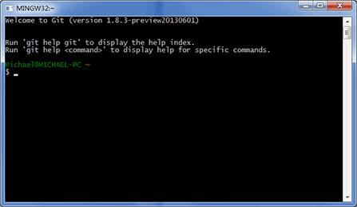
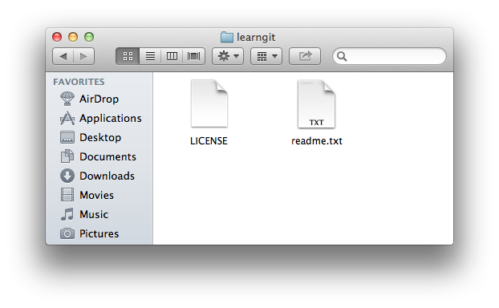
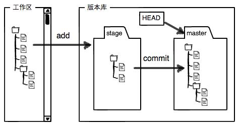
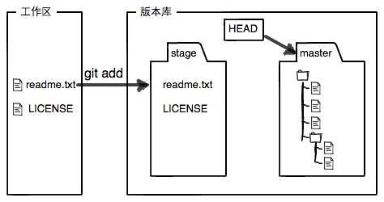
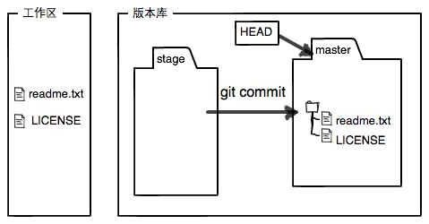
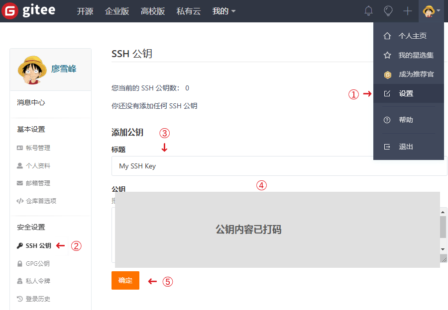
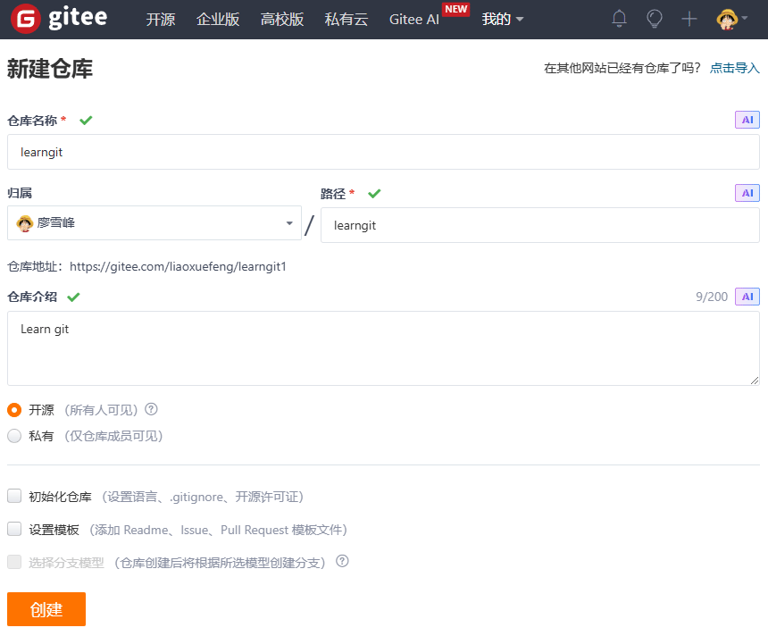

# 第四周 · Git 安装与使用：在 Windows 上管理你的代码版本

> **参考文献**
> [《Git教程》](https://liaoxuefeng.com/books/git/index.html) —— 廖雪峰，发布于 廖雪峰的官方网站，抓取日期 2026-10-24
> [《Git简介》](https://liaoxuefeng.com/books/git/introduction/index.html) —— 廖雪峰，发布于 廖雪峰的官方网站，抓取日期 2026-10-24
> [《安装Git》](https://liaoxuefeng.com/books/git/install-git/index.html) —— 廖雪峰，发布于 廖雪峰的官方网站，抓取日期 2026-10-24
> [《创建版本库》](https://liaoxuefeng.com/books/git/create-repo/index.html) —— 廖雪峰，发布于 廖雪峰的官方网站，抓取日期 2026-10-24
> [《时光机穿梭》](https://liaoxuefeng.com/books/git/time-travel/index.html) —— 廖雪峰，发布于 廖雪峰的官方网站，抓取日期 2026-10-24
> [《远程仓库》](https://liaoxuefeng.com/books/git/remote/index.html) —— 廖雪峰，发布于 廖雪峰的官方网站，抓取日期 2026-10-24
> [《使用Gitee》](https://liaoxuefeng.com/books/git/gitee/index.html) —— 廖雪峰，发布于 廖雪峰的官方网站，抓取日期 2026-10-24
> [《忽略特殊文件》](https://liaoxuefeng.com/books/git/customize/ignore/index.html) —— 廖雪峰，发布于 廖雪峰的官方网站，抓取日期 2026-10-24
> [《分支管理》](https://liaoxuefeng.com/books/git/branch/index.html) —— 廖雪峰，发布于 廖雪峰的官方网站，抓取日期 2026-10-24
>
> 本文操作步骤依据该教程整理；**文中 7 张截图（图 1–图 7）全部来自该教程**，版权归原作者所有。
> **注意：该教程以 macOS / Linux + GitHub 为主，本课程是 Windows 11 + Gitee**；安装方式、远程平台和部分命令不同，第 2.4 节会列表对比，**一切以本文档为准**。

---

## 0. 本节目标

学完并动手做完本文档，你应该能够：

- 说清 **Git、仓库、工作区、暂存区、提交、远程仓库** 分别是什么，以及它们怎么串起来；
- 在 Windows 上**独立**装好 Git for Windows，并用 `git --version` 验证；
- 配置 `user.name` 和 `user.email`，创建仓库，完成 `git add` → `git commit` 流程，会用 `git status`、`git diff`、`git log`；
- 用 `git reset`、`git reflog`、`git restore` 回退版本、撤销修改、找回误删的内容；
- 用 `.gitignore` 把 `build/`、`*.exe` 这类编译产物挡在仓库外；
- 在 **Gitee** 上创建远程仓库，用 SSH Key 完成 `git push` 和 `git clone`。

> [!IMPORTANT]
> 本周不是"学一门新语言"，而是**给你的代码装一台时光机**。
> 从这周开始，你写的每个 C 程序都可以提交到 Git；改坏了能回退，换电脑能克隆，作业也有历史记录可查。
> 第三周生成的 `build/` 目录、`.exe` 文件**不应该**提交进仓库，本周第 10 节会教你排除它们。

---

## 1. 课前准备

| 需要的东西 | 从哪来 | 大概多大 / 多久 |
| --- | --- | --- |
| 第一周装好的 VS Code | 第一周已经装好，直接沿用 | — |
| **Git for Windows 安装包（.exe）** | 官网下载（本文第 3 节） | 约 **64 MB** |
| 一个 **Gitee 账号** | [gitee.com](https://gitee.com) 注册（本文第 11 节） | 免费，需手机号 |
| 一个纯英文、无空格的练习目录 | 自己建，如 `D:\Code\git-demo` | — |
| 联网 | 下载安装包、注册 Gitee、推送代码时要用 | — |

> [!WARNING]
> **项目路径里不要出现中文和空格。**
> 例如 `D:\我的文件\C语言\` 这种路径，在 Git 和命令行里容易出各种奇怪问题。请用 `D:\Code\git-demo` 这类纯英文路径。

> [!IMPORTANT]
> **`D:\Code\git-demo` 不是电脑里本来就有的目录。**
> 它只是本文档举的一个**示例路径**，需要你自己创建。你的电脑上可能没有 `D:\Code`，甚至可能没有 D 盘——这都很正常。
> 有 D 盘就用 D 盘；**没有 D 盘就改用 C 盘上一个纯英文目录**，例如 `C:\Code\git-demo`（可能需要管理员权限）；如果 C 盘根目录不让建，改用 `C:\Users\Public\Documents\Code\git-demo`。**不要用带中文或空格的路径**——如果你的 Windows 用户名是中文，就不要放在 `C:\Users\你的用户名\...` 下。如果你换了盘符或路径，本文后面所有出现 `D:\Code\...` 的命令都要换成你的实际路径。

> [!TIP]
> Git 和第一周的 GCC、第三周的 CMake **互不依赖**。本周不需要重新配置编译器，也不需要装 CMake；只要 VS Code 能用、终端能敲命令即可。

---

## 2. 先搞懂名词与路线

很多同学学 Git 卡住，不是因为命令难，而是因为**名词没搞清**：工作区、暂存区、版本库、远程仓库，听起来都像"文件夹"。先把下面这张表看完，后面会顺很多。

### 2.1 Git 到底解决什么问题

假设你写 `hello.c`，改来改去，最后变成了这样：

```text
hello.c
hello_最终版.c
hello_最终版2.c
hello_真的最终版.c
hello_再改我是狗.c
```

这就是没有版本控制的后果：**你不知道每个文件改了什么、为什么改、哪个能用**。

Git 是一个**分布式版本控制系统**（distributed version control system）。它替你做三件事：

1. **记录历史**：每次提交都保存一个快照，附带你写的说明；
2. **随时回退**：改坏了可以回到任意一次提交；
3. **备份与协作**：把仓库推送到 Gitee / GitHub，换台电脑克隆下来就能继续写。

> [!NOTE]
> "分布式"的意思是：**你电脑上有一份完整的仓库**，不是只连着一台服务器。没网也能提交、看历史、回退；有网时再把提交推送到远程仓库。

### 2.2 三个区域和一条命令链

Git 把"文件"分成三个区域。这是本周**最重要**的一张表：

| 名词 | 是什么 | 在本课程里的样子 |
| --- | --- | --- |
| **工作区**（Working Directory） | 你在资源管理器 / VS Code 里**能直接看到、直接改**的文件夹 | `D:\Code\git-demo\learngit` |
| **暂存区**（Stage / Index） | 一个"待提交清单"。`git add` 把修改放进来 | 暂存在 `.git` 里，平时看不见 |
| **本地仓库**（Repository） | `.git` 目录里保存的**提交历史**。`git commit` 把暂存区存成一个快照 | `learngit\.git` |
| **远程仓库**（Remote） | 放在 Gitee / GitHub 上的仓库，用来备份和协作 | `git@gitee.com:你的用户名/learngit.git` |
| **HEAD** | 一个指针，指向**你当前所在的分支和提交** | `HEAD -> master` |
| **origin** | 远程仓库的**默认名字**，只是习惯叫法 | `git remote add origin ...` |

用一张图表示文件的流动方向：

```text
         git add                git commit              git push
工作区 ──────────▶ 暂存区 ──────────────▶ 本地仓库 ──────────────▶ 远程仓库
   ▲                  │                    │                        │
   │                  │ git restore        │ git reset              │ git clone / pull
   └──────────────────┴────────────────────┴────────────────────────┘
```

一句话记住：

- **`git add` 是"把修改放进待提交清单"**；
- **`git commit` 是"把清单存成一个历史版本"**；
- **`git push` 是"把本地历史传到远程仓库"**。

> [!IMPORTANT]
> **`git add` 不是"保存文件"。** 文件本身要用 **Ctrl + S** 保存到磁盘；`git add` 只是把**当前磁盘上的内容**放进暂存区。
> 如果你改了文件没保存，`git add` 加进去的还是旧内容。

### 2.3 三种终端：PowerShell、CMD、Git Bash

Windows 上你会遇到三种命令行窗口。**Git 命令在三种里完全一样**，区别只在"查看文件、删文件"这些系统命令：

| 操作 | PowerShell（VS Code 默认） | CMD | Git Bash |
| --- | --- | --- | --- |
| 查看当前目录 | `Get-Location` 或 `pwd` | `cd`（不带参数） | `pwd` |
| 列出文件 | `dir` 或 `ls` | `dir` | `ls` |
| 查看文本内容 | `Get-Content readme.txt` 或 `cat readme.txt` | `type readme.txt` | `cat readme.txt` |
| 删除文件 | `Remove-Item temp.txt` | `del temp.txt` | `rm temp.txt` |
| 复制到剪贴板 | `Get-Content 文件 \| Set-Clipboard` | `clip < 文件` | `clip < 文件` |
| 运行当前目录的 exe | `.\hello.exe` | `hello.exe` | `./hello.exe` |

本文命令默认写在 **VS Code 的集成终端（PowerShell）** 里。遇到只在 Git Bash 里更方便的命令（例如查看 SSH 公钥），会单独注明。

> [!TIP]
> 打开 VS Code 终端：按 **Ctrl + 反引号**（键盘左上角 Esc 下面那个键）。
> 想用 Git Bash：在开始菜单搜 **Git Bash**，或者在 VS Code 终端右上角的下拉箭头里选择 **Git Bash**。

> [!WARNING]
> **不要在"以管理员身份运行"的窗口里做日常 Git 操作**，否则仓库文件可能变成管理员所有，之后普通账户使用会报 `detected dubious ownership`。用普通窗口即可。

### 2.4 参考文献的环境 vs 本课程的环境

参考文献是一套很完整的 Git 教程，但它主要面向 **macOS / Linux + GitHub**。本课程是 **Windows 11 + Gitee**。差异如下，**以本文档为准**：

| 对比项 | 参考文献的做法 | **本课程的实际做法** |
| --- | --- | --- |
| 操作系统 | macOS / Linux | Windows 11 |
| 安装方式 | 官网安装程序，或 `brew` / `apt` / `scoop` 包管理器 | 下载 **Git for Windows 安装包**，双击安装 |
| 远程平台 | GitHub | **Gitee**（国内访问稳定，界面中文） |
| 认证方式 | SSH Key | **SSH Key**（操作相同，公钥添加到 Gitee） |
| 默认分支 | `master` | `master`（Git 2.x 的默认值） |
| 撤销修改 | `git checkout -- <file>` | **`git restore <file>`**（旧写法仍然可用） |
| 取消暂存 | `git reset HEAD <file>` | **`git restore --staged <file>`**（旧写法仍然可用） |
| 截图界面 | macOS / GitHub 旧界面 | Windows / Gitee；参考图会注明差别 |

> [!IMPORTANT]
> **以本文档（Windows 11 + Gitee + Git 2.56）为准，参考文献仅供参考。**
> Git 的核心命令是跨平台通用的，差别主要在**安装步骤、远程平台、界面文字**。你在网上看到用 `git checkout --`、`git reset HEAD` 的教程，不算错，只是旧写法；本文会给出对照表。

### 2.5 本周核对到的版本信息

> [!NOTE]
> 本文更新时（2026-10-24），Git for Windows 最新稳定版是 **2.56.0(3)**，安装包文件名 **`Git-2.56.0.3-64-bit.exe`**，约 **64 MB**，发布于 2026-10-22。
> **你下载时版本号可能更高**，安装界面和命令基本一致；只要版本 ≥ 2.40，本文所有命令都能用。
> 不要下载 `-rc` 结尾的候选版。

---

## 3. 安装 Git for Windows

### 3.1 下载安装包

> [!TIP]
> 先在新终端执行 `git --version`。如果已经显示 `git version 2.40` 或更高，**并且开始菜单里有 Git Bash**，说明电脑上已经有完整的 Git，可以跳过 3.1–3.2，直接看 3.3 验证和第 4 节配置。
> 如果版本太低、没有 Git Bash，或者提示"不是内部或外部命令"，就按本节安装。

1. 打开 Git 官网 Windows 下载页：[https://git-scm.com/download/win](https://git-scm.com/download/win)

2. 页面会自动跳转到 **Install for Windows**。找到 **Latest version**，点击 **Click here to download** 或 **Git for Windows/x64 Setup**：

```text
Git-2.56.0.3-64-bit.exe
```

文件约 **64 MB**（以官网下载页显示的为准）。同页面还有几个长得很像的文件，别下错：

| 文件名 | 是什么 | 选不选 |
| --- | --- | --- |
| **`Git-2.56.0.3-64-bit.exe`** | 64 位 Windows 安装版 | **选它** |
| `Git-2.56.0.3-arm64.exe` | ARM 架构电脑版 | 普通 Intel / AMD 笔记本**不要选** |
| `PortableGit-2.56.0.3-64-bit.7z.exe` | 免安装便携版 | 不想装进系统时选；**要自己配 PATH**，本周不推荐 |

> [!WARNING]
> **只从官网 `git-scm.com` 下载**，不要从"软件下载站"、网盘、群文件里下。那些渠道的安装包可能被捆绑广告或篡改。
> 也不要在 64 位电脑上选 `arm64` 版；不确定就选带 **64-bit** 的那个。

> [!TIP]
> 不确定自己电脑是不是 ARM？绝大多数同学的笔记本是 **x64**（Intel / AMD 处理器），选 `64-bit.exe` 就对了。

### 3.2 安装向导：只需要主动改 4 处

双击下载好的 `.exe`。如果弹出"用户帐户控制"窗口询问是否允许，点**是**。

安装向导有很多页。**大部分页面直接点 Next 即可**，但下面 4 处请按本文档选择：

| 向导页面 | 选择 | 为什么 |
| --- | --- | --- |
| **Choosing the default editor**（默认编辑器） | **Use Visual Studio Code as Git's default editor** | 默认是 Vim，零基础同学很容易卡在"怎么退出" |
| **Adjusting your PATH environment**（PATH 环境） | **Git from the command line and also from 3rd-party software** | 这样 PowerShell、VS Code 终端里才能直接敲 `git` |
| **Configuring the line ending conversions**（换行符） | **Checkout Windows-style, commit Unix-style line endings** | Windows 默认选项；Git 内部统一用 LF，检出时转成 CRLF |
| **Choosing the default branch name**（如果出现） | **Let Git decide**（当前为 `master`） | 与参考文献、Gitee 默认分支保持一致 |

其余页面保持默认：

1. **Information / License**：点 **Next**。
2. **Select Destination Location**：保持 `C:\Program Files\Git`，点 **Next**。
3. **Select Components**：保持默认（含 **Git Bash Here**、**Git GUI Here**），点 **Next**。
4. **Select Start Menu Folder**：保持默认 `Git`，点 **Next**。
5. **Choosing the default editor used by Git**：选 **Use Visual Studio Code as Git's default editor**，点 **Next**。
6. **Choosing the default branch name**（如果出现）：选 **Let Git decide**（当前为 `master`），点 **Next**。
7. **Adjusting your PATH environment**：选第二项 **Git from the command line and also from 3rd-party software**，点 **Next**。
8. **Choosing the SSH executable**：保持 **Use bundled OpenSSH**，点 **Next**。
9. **Choosing HTTPS transport backend**：保持 **Use the OpenSSL library**，点 **Next**。
10. **Configuring the line ending conversions**：保持 **Checkout Windows-style, commit Unix-style line endings**，点 **Next**。
11. **Configuring the terminal emulator to use with Git Bash**：保持 **Use MinTTY**，点 **Next**。
12. **Choose the default behavior of `git pull`**：保持 **Fast-forward or merge**，点 **Next**。
13. **Choose a credential helper**：保持 **Git Credential Manager**，点 **Next**。
14. **Configuring extra options**：保持默认（**Enable file system caching** 勾选），点 **Install**。
15. 等待进度条走完，点 **Finish**。如果勾选了 **Launch Git Bash**，会弹出一个黑窗口；关掉它即可。

> 📷 **截图待补充**：安装向导的 **Adjusting your PATH environment** 页面，选中 **Git from the command line and also from 3rd-party software** 这一项的样子。

> [!TIP]
> 如果默认编辑器列表里**没有 VS Code**，说明安装器没检测到它。先选 **Use Notepad as Git's default editor** 完成安装，然后在终端执行 `git config --global core.editor "code --wait"`，并用 `code --version` 确认 VS Code 的命令行可用。

> [!IMPORTANT]
> **PATH 这一页必须选第二项。**
> 如果你选了第一项 **Use Git from Git Bash only**，那么在 PowerShell、VS Code 终端里敲 `git` 会提示"不是内部或外部命令"，只有 Git Bash 里能用。
> 选错了不用重装整个系统：重新运行安装包，把这一项改成第二项即可。

> [!NOTE]
> 安装向导的**标题、顺序、选项文字**可能因版本略有不同。你只要认准上面 4 个关键词：
> **Visual Studio Code**、**Git from the command line and also from 3rd-party software**、**Checkout Windows-style**、**Let Git decide**。
> 其他页面保持默认就能装好。

### 3.3 验证安装

> [!IMPORTANT]
> **先关掉所有已经打开的终端和 VS Code，再重新打开。**
> PATH 是程序启动时读取的，已经开着的窗口不会自动更新。

1. 打开 VS Code，按 **Ctrl + 反引号** 打开终端。
2. 输入：

```powershell
git --version
```

3. 应该看到类似下面的输出（版本号可能不同）：

```text
git version 2.56.0.windows.3
```

4. 再确认 Git 的安装位置：

```powershell
where.exe git
```

应该输出：

```text
C:\Program Files\Git\cmd\git.exe
```

> [!TIP]
> 如果你电脑上装过多个 Git（例如某个 IDE 自带过），`where.exe git` 可能输出好几行。**认准其中一行是 `C:\Program Files\Git\cmd\git.exe`**；如果第一行指向别的旧版本，说明 PATH 顺序有问题，可以先把旧版本从 PATH 里移除，或重新运行安装包修复。

5. 从开始菜单搜 **Git Bash** 并打开，应该能看到一个类似这样的窗口：


*图 1：Git Bash 启动后的样子（截图来自参考文献，版本很老，显示的是 1.8.3；你装的是 2.56.0，窗口标题和样式会不同，能打开这个黑窗口就说明安装成功）*

> [!NOTE]
> 图 1 是教程作者 2013 年截的 **Git 1.8.3**，所以窗口样式和版本号都很旧。**你的窗口样式会不同**，这是正常的，不影响操作。
> 你的提示符会显示 `MINGW64` 和 Windows 用户名，例如 `你的名字@你的电脑 MINGW64 ~`；**版本号以 `git --version` 的输出为准**，不要以窗口标题或图 1 为准。

> [!TIP]
> 三条验证都通过，说明 Git 装好了：
> `git --version` 有版本输出、`where.exe git` 指向 `C:\Program Files\Git\cmd\git.exe`、Git Bash 能打开。
> 如果 `git` 提示"不是内部或外部命令"，先看第 13 节 FAQ 第 1 条。

---

## 4. 配置 Git 身份

Git 每次提交都会记录"是谁提交的"。这个身份**不是登录账号，也不是密码**，只是写进提交记录里的名字和邮箱。

1. 在 VS Code 终端里执行（把引号里的内容换成你自己的）：

```powershell
git config --global user.name "你的名字"
git config --global user.email "你的邮箱"
```

2. 检查是否写入成功：

```powershell
git config --global --list
```

应该能看到类似的两行：

```text
user.name=张三
user.email=zhangsan@example.com
```

> [!TIP]
> 如果你用 Gitee，`user.email` 建议填 **Gitee 账号绑定的邮箱**。Gitee 靠邮箱把提交关联到你的账号；不匹配也能正常推送，只是提交记录里可能不显示你的头像。

3. （可选）如果你安装时没选 VS Code 作为默认编辑器，可以补一条：

```powershell
git config --global core.editor "code --wait"
```

> [!IMPORTANT]
> **`--global` 表示"这台电脑上所有仓库都用这个身份"**，只需要配置一次。
> 如果漏掉 `--global`，配置只对当前仓库生效；换一个仓库又要重新配。

> [!WARNING]
> **名字和邮箱会写进每一次提交，公开仓库里所有人都能看到。**
> 不要填密码、手机号、身份证号等敏感信息。用你愿意公开的名字和一个常用邮箱即可；邮箱如果不想公开，可以在 Gitee 设置里使用隐私邮箱。

> [!TIP]
> 如果终端对中文支持不好，`user.name` 可以填**拼音或英文**（例如 `Zhang San`）。它只是提交记录里的显示名，不影响推送和作业验收。

> [!NOTE]
> 现在改配置**不会**修改以前的提交记录。以前提交里写的还是当时的名字和邮箱。

---

## 5. 创建第一个仓库

### 5.1 建目录和文件

最终结构：

```text
D:\Code\git-demo\
└── learngit\
    └── readme.txt
```

操作：

1. 按 **Win + E** 打开文件资源管理器，进入你要用的盘（例如 `D:` 或 `C:`）。
2. 新建文件夹 `Code`（如果已经有 `Code`，直接进入即可）；进入 `Code`，再新建文件夹 `git-demo`；进入 `git-demo`，再新建文件夹 `learngit`。**这三层都要你自己建。**
3. 打开 VS Code，点 **文件 → 打开文件夹**，选择 `D:\Code\git-demo`（选 `git-demo` 这一层）。
4. 如果弹出"是否信任此文件夹中文件的作者"，点 **是，我信任此作者**。
5. 在 VS Code 左侧**资源管理器**里，右键 `learngit` → **新建文件**，输入 `readme.txt` 并回车。
6. 在 `readme.txt` 里输入两行：

```text
Git is a version control system.
Git is free software.
```

7. 按 **Ctrl + S** 保存。标签上的小圆点消失，表示已经保存到磁盘。

> [!IMPORTANT]
> `readme.txt` 必须放在 `learngit` 目录里（子目录也可以），**不能放在 `git-demo` 根目录**。Git 只管理仓库目录里的文件；放到仓库外面，Git 找不到它。

> [!WARNING]
> **不要用 Windows 记事本编辑代码或文本文件。** 记事本可能在文件开头加 BOM，导致编译报奇怪的语法错误。
> 用第一周装好的 **VS Code** 编辑，保存时默认就是 UTF-8。

### 5.2 把目录变成 Git 仓库

1. 在 VS Code 终端里，切换到 `learngit` 目录：

```powershell
cd D:\Code\git-demo\learngit
```

> [!TIP]
> 不确定自己在哪？输入 `Get-Location`（PowerShell）或 `pwd`（Git Bash）查看。
> 如果你把项目建在别的路径（例如 C 盘），把上面的路径换成你自己的。

2. 执行初始化命令：

```powershell
git init
```

3. 应该看到：

```text
Initialized empty Git repository in D:/Code/git-demo/learngit/.git/
```

> [!NOTE]
> 新版 Git 可能在 `Initialized...` 后面多打几行 `hint:`，提醒默认分支名以后可能改为 `main`。**这些是提示，不是错误**，本周继续按 `master` 操作即可。

4. 查看当前状态：

```powershell
git status
```

应该看到：

```text
On branch master

No commits yet

Untracked files:
  (use "git add <file>..." to include in what will be committed)
        readme.txt

nothing added to commit but untracked files present (use "git add" to track)
```

`Untracked files` 的意思是：**Git 看到了 `readme.txt`，但还没有开始跟踪它**。

> [!IMPORTANT]
> `git init` 会在当前目录下创建一个隐藏的 **`.git`** 文件夹，里面存放所有提交历史。
> **不要手动修改、移动或删除 `.git`**，否则仓库会损坏。平时你看不到它，是因为 Windows 默认隐藏以点开头的文件夹。
> 想在资源管理器里看到它：**查看 → 显示 → 隐藏的项目**。在 PowerShell 里可以用 `Get-ChildItem -Force` 查看。

> [!WARNING]
> **一定要在 `learngit` 目录里执行 `git init`。**
> 如果你在 `git-demo` 或 `C:\Users\你的用户名` 里执行，仓库就建在了错误的位置。发现建错了：删掉那个目录里的 `.git` 文件夹，回到正确目录重新 `git init`。

---

## 6. 第一次提交

提交分两步：**`git add` 放进暂存区 → `git commit` 存成历史版本**。

### 6.1 把文件加入暂存区

```powershell
git add readme.txt
```

正常情况下**没有任何输出**——Unix 哲学是"没有消息就是好消息"。

> [!NOTE]
> 如果你看到 `warning: LF will be replaced by CRLF the next time Git touches it`，**这不是错误**。
> 这是 Windows 换行符转换提示：Git 内部存 LF，检出到 Windows 时转成 CRLF。详见第 13 节 FAQ 第 6 条。

### 6.2 查看暂存区状态

```powershell
git status
```

应该看到：

```text
On branch master

No commits yet

Changes to be committed:
  (use "git rm --cached <file>..." to unstage)
        new file:   readme.txt
```

`Changes to be committed` 的意思是：**这些修改已经放进暂存区，下一次 commit 会包含它们**。

### 6.3 提交

```powershell
git commit -m "wrote a readme file"
```

应该看到类似：

```text
[master (root-commit) 3f2a1c9] wrote a readme file
 1 file changed, 2 insertions(+)
 create mode 100644 readme.txt
```

逐项解释：

| 输出 | 含义 |
| --- | --- |
| `master` | 当前分支名 |
| `root-commit` | 这是仓库的第一次提交（根提交） |
| `3f2a1c9` | 本次提交的 **commit ID**（版本号），你的和这里**一定不一样** |
| `1 file changed` | 有 1 个文件被改动 |
| `2 insertions(+)` | 新增了 2 行内容 |
| `create mode 100644 readme.txt` | 新建了 `readme.txt` |

> [!IMPORTANT]
> **`-m` 后面是提交说明，必须写清楚这次改了什么。**
> 不要写 `update`、`修改`、`111` 这种没有信息量的说明。以后回看历史时，好的说明能救你一命。
> 本课程建议用**英文或拼音**写提交说明，避免 PowerShell 中文编码导致 `git log` 乱码（见 FAQ 第 11 条）。

> [!WARNING]
> 如果 `git commit` 没有加 `-m`，Git 会打开默认编辑器让你写说明。如果你安装时选了 Vim，会看到一个黑屏，零基础同学很容易卡住。
> 退出方法：按 **Esc**，输入 `:wq`，按回车（保存并退出）；或者输入 `:q!` 放弃本次提交。

### 6.4 查看历史

```powershell
git log --oneline
```

应该看到一行：

```text
3f2a1c9 (HEAD -> master) wrote a readme file
```

- `3f2a1c9`：提交 ID 的前 7 位；
- `(HEAD -> master)`：**HEAD 指向 `master` 分支**，也就是你当前所在的位置；
- `wrote a readme file`：提交说明。

再看完整版：

```powershell
git log
```

```text
commit 3f2a1c9...（一长串）
Author: 张三 <zhangsan@example.com>
Date:   Sat Oct 24 10:00:00 2026 +0800

    wrote a readme file
```

> [!NOTE]
> 参考文献用的是 `git log --pretty=oneline`，效果和 `git log --oneline` 基本一样；`--oneline` 更短，本文用它。

> [!NOTE]
> **commit ID 是 Git 用 SHA-1 算出来的一串十六进制数**，不是 1、2、3 递增的编号。
> 你和同学的提交内容、时间、作者不同，ID 就不同。**不要照抄本文档或同学的 ID**，要用你自己 `git log` 里显示的那个。

---

## 7. 工作区、暂存区和版本库

### 7.1 三个区域长什么样

你在资源管理器里看到的 `learngit` 文件夹，就是**工作区**：


*图 2：教程作者在 macOS 上的 `learngit` 工作区，里面有 `LICENSE` 和 `readme.txt`。Windows 下就是你用资源管理器打开的 `learngit` 文件夹，界面不同，含义一样*

而 Git 的**版本库**在隐藏的 `.git` 目录里，里面最重要的三个东西是**暂存区（stage）**、**master 分支**和**指向当前分支的 HEAD**：


*图 3：工作区、版本库、暂存区、master 和 HEAD 的关系（来自参考文献）。`git add` 把修改送进 stage，`git commit` 把 stage 的内容存进 master*

`git add` 之后，暂存区里多了 `readme.txt`：


*图 4：执行 `git add` 后，`readme.txt` 和 `LICENSE` 被放进 stage，等待提交*

`git commit` 之后，暂存区清空，内容进入 master 分支：


*图 5：执行 `git commit` 后，暂存区的内容被提交到 master，stage 清空，HEAD 仍指向 master*

> [!NOTE]
> 这三张示意图来自参考文献，画的是 `readme.txt` 和 `LICENSE` 两个文件。你的仓库现在只有 `readme.txt`，**结构一致即可**，不必强行造一个 `LICENSE`。

### 7.2 修改、查看、再提交

现在把 `readme.txt` 的第一行改掉，变成：

```text
Git is a distributed version control system.
Git is free software.
```

按 **Ctrl + S** 保存，然后：

```powershell
git status
```

应该看到：

```text
On branch master
Changes not staged for commit:
  (use "git add <file>..." to update what will be committed)
  (use "git restore <file>..." to discard changes in working directory)
        modified:   readme.txt

no changes added to commit (use "git add" and/or "git commit -a")
```

`Changes not staged for commit` 的意思是：**文件改了，但还没放进暂存区**。

想看具体改了什么，用 `git diff`：

```powershell
git diff readme.txt
```

```text
diff --git a/readme.txt b/readme.txt
index 46d49bf..9247db6 100644
--- a/readme.txt
+++ b/readme.txt
@@ -1,2 +1,2 @@
-Git is a version control system.
+Git is a distributed version control system.
 Git is free software.
```

- 以 `-` 开头的是**修改前**的内容；
- 以 `+` 开头的是**修改后**的内容；
- 没有 `-` / `+` 的行是没变的上下文。

确认没问题后，提交这次修改：

```powershell
git add readme.txt
git status
git commit -m "add distributed"
git status
```

`git add` 后的 `git status` 应该显示 `Changes to be committed: modified: readme.txt`；提交后应该显示：

```text
On branch master
nothing to commit, working tree clean
```

`working tree clean` 表示**工作区是干净的**：没有未提交的修改。

> [!TIP]
> `git add` 可以一次加多个文件：
> `git add add.c sub.c main.c`，或者 `git add .` 加当前目录下所有新文件和修改。
> **但 `git add .` 之前一定要先 `git status`**，确认没有把 `build/`、`.exe`、密码文件之类不该提交的东西加进去。第 10 节会用 `.gitignore` 解决这个问题。

### 7.3 一个最容易犯的错：add 之后又改了文件

`git add` 放进暂存区的是**那一刻**的文件内容。如果你 `git add` 之后又改了文件，**新的修改不会自动进入暂存区**：

```text
第一次修改 → git add → 第二次修改 → git commit
```

上面的流程，**commit 只包含第一次修改**，第二次修改还留在工作区，`git status` 会继续显示 `modified: readme.txt`。

正确的做法是：

```text
第一次修改 → git add → 第二次修改 → git add → git commit
```

或者在 commit 前养成习惯：

```powershell
git status
```

确认所有想提交的修改都在 `Changes to be committed` 里，再 commit。

> [!IMPORTANT]
> **每次 commit 前看一眼 `git status`**，这是本周最值得养成的习惯。
> 它能告诉你：哪些改动已暂存、哪些没暂存、哪些文件还没被跟踪。

---

## 8. 版本回退与撤销

### 8.1 再提交一个版本

把 `readme.txt` 改成第三个版本：

```text
Git is a distributed version control system.
Git is free software distributed under the GPL.
```

保存后提交：

```powershell
git add readme.txt
git commit -m "append GPL"
```

现在看历史：

```powershell
git log --oneline
```

```text
c4d5e6f (HEAD -> master) append GPL
a1b2c3d add distributed
3f2a1c9 wrote a readme file
```

三次提交，**最近的在最上面**。你的 commit ID 会和这里不同。

### 8.2 回退到上一个版本

Git 用 **`HEAD`** 表示当前版本：

- `HEAD`：当前版本（`append GPL`）；
- `HEAD^`：上一个版本（`add distributed`）；
- `HEAD^^`：上上一个版本（`wrote a readme file`）；
- `HEAD~100`：往上 100 个版本。

执行：

```powershell
git reset --hard HEAD^
```

应该看到：

```text
HEAD is now at a1b2c3d add distributed
```

再查看文件内容：

```powershell
Get-Content readme.txt
```

（Git Bash 里用 `cat readme.txt`。）应该看到第二版的内容：

```text
Git is a distributed version control system.
Git is free software.
```

`--hard` 的意思是：**把 HEAD、暂存区、工作区一起回退到这个版本**。目标版本之后的工作区和暂存区修改会丢失；目标版本之后的提交也会从当前分支历史里消失（还能用 `git reflog` 找回）。

> [!WARNING]
> **`git reset --hard` 会丢弃未提交的修改，而且没有确认提示。**
> 执行前先 `git status` 看清楚；如果有不想丢的改动，先 `git add` + `git commit`，或者先复制一份。

### 8.3 用 reflog 回到"未来"

回退之后，`git log` 里已经看不到 `append GPL` 了：

```powershell
git log --oneline
```

```text
a1b2c3d (HEAD -> master) add distributed
3f2a1c9 wrote a readme file
```

别慌，Git 记录了你的每一次操作。执行：

```powershell
git reflog
```

```text
a1b2c3d (HEAD -> master) HEAD@{0}: reset: moving to HEAD^
c4d5e6f HEAD@{1}: commit: append GPL
a1b2c3d HEAD@{2}: commit: add distributed
3f2a1c9 HEAD@{3}: commit (initial): wrote a readme file
```

找到 `append GPL` 那一行前面的 ID（这里是 `c4d5e6f`），执行：

```powershell
git reset --hard c4d5e6f
```

再查看文件，第三版又回来了：

```text
Git is a distributed version control system.
Git is free software distributed under the GPL.
```

> [!TIP]
> commit ID 不用写全，**前 7 位左右就够**，Git 会自动匹配。但不要只写一两位，否则可能匹配到多个提交。
> `git reflog` 是你误操作后的"后悔药"：只要提交过，基本都能找回来。

### 8.4 撤销还没提交的修改

分三种情况，对应三种命令：

**情况 1：改了文件，但还没 `git add`。** 想直接丢弃工作区的修改：

```powershell
git restore readme.txt
```

执行后没有任何输出，`git status` 会变回 `working tree clean`。

**情况 2：已经 `git add`，但还没 `git commit`。** 想把修改从暂存区拿回工作区：

```powershell
git restore --staged readme.txt
```

执行后 `git status` 会显示 `Changes not staged for commit`。这时文件内容还在，只是不再准备提交；如果确定不要，再执行 `git restore readme.txt`。

**情况 3：已经 `git commit`，但还没 `git push`。** 想撤销这次提交：

```powershell
git reset --hard HEAD^
```

如果已经推送到 Gitee，**不要用 `reset --hard` 改写历史**，否则会和远程仓库冲突；这种情况用 `git revert` 生成一个"反向提交"（本周不要求掌握，知道有这个命令即可）。

> [!WARNING]
> **`git restore readme.txt` 会永久丢弃工作区里未提交的修改，没有撤销按钮。**
> 执行前确认你不需要这些改动了。不确定的话，先复制文件或先 commit。

### 8.5 新旧命令对照

参考文献写于较早年，用的是旧命令。两种写法现在都能用，本文用新写法：

| 目的 | 本文写法（Git 2.23+） | 参考文献 / 老教程写法 |
| --- | --- | --- |
| 丢弃工作区修改 | `git restore <file>` | `git checkout -- <file>` |
| 取消暂存（unstage） | `git restore --staged <file>` | `git reset HEAD <file>` |
| 切换分支 | `git switch <branch>` | `git checkout <branch>` |
| 创建并切换分支 | `git switch -c <branch>` | `git checkout -b <branch>` |

> [!NOTE]
> 你在网上看到 `git checkout -- readme.txt`，它的效果和 `git restore readme.txt` 一样，只是老写法。
> `--` 很重要：`git checkout -- file` 是"丢弃修改"，`git checkout file`（没有 `--`）是"切换分支/检出文件"，含义不同。

---

## 9. 删除文件

Git 里删除文件也要**记录到历史**里，不能只在资源管理器里删掉就完事。

1. 新建一个临时文件 `temp.txt`，随便写一行：

```text
temporary file
```

2. 把它加入仓库并提交：

```powershell
git add temp.txt
git commit -m "add temp file"
```

3. 在资源管理器或 VS Code 里删除 `temp.txt`。然后在终端查看状态：

```powershell
git status
```

应该看到：

```text
On branch master
Changes not staged for commit:
  (use "git add/rm <file>..." to update what will be committed)
  (use "git restore <file>..." to discard changes in working directory)
        deleted:    temp.txt
```

4. 如果**后悔了**，想把文件恢复回来：

```powershell
git restore temp.txt
```

`temp.txt` 会重新出现，内容还在。

5. 如果**确定要删**，先删除文件，再让 Git 记录这次删除：

```powershell
git add temp.txt
git commit -m "delete temp file"
```

也可以用一个命令完成"删除 + 加入暂存区"：

```powershell
git rm temp.txt
git commit -m "delete temp file"
```

> [!IMPORTANT]
> **只在资源管理器里删除文件，Git 只会看到 `deleted`，不会自动提交。**
> 必须再 `git add`（或 `git rm`）并 `git commit`，这次删除才会进入历史。
> 这样以后你还能从历史里把文件找回来。

> [!NOTE]
> 如果删除已经提交，想从上一个版本恢复：
> `git restore --source=HEAD^ temp.txt`（把上一个版本的 `temp.txt` 恢复到工作区）。
> 这是进阶用法，本周知道有这条命令即可。

---

## 10. 忽略不需要提交的文件

第三周你用 CMake 构建时，项目里会出现 `build/` 文件夹和 `.exe` 文件。这些是**编译产物**，随时可以重新生成，**不应该提交到 Git**。

Git 用 **`.gitignore`** 文件来指定"哪些文件不要跟踪"。

1. 在仓库根目录（`learngit`）新建一个文件，文件名必须叫 **`.gitignore`**（注意前面有个点，没有扩展名）。
2. 输入：

```text
# 编译产物
build/
*.exe
*.o
```

3. 在仓库里建一个 `build` 文件夹，里面放一个 `hello.exe`（内容随便），再执行：

```powershell
git status
```

你会发现 `build/` 和 `hello.exe` **没有出现在未跟踪列表里**，只有 `.gitignore` 自己显示为 `??`：

```text
On branch master
Untracked files:
  (use "git add <file>..." to include in what will be committed)
        .gitignore
```

4. 把 `.gitignore` 提交进仓库：

```powershell
git add .gitignore
git commit -m "add gitignore"
```

> [!IMPORTANT]
> **`.gitignore` 只对"还没有被 Git 跟踪"的文件生效。**
> 如果某个文件之前已经提交过（例如你先提交了 `build/hello.exe`，后来才加 `.gitignore`），它不会自动消失。
> 需要先把它从 Git 的跟踪列表里移除（**不会删除磁盘上的文件**）：
>
> ```powershell
> git rm -r --cached build
> git commit -m "stop tracking build"
> ```

> [!TIP]
> `.gitignore` 的常用写法：
>
> - `build/`：忽略整个 `build` 目录；
> - `*.exe`：忽略所有 `.exe` 文件；
> - `*.o`：忽略所有目标文件；
> - `#` 开头是注释；
> - `!important.exe`：表示"不要忽略这个文件"（例外规则）。
>
> 写完用 `git status` 检查，确认源文件（`.c`、`.h`、`CMakeLists.txt`）没有被误伤。

> [!WARNING]
> **不要把 `.gitignore` 本身也忽略了。** 它需要提交进仓库，这样别人克隆下来也能得到同样的忽略规则。

---

## 11. 远程仓库：把代码放到 Gitee

### 11.1 为什么本课程用 Gitee

参考文献主要用 **GitHub**。GitHub 是全球最大的代码托管平台，但它在中国大陆的访问**不稳定**：注册、克隆、推送都可能很慢或失败。

本课程改用 **Gitee（码云）**，它是国内的代码托管平台，访问速度快，界面中文。**Git 命令完全一样**，只是远程地址和账号不同：

| 对比项 | 参考文献：GitHub | **本课程：Gitee** |
| --- | --- | --- |
| 网址 | `github.com` | `gitee.com` |
| 国内访问 | 不稳定 | 稳定、速度快 |
| 仓库地址示例 | `git@github.com:用户名/learngit.git` | `git@gitee.com:用户名/learngit.git` |
| 默认分支 | 新仓库常用 `main` | 常用 `master` |
| 界面语言 | 英文为主 | 中文 |

> [!IMPORTANT]
> **以本文档的 Gitee 路线为准。**
> 如果你以后要用 GitHub，Git 命令完全一样，只需要把远程地址从 `gitee.com` 换成 `github.com`，并把公钥添加到 GitHub。
> 注意 GitHub 新仓库的默认分支可能叫 `main`，而本地 `git init` 默认是 `master`；这种情况可以先执行 `git branch -M main`，再 `git push -u origin main`。

### 11.2 注册并准备 Gitee 账号

1. 打开 [https://gitee.com](https://gitee.com)，注册并登录。
2. 按页面提示绑定手机号；如果创建公开仓库时要求实名认证，按提示完成。
3. 练习阶段建议建**私有仓库**（只有自己和被邀请的人能看）。公开仓库所有人都能看到，**不要放密码、学号、身份证号等敏感信息**。

> [!WARNING]
> **免费版也支持私有仓库**，人数上限以 Gitee 官网为准。
> 不要把 API Key、密码、私钥、身份证照片提交到任何仓库——**一旦推送到远程，即使后来删除，也可能已经被别人看到或缓存**。

### 11.3 生成 SSH Key

SSH Key 是一对文件：

- **私钥** `id_rsa`：留在你自己的电脑上，**绝对不能发给别人**；
- **公钥** `id_rsa.pub`：可以公开，添加到 Gitee，用来证明"这台电脑是我"。

有了它，推送代码时就不用每次输账号密码。

1. 打开 **Git Bash**（开始菜单搜 Git Bash），执行（把邮箱换成你的）：

```bash
ssh-keygen -t rsa -b 4096 -C "你的邮箱"
```

2. 接下来会连续问你三个问题，**全部直接按回车**：

```text
Generating public/private rsa key pair.
Enter file in which to save the key (C:\Users\你的用户名/.ssh/id_rsa):
Enter passphrase (empty for no passphrase):
Enter same passphrase again:
```

- 第一个问题：密钥保存位置，直接回车用默认路径；
- 第二、三个问题：密码短语，直接回车表示**不设密码**（零基础推荐；设了每次推送都要输）。

3. 看到类似下面的输出，说明生成成功：

```text
Your identification has been saved in C:\Users\你的用户名/.ssh/id_rsa
Your public key has been saved in C:\Users\你的用户名/.ssh/id_rsa.pub
The key fingerprint is:
SHA256:...
```

4. 查看公钥内容：

Git Bash 里：

```bash
cat ~/.ssh/id_rsa.pub
```

PowerShell 里：

```powershell
Get-Content $env:USERPROFILE\.ssh\id_rsa.pub
```

输出是一整行，以 `ssh-rsa` 开头，例如：

```text
ssh-rsa AAAAB3NzaC1yc2EAAAADAQABAAACAQ... 你的邮箱
```

5. 把整行复制到剪贴板：

Git Bash：

```bash
clip < ~/.ssh/id_rsa.pub
```

PowerShell：

```powershell
Get-Content $env:USERPROFILE\.ssh\id_rsa.pub | Set-Clipboard
```

> [!WARNING]
> **只复制 `id_rsa.pub`（公钥），不要复制 `id_rsa`（私钥）。**
> 私钥等于你电脑的"身份证"，泄露后别人可以冒充你推送代码。
> 如果私钥不小心泄露：立刻到 Gitee 删除对应公钥，然后重新生成一对新的密钥。

> [!NOTE]
> 如果你之前已经生成过 SSH Key，`ssh-keygen` 会提示是否覆盖。**不要覆盖**，直接使用已有的 `id_rsa.pub` 即可；或者用 `-f` 指定一个新文件名（例如 `id_rsa_gitee`），但那需要额外配置 `~/.ssh/config`，本周不展开。

### 11.4 把公钥添加到 Gitee

1. 登录 Gitee，点击右上角头像 → **设置**。
2. 在左侧菜单选择 **SSH 公钥**。
3. 在 **标题** 里填一个能认出这台电脑的名字，例如 `我的笔记本`。
4. 把刚才复制的**公钥**粘贴到 **公钥** 文本框里。
5. 点击 **确定**。


*图 6：Gitee 的「设置 → SSH 公钥」页面，箭头 1 指向头像菜单，箭头 2 指向 SSH 公钥，箭头 3 填标题，箭头 4 粘贴公钥，箭头 5 确定。图中公钥内容已由本课程助教打码；你的页面会显示你自己的账号名*

添加成功后，页面会列出这把公钥。然后测试连接：

```bash
ssh -T git@gitee.com
```

第一次连接会提示：

```text
The authenticity of host 'gitee.com (...)' can't be established.
...
Are you sure you want to continue connecting (yes/no/[fingerprint])?
```

输入 **`yes`** 并回车。看到类似下面的内容，就说明认证成功：

```text
Hi 你的用户名! You've successfully authenticated, but GITEE.COM does not provide shell access.
```

> [!IMPORTANT]
> 第一次必须输入完整的 `yes`，不能只输 `y`。
> 如果提示 `Permission denied (publickey)`，说明公钥没添加成功、加到了别的账号，或者你用的不是刚才那把钥匙。先看第 13 节 FAQ 第 7 条。

### 11.5 在 Gitee 上新建一个空仓库

1. 登录 Gitee，点击右上角的 **`+`** → **新建仓库**。
2. 填写：

| 字段 | 填什么 |
| --- | --- |
| **仓库名称** | `learngit` |
| **路径** | 一般自动填 `learngit`；如果被占用，改成 `learngit-你的学号` |
| **仓库介绍** | 可不填，或写 `学习 Git` |
| **开源 / 私有** | 练习建议选 **私有** |
| **初始化仓库** | **不要勾选** |
| **设置模板** | **不要勾选** |
| **选择分支模型** | **不要选** |

3. 点击 **创建**。


*图 7：Gitee 的「新建仓库」页面。图中是教程作者的账号，仓库名显示为 `learngit1`（因为 `learngit` 已被占用）；你填自己的仓库名即可。图中演示选了「开源」，你练习时建议选「私有」；下方的「初始化仓库」「设置模板」都不要勾选*

> [!IMPORTANT]
> **「初始化仓库」千万不要勾选。**
> 勾了它，Gitee 会自动生成一个 README 提交，远程仓库就不再是空的；你本地仓库的历史和它对不上，第一次 `git push` 会被拒绝。
> 如果你已经勾了：删掉这个远程仓库，重新建一个**空仓库**，不要勾任何初始化选项。

4. 创建成功后，在仓库页面点击 **克隆/下载**，复制 **SSH** 地址。它长这样：

```text
git@gitee.com:你的空间地址/learngit.git
```

> [!WARNING]
> **不要照抄本文档或教程作者的地址。** `git@gitee.com:liaoxuefeng/learngit.git` 是教程作者的仓库，你推不上去。
> 一定从你自己的仓库页面复制 **SSH** 地址；`你的空间地址` 不一定等于你的显示昵称，以页面复制的为准。

### 11.6 关联远程仓库并第一次推送

回到本地仓库 `D:\Code\git-demo\learngit`，执行：

```powershell
git remote add origin git@gitee.com:你的空间地址/learngit.git
git remote -v
```

`git remote -v` 应该显示两行（fetch 和 push）：

```text
origin  git@gitee.com:你的空间地址/learngit.git (fetch)
origin  git@gitee.com:你的空间地址/learngit.git (push)
```

然后第一次推送：

```powershell
git push -u origin master
```

应该看到类似：

```text
Enumerating objects: 13, done.
Counting objects: 100% (13/13), done.
...
To gitee.com:你的空间地址/learngit.git
 * [new branch]      master -> master
branch 'master' set up to track 'origin/master'.
```

- `origin`：远程仓库的名字，`git remote add` 时起的；
- `master`：要推送的本地分支；
- `-u`：把本地 `master` 和远程 `master` **关联起来**，以后直接 `git push` 就行，不用再写 `origin master`。

推送成功后，刷新 Gitee 仓库页面，应该能看到 `readme.txt` 和你的提交记录。

> 📷 **截图待补充**：Gitee 仓库页面，能看到 `readme.txt` 文件和提交说明 `append GPL` / `add distributed` / `wrote a readme file`。

以后每次本地提交后，只要执行：

```powershell
git push
```

就能把新提交同步到 Gitee。

> [!WARNING]
> 如果 `git push` 报 `fatal: remote origin already exists`，说明 `origin` 已经关联过别的地址。先 `git remote -v` 查看，再用 `git remote remove origin` 删掉旧关联，重新 `git remote add`。
> 如果报 `! [rejected] ... (fetch first)`，说明远程仓库有本地没有的提交（多半是建仓库时勾了"初始化仓库"）。初学者最简单的解法：删掉远程仓库，重建一个空仓库再推。

### 11.7 克隆远程仓库

"克隆"就是把远程仓库**完整下载**到另一台电脑（或另一个目录），包括所有历史记录。

1. 切换到你想存放克隆仓库的目录，例如：

```powershell
cd D:\Code
```

2. 执行克隆（地址换成你自己的）：

```powershell
git clone git@gitee.com:你的空间地址/learngit.git learngit-clone
```

应该看到：

```text
Cloning into 'learngit-clone'...
remote: Enumerating objects: 13, done.
remote: Counting objects: 100% (13/13), done.
...
Receiving objects: 100% (13/13), done.
```

3. 进入克隆出来的目录，查看历史：

```powershell
cd learngit-clone
git log --oneline
```

你应该看到和原仓库一样的提交记录。`git clone` 会自动把远程地址命名为 `origin`，所以在这个目录里直接 `git push` / `git pull` 即可。

4. 在克隆目录里修改 `readme.txt`，提交并推送：

```powershell
git add readme.txt
git commit -m "update from clone"
git push
```

5. 回到原来的 `learngit` 目录，把远程的新提交拉下来：

```powershell
cd D:\Code\git-demo\learngit
git pull
```

`git pull` 的意思是"**拉取远程的新提交并合并到当前分支**"。执行后，原目录里的 `readme.txt` 也会变成修改后的内容。

> [!NOTE]
> `git clone` 和 `git pull` 的区别：
>
> - **clone**：第一次把整个仓库复制到本地，只需要做一次；
> - **pull**：仓库已经存在，把远程的**新提交**拉下来，平时经常用。

> [!TIP]
> 克隆时如果目标文件夹已经存在且**不为空**，Git 会报错。换一个不存在的文件夹名，或者先清空目标文件夹。

### 11.8 如果 SSH 的 22 端口不通

有些校园网、公司网络会封掉 SSH 的 **22 端口**，表现为：

```text
ssh: connect to host gitee.com port 22: Connection timed out
```

这时可以改用 **HTTPS** 地址（走 443 端口，一般不会被封）：

```powershell
git remote set-url origin https://gitee.com/你的空间地址/learngit.git
git push -u origin master
```

第一次推送会提示输入 Gitee 的**用户名和密码**。如果你开启了双因素认证，密码处要填 **私人令牌**（Gitee：头像 → 设置 → 私人令牌）。

> [!WARNING]
> HTTPS 方式下，Gitee 的登录密码 / 私人令牌**不要写进任何文件或提交到仓库**。Windows 的 Git Credential Manager 会帮你安全保存。

---

## 12. 选做：分支

> [!NOTE]
> 本节是**选做**，不做也不影响本周作业。分支是 Git 的核心功能之一，建议至少跟着走一遍，知道它是什么。

**分支（branch）** 可以理解成一条独立的"开发线"：你可以在 `dev` 分支上随便改，不影响 `master`；改好了再合并回去。
本质上，分支只是一个**指向某次提交的指针**；`HEAD` 指向你当前所在的分支。

1. 查看当前分支：

```powershell
git branch
```

```text
* master
```

`*` 表示当前所在的分支。

2. 创建并切换到 `dev` 分支：

```powershell
git switch -c dev
```

```text
Switched to a new branch 'dev'
```

3. 在 `dev` 分支上修改 `readme.txt`，比如加一行：

```text
Git tracks changes.
```

然后提交：

```powershell
git add readme.txt
git commit -m "add feature on dev"
```

4. 切回 `master`：

```powershell
git switch master
```

此时打开 `readme.txt`，你会发现刚才加的那一行**不见了**——因为它在 `dev` 分支上，`master` 还没有。

5. 把 `dev` 合并到 `master`：

```powershell
git merge dev
```

```text
Updating a1b2c3d..e4f5a6b
Fast-forward
 readme.txt | 3 ++-
 1 file changed, 2 insertions(+), 1 deletion(-)
```

6. 删除已经合并的 `dev` 分支：

```powershell
git branch -d dev
```

7. 查看分支图：

```powershell
git log --oneline --graph --all
```

```text
* e4f5a6b (HEAD -> master) add feature on dev
* a1b2c3d add distributed
* 3f2a1c9 wrote a readme file
```

> [!NOTE]
> 老教程里的 `git checkout -b dev` 和 `git checkout master`，分别等价于本文的 `git switch -c dev` 和 `git switch master`。
> `git merge dev` 在两边一样。

> [!WARNING]
> **切换分支前先提交或丢弃当前修改。** 如果工作区有未提交的改动，`git switch` 可能把改动带到另一个分支，或者直接拒绝切换。
> 本周的分支练习没有冲突；多人同时改同一行时会出现 **merge conflict**，那是后面的内容，先不展开。

---

## 13. 常见问题（FAQ）

### 1. 现象：终端提示 `'git' 不是内部或外部命令，也不是可运行的程序或批处理文件`

**原因**：Git 没装、PATH 没配，或者你还在用安装前就开着的旧终端。

**解决**：

1. **关掉所有终端和 VS Code**，重新打开（PATH 只在程序启动时读取）；
2. 再执行 `git --version`；
3. 还不行就执行 `where.exe git`。如果没有任何输出，重新运行 Git 安装包，在 **Adjusting your PATH environment** 页面选 **Git from the command line and also from 3rd-party software**；
4. 或者手动把 `C:\Program Files\Git\cmd` 加进 PATH（方法同第一周配 GCC 的 PATH），保存后重开终端；
5. 用 `where.exe git` 确认找到的是 `C:\Program Files\Git\cmd\git.exe`。

---

### 2. 现象：`git commit` 报 `Author identity unknown` 或 `*** Please tell me who you are.`

**原因**：没有配置 `user.name` 和 `user.email`。

**解决**：

```powershell
git config --global user.name "你的名字"
git config --global user.email "你的邮箱"
git config --global --list
```

确认 `--global` 没漏。配置完重新 `git commit`。

---

### 3. 现象：`fatal: not a git repository (or any of the parent directories): .git`

**原因**：当前终端所在目录不是 Git 仓库，也不是仓库的子目录。

**解决**：

1. 用 `Get-Location`（PowerShell）或 `pwd`（Git Bash）看当前目录；
2. `cd` 到仓库根目录（包含 `.git` 的那一层），例如 `cd D:\Code\git-demo\learngit`；
3. 用 `Get-ChildItem -Force` 确认 `.git` 存在；
4. 如果 `.git` 不存在，说明你还没 `git init`，或者进错了目录。

---

### 4. 现象：`fatal: pathspec 'readme.txt' did not match any files`

**原因**：当前目录下没有这个文件，或者文件名/扩展名写错了。

**解决**：

1. 用 `dir` 或 `ls` 看当前目录有什么；
2. 检查文件名大小写、扩展名是否一致；
3. Windows 资源管理器默认隐藏已知扩展名，可能实际文件名是 `readme.txt.txt`。打开 **查看 → 文件扩展名** 确认；
4. `cd` 到文件所在目录再 `git add`。

---

### 5. 现象：执行 `git commit` 后打开一个黑屏（Vim），不知道怎么退出

**原因**：没有加 `-m`，Git 打开了默认编辑器；安装时默认可能是 Vim。

**解决**：

- 想保存提交说明并退出：按 **Esc**，输入 `:wq`，按回车；
- 想放弃这次提交：按 **Esc**，输入 `:q!`，按回车；
- 以后统一用 `git commit -m "说明"`；
- 想把默认编辑器改成 VS Code：`git config --global core.editor "code --wait"`。

---

### 6. 现象：`git add` 时出现 `warning: LF will be replaced by CRLF the next time Git touches it`

**原因**：Windows 和 Linux/macOS 的换行符不同（CRLF vs LF）。Git 安装时选了 **Checkout Windows-style, commit Unix-style line endings**，所以检出到 Windows 时把 LF 转成 CRLF，提交时再转回 LF。

**解决**：

- **这不是错误，不用处理**，照常 `git add` / `git commit` 即可；
- 不要为了消除这行提示去乱改 `core.autocrlf`，否则可能让整个仓库的换行符混乱；
- 本课程统一保持安装时的默认选项。

---

### 7. 现象：`git push` 或 `ssh -T git@gitee.com` 报 `Permission denied (publickey)`

**原因**：Gitee 上没有你的公钥、公钥加到了别的账号，或者你用的不是对应的私钥。

**解决**：

1. 执行 `ssh -T git@gitee.com`，看是否仍然被拒；
2. 登录 Gitee → **设置 → SSH 公钥**，确认列表里有你刚才添加的公钥；
3. 确认复制的是 **`id_rsa.pub`**（公钥，以 `ssh-rsa` 开头），不是 `id_rsa`（私钥）；
4. 确认 Gitee 账号和你要推送的仓库属于同一个账号；
5. 如果你生成过多把钥匙，先确认 Gitee 上加的是**当前默认密钥** `id_rsa.pub` 的内容；不确定就重新生成一对，把新的 `.pub` 加到 Gitee。

---

### 8. 现象：`fatal: remote origin already exists.`

**原因**：本地仓库已经关联过一个叫 `origin` 的远程地址。

**解决**：

```powershell
git remote -v
```

查看当前关联。如果地址错了：

```powershell
git remote remove origin
git remote add origin git@gitee.com:你的空间地址/learngit.git
```

也可以直接改地址：

```powershell
git remote set-url origin git@gitee.com:你的空间地址/learngit.git
```

---

### 9. 现象：`git push` 报 `! [rejected] master -> master (fetch first)` 或 `failed to push some refs`

**原因**：远程仓库里有你本地没有的提交。最常见的原因是：在 Gitee 新建仓库时勾选了 **初始化仓库**，自动生成了 README。

**解决**（初学者推荐第 1 种）：

1. 删掉 Gitee 上的这个仓库，重新建一个**空仓库**，所有初始化选项都不勾；然后重新 `git remote add` + `git push -u origin master`；
2. 或者先把远程内容拉下来再推：

```powershell
git pull --rebase origin master
git push -u origin master
```

> [!WARNING]
> 不要在不了解后果的情况下使用 `git push -f`（强制推送），它会覆盖远程历史，可能让别人丢失提交。

---

### 10. 现象：`error: src refspec master does not match any`

**原因**：本地还没有任何提交，或者当前分支不叫 `master`（例如叫 `main`）。

**解决**：

1. `git log --oneline` 确认有没有提交；没有就先 `git add` + `git commit`；
2. `git branch` 看当前分支名；
3. 推送**实际存在的分支**：如果叫 `main`，就执行 `git push -u origin main`；
4. 或者把分支改名为 `master`：`git branch -M master`，再推送。

---

### 11. 现象：中文提交说明在 `git log` 里显示为乱码

**原因**：PowerShell 的默认编码和 Git 使用的 UTF-8 不一致，中文参数传给 Git 时可能已经变成乱码。

**解决**：

1. **本课程建议提交说明用英文或拼音**，例如 `add hello.c`、`fix printf`，最省事；
2. 如果一定要用中文：优先在 **Git Bash** 里提交（它默认按 UTF-8 处理）；或者在 PowerShell 里先执行 `chcp 65001` 切到 UTF-8，再 `git commit`；
3. 已经提交的乱码说明要改写历史才能修正，本周不要求处理；下次用正确的编码重新提交即可。

---

### 12. 现象：`ssh: connect to host gitee.com port 22: Connection timed out`

**原因**：当前网络封了 SSH 的 22 端口（校园网、公司网络常见）。

**解决**：改用 HTTPS 地址：

```powershell
git remote set-url origin https://gitee.com/你的空间地址/learngit.git
git push -u origin master
```

按提示输入 Gitee 用户名和密码；如果开了双因素认证，密码处填 **私人令牌**。

---

### 13. 现象：`git log` 底部出现一个 `:`，按回车只往下滚，退不出去

**原因**：Git 把长输出交给了分页器 `less`，它在等你翻页。

**解决**：

- 按 **`q`** 退出分页器；
- 或者用 `git --no-pager log --oneline` 一次性输出，不分页。

---

## 14. 课后作业

> 以下作业都要**交截图**，截图里要能看出是你自己做的。**截图里不要出现密码、私钥、令牌**；邮箱如果不想公开，可以打码。

**第 1 题（必做）**：完成 Git 安装与配置。

要求：

- 提交一张终端截图，包含 `git --version` 和 `where.exe git` 的输出；
- 提交一张 `git config --global --list` 的截图，能看到 `user.name` 和 `user.email`（邮箱可打码）；
- 用一句话回答：`git add` 和 `git commit` 各自做了什么？

**第 2 题（必做）**：在本地仓库里练习"提交—回退—找回"。

要求：

- 新建仓库 `D:\Code\git-demo\week4_git`（没有 D 盘就用 C 盘的纯英文目录）；
- 放入一个 `hello.c`，用 `printf` 输出你的**学号、姓名**和 `Hello, Git!`；
- 至少提交 **3 个版本**（例如：先输出姓名，再增加学号，再增加一句话），每次提交说明要能看出改了什么；
- 提交 `git log --oneline` 的截图；
- 执行 `git reset --hard HEAD^` 回退，再执行 `git reflog` 找到回退前的提交并恢复；
- 提交回退后和恢复后的 `git log --oneline` 截图各一张，并用一句话说明 `reflog` 的作用。

**第 3 题（必做）**：把仓库推送到 Gitee，并克隆一份。

要求：

- 在 Gitee 新建一个**空仓库**（不要勾"初始化仓库"），把 `week4_git` 推送上去；
- 提交一张 Gitee 仓库页面的截图，要能看到 `hello.c` 和至少两条提交记录；
- 用 `git clone` 把仓库克隆到 `D:\Code\git-demo\week4_git_clone`；
- 在克隆目录里修改 `hello.c`，提交并 `git push`；
- 回到原仓库执行 `git pull`，提交终端截图，证明两边同步；
- 用一句话回答：`git clone` 和 `git pull` 有什么区别？

**第 4 题（选做）**：分支练习。

要求：

- 在 `week4_git` 里创建 `dev` 分支；
- 在 `dev` 上给 `hello.c` 增加一个函数（例如 `int square(int x)`），提交；
- 切回 `master`，用 `git merge dev` 合并，再删除 `dev` 分支；
- 提交 `git log --oneline --graph --all` 的截图。

---

## 15. 自检清单

做完之后，逐条打勾。有任何一条打不上，回到对应章节重做。

- [ ] `git --version` 有输出，版本 ≥ 2.40（助教写作时为 **2.56.0.windows.3**）
- [ ] `where.exe git` 指向 `C:\Program Files\Git\cmd\git.exe`
- [ ] 我能打开 Git Bash，知道它和 PowerShell 的区别
- [ ] `git config --global --list` 能看到我的 `user.name` 和 `user.email`
- [ ] 我知道 `D:\Code\git-demo` 是**自己创建的示例目录**，不是电脑自带；没有 D 盘时我会改用 C 盘的纯英文目录
- [ ] 我在纯英文、无空格的路径下创建了 `learngit`，并成功执行 `git init`
- [ ] 我能说清**工作区、暂存区、本地仓库**三者的关系
- [ ] 我完成了至少 3 次提交，每次提交说明都能看出改了什么
- [ ] 提交后 `git status` 显示 `working tree clean`
- [ ] 我会用 `git log --oneline` 查看历史，用 `git diff` 查看具体改动
- [ ] 我会用 `git reset --hard HEAD^` 回退，并用 `git reflog` 找回回退前的提交
- [ ] 我会用 `git restore <file>` 丢弃工作区修改
- [ ] 我会用 `git restore --staged <file>` 取消暂存
- [ ] 我删除文件后，会用 `git add` + `git commit` 把删除记录进历史
- [ ] `.gitignore` 能挡住 `build/` 和 `*.exe`，且 `.gitignore` 本身已提交
- [ ] 我生成了 SSH Key，并把 **`.pub` 公钥**（不是私钥）添加到 Gitee
- [ ] `ssh -T git@gitee.com` 返回 `successfully authenticated`
- [ ] 我在 Gitee 建了**空仓库**，并成功 `git push -u origin master`
- [ ] 我把仓库 `git clone` 到了另一个目录，并能 `git pull` 同步
- [ ] 我没有把私钥、密码、令牌提交到仓库，也没有发到群里
- [ ] （选做）我创建、合并并删除了一个 `dev` 分支

---

## 图片来源

本文共 **7 张**截图（`images/01` – `images/07`），**全部来自参考文献**；其中图 6 的公钥内容由本课程助教打码处理。

| 图号 | 内容 | 出现位置 | 来源 |
| --- | --- | --- | --- |
| 图 1 | Git Bash 启动窗口（Git 1.8.3，2013 年截图） | 第 3.3 节 | 参考文献《安装Git》 |
| 图 2 | 工作区示例（macOS Finder） | 第 7.1 节 | 参考文献《工作区和暂存区》 |
| 图 3 | 工作区、版本库、暂存区、HEAD 关系图 | 第 7.1 节 | 参考文献《工作区和暂存区》 |
| 图 4 | `git add` 把文件放进暂存区 | 第 7.1 节 | 参考文献《工作区和暂存区》 |
| 图 5 | `git commit` 把暂存区提交到分支 | 第 7.1 节 | 参考文献《工作区和暂存区》 |
| 图 6 | Gitee「设置 → SSH 公钥」页面 | 第 11.4 节 | 参考文献《使用Gitee》；公钥已打码 |
| 图 7 | Gitee「新建仓库」页面 | 第 11.5 节 | 参考文献《使用Gitee》 |

**说明**：

- 图 1–图 7 来自廖雪峰的 [《Git教程》](https://liaoxuefeng.com/books/git/index.html)，版权归原作者 **廖雪峰** 所有。
- 图 1 是 2013 年的 **Git 1.8.3** 截图，版本号和窗口样式与你现在安装的 **2.56.0** 不同，仅用于说明"Git Bash 长什么样"。
- 图 2 是 **macOS** 的 Finder 窗口，Windows 下对应的是资源管理器，文件夹结构一致即可。
- 图 6 中 Gitee 账号为教程作者，公钥内容已由助教用灰色色块遮盖；**你的页面会显示你自己的账号和公钥**。
- 图 7 中仓库名显示为 `learngit1`，是因为教程作者的 `learngit` 已被占用；你填自己的仓库名即可。图中演示选的是「开源」，你练习时建议选「私有」。图中的「初始化仓库」等选项**不要勾选**。
- 本文仍有 **2 处截图待补充**（安装向导的 PATH 页面、Gitee 推送成功后的仓库页面），见正文中的 📷 占位提示；补充后会按 `instruct.md` §4.2.1 的流程接入编号。
