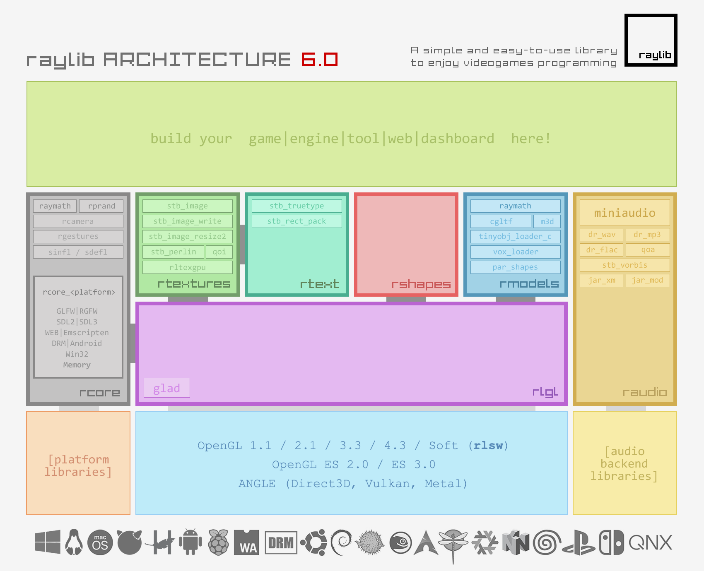
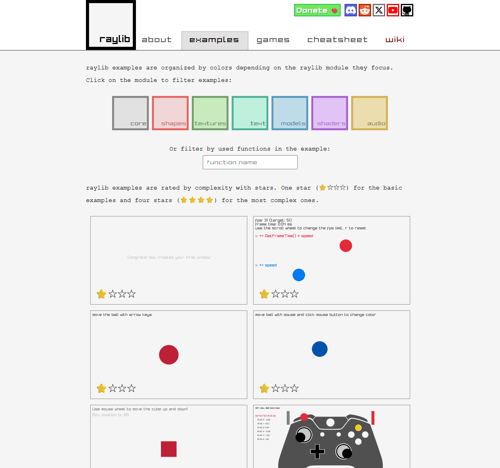
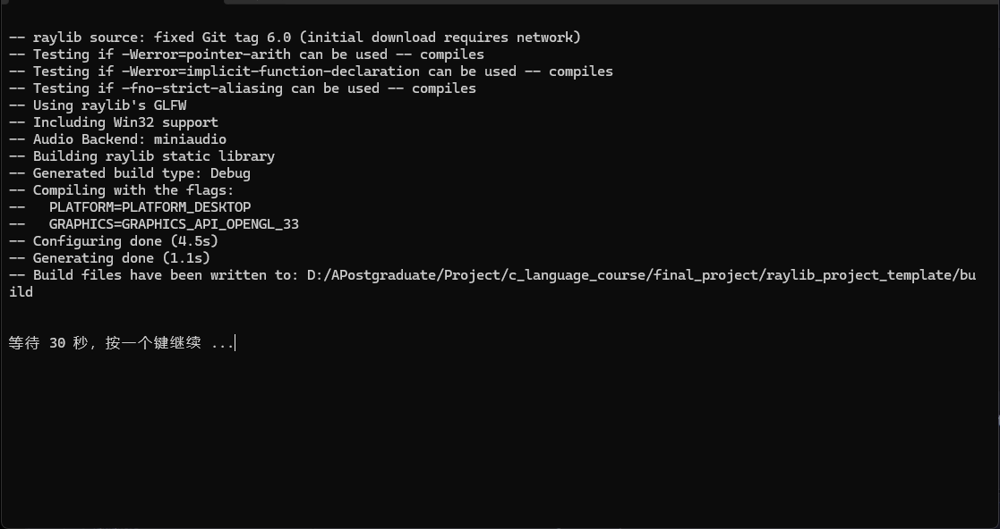
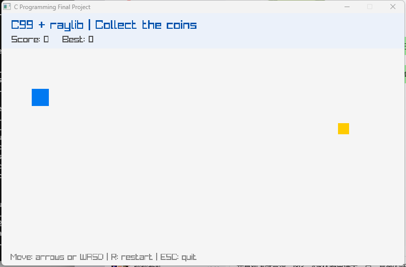

# 期末项目 · raylib 图形库与项目实操：从模板到你的第一个图形程序

> **参考文献**
> [《raylib — a simple and easy-to-use library to enjoy videogames programming》](https://www.raylib.com/) —— raysan5（Ramon Santamaria），发布于 raylib 官方网站，抓取日期 2026-10-26
> [《raysan5/raylib》](https://github.com/raysan5/raylib) —— raysan5，发布于 GitHub，抓取日期 2026-10-26
> [《raylib v6.0》](https://github.com/raysan5/raylib/releases/tag/6.0) —— raysan5，发布于 GitHub Releases（2026-04-23），抓取日期 2026-10-26
> [《raylib v6.2》](https://github.com/raysan5/raylib/releases/tag/6.2) —— raysan5，发布于 GitHub Releases（2026-10-15），抓取日期 2026-10-26
> [《Quick Setup for Windows with Visual Studio 2022, GCC, or MinGW》](https://github.com/raysan5/raylib/wiki/Quick-Setup-for-Windows-with-Visual-Studio-2022%2C-GCC%2C-or-MinGW) —— raylib Wiki，抓取日期 2026-10-26
> [《raylib cheatsheet（中文版）》](https://www.raylib.com/cheatsheet/cheatsheet_zh.html) —— raylib 官方，抓取日期 2026-10-26
> [《raylib examples》](https://www.raylib.com/examples.html) —— raylib 官方，抓取日期 2026-10-26
>
> 本文的 raylib 概念、模块划分和 API 说明依据上述官方资料整理；**模板工程的操作步骤依据模板自带的 `docs/STUDENT_GUIDE.md` 整理，并与官方资料核对**。
> **图 1（架构图）来自 raylib 官网，图 2（示例页）为 raylib 官网截图**；图 3、图 4 由本课程助教在 Windows 11 实机截取。
> **版本说明**：官方最新版是 **6.2**（2026-10-15），但**本课程模板固定使用 6.0**（2026-04-23）。6.2 调整了部分文件 API 的返回值、重做了 Image 绘制 API，模板代码是按 6.0 写的；**不要自行修改模板里的 `GIT_TAG`**，验收也以 6.0 为准。
> **主次说明**：官方 Wiki 推荐的是 `raylib-game-template` + `premake` 的建工程方式，与本课程的 CMake 模板不同；**操作以本文档（课程模板）为准，官方 Wiki 和示例仅供参考**，差异见 2.4 的对比表。

---

## 0. 本节目标

学完并动手做完本文档，你应该能够：

- 说清 **raylib 是什么、用什么许可证、支持哪些平台**，以及课程为什么选它来做期末项目；
- 说出 raylib 的 **7 个核心模块**分别负责什么，能解释 `InitWindow` → `WindowShouldClose` → `BeginDrawing` / `EndDrawing` → `CloseWindow` 这条主循环骨架；
- 在课程模板上**独立完成**「配置 → 编译 → 测试 → 运行」，看到一个可以用键盘操作的窗口；
- 读懂 `main.c`、`score.c`、`score.h` 的分工，能指出**结构体、指针参数、文件读写**分别写在哪里；
- 自己新增一个 `.c` + `.h` 模块，并**正确登记到 `CMakeLists.txt`**，不出现 `undefined reference`；
- 按期末要求完成**选题、模块划分、Git 提交和 README**，知道 100 分分别扣在哪。

> [!IMPORTANT]
> 这是本学期的**收尾课**：前四周装好的 GCC、CMake、VS Code、Git，本周要全部串起来用一次。
> 本周不教新语法，重点是把「会写单文件 C 程序」变成「能交一个多文件图形项目」。

---

## 1. 课前准备

| 需要的东西 | 从哪来 | 说明 |
| --- | --- | --- |
| 第一周的 **VS Code + MinGW-w64 GCC** | 已安装，直接沿用 | 终端里 `gcc --version` 有输出 |
| 第三周的 **CMake** | 已安装，直接沿用 | 模板要求 **CMake ≥ 3.24**，用 `cmake --version` 确认 |
| 第四周的 **Git** | 已安装，直接沿用 | 期末要提交到自己的远程仓库 |
| **课程工程模板** `raylib_project_template` | 课程资料的 `final_project/` 目录，或教师发的压缩包 | 解压后是一个完整工程，**不要拆散** |
| 一个纯英文、无空格的目录 | 自己建，如 `D:\Code\c-final` | 首次配置会在里面生成 `build/` |
| 联网 | 首次配置时自动下载 raylib 6.0 | 下载完成后可离线使用 |
| 约 **1～2 小时** | 课堂 + 课后 | 首次配置和首次编译都比较慢 |

> [!WARNING]
> **项目路径里不要出现中文和空格。**
> `D:\我的文件\C语言\期末\` 这类路径，在 `MinGW Makefiles` 生成器下容易出各种奇怪问题。请用 `D:\Code\c-final` 这种纯英文路径。

> [!IMPORTANT]
> **`D:\Code\c-final` 不是电脑里本来就有的目录。**
> 它只是本文档的示例路径，需要你自己创建。有 D 盘就用 D 盘；没有 D 盘就改用 `C:\Code\c-final`（可能需要管理员权限）；C 盘根目录也不让建，就用 `C:\Users\Public\Documents\Code\c-final`。
> **不要放在中文用户名下面**（例如 `C:\Users\张三\...`）。如果你换了路径，本文后面所有出现 `D:\Code\c-final` 的命令都要换成你的实际路径。

> [!TIP]
> 本周的所有命令都要在 **PowerShell / CMD / VS Code 内置终端**里执行，**不要用 Git Bash 或 MSYS**。
> 原因：`MinGW Makefiles` 生成器会通过 `cmd.exe` 执行构建规则，Git Bash 的路径写法会让它找不到编译器。

---

## 2. 认识 raylib：一个为「写游戏」而生的 C 库

### 2.1 一句话认识它

raylib 的官方介绍只有一句话：

> **raylib is a simple and easy-to-use library to enjoy videogames programming.**
> （raylib 是一个简单易用的库，让你享受电子游戏编程的乐趣。）

它由 **Ramon Santamaria**（GitHub 用户名 **raysan5**）创建，从 2013 年持续开发至今。它不是游戏引擎，不提供编辑器、场景面板、可视化拖拽；它只给你一套**画图、放声音、读键盘鼠标**的函数，剩下的逻辑全部由你写 C 代码完成。官方原话是 "no fancy interface, no visual helpers, no debug button... just coding"。

这正是它适合课程的原因：**你写的仍然是 C**，只是多了一个能开窗口的库。

| 项目 | 内容 |
| --- | --- |
| 定位 | 简单易用的游戏 / 图形编程库，适合原型、工具、图形应用和**教学** |
| 语言 | **C99**（也可以被 C++ 调用） |
| 许可证 | **zlib/libpng**：OSI 认证、类 BSD，允许静态链接进闭源软件 |
| 模板许可证 | **MIT**（见模板根目录 `LICENSE`）；raylib 本身仍是 zlib/libpng，两者不冲突 |
| 最新版本 | **6.2**（2026-10-15） |
| 课程版本 | **6.0**（2026-04-23），模板 `GIT_TAG` 固定 |
| 支持平台 | Windows、Linux、macOS、树莓派、Android、HTML5 等 |
| 外部依赖 | **无**。GLFW、miniaudio 等第三方代码已内置在 raylib 源码里 |
| 官方示例 | **200 多个**，全部开源可读 |
| 语言绑定 | 60 多种（Python、C#、Rust、Lua 等） |
| 官网 | <https://www.raylib.com/> |
| 源码仓库 | <https://github.com/raysan5/raylib> |

> [!NOTE]
> 表中的示例数、语言绑定数会随时间变化；本文数据抓取于 2026-10-26（GitHub 约 3.5 万 star）。
> 你看到的数字更大是正常的，不影响操作。

**几个名词先解释清楚：**

- **开源库**：源代码公开，允许你按许可证使用、修改、再分发。开源不等于"没有版权"，使用时仍要遵守许可证。
- **zlib/libpng 许可证**：非常宽松，允许你把 raylib **静态链接**进自己的程序，甚至闭源发布，只要不冒充原作者。模板就是静态链接的，所以最后只需要一个 `.exe`，不用带 `raylib.dll`。
- **C99**：C 语言 1999 年标准。模板的 `CMakeLists.txt` 里写了 `set(CMAKE_C_STANDARD 99)`，所以你可以用 `//` 注释、在 `for` 里定义变量、使用结构体复合字面量等写法。

> [!WARNING]
> **课程固定 6.0，不要升级到 6.2。**
> 6.2 虽然是最新版，但它调整了**文件 API 的返回值**、重做了 **Image 绘制 API**，网上基于 6.2 的代码直接抄进本模板可能编译不过。模板 `CMakeLists.txt` 中的 `GIT_TAG 6.0` 是课程统一版本，**不要改**；验收、答疑、评分都以 6.0 为准。

---

### 2.2 七个核心模块

raylib 把功能拆成七个模块。你不需要记住所有函数，但要建立一张"地图"：**遇到一个需求，知道该去哪个模块找函数**。


*图 1：raylib 6.0 的模块架构——最底下是平台库和 OpenGL，中间是七个核心模块，最上面是你的游戏（来自 raylib 官网）*

| 模块 | 负责什么 | 本课程会用到的代表函数 |
| --- | --- | --- |
| **rcore** | 窗口、输入、时间、文件系统 | `InitWindow`、`WindowShouldClose`、`IsKeyDown`、`IsKeyPressed`、`GetFrameTime`、`SetTargetFPS` |
| **rshapes** | 2D 形状绘制与碰撞检测 | `DrawRectangle`、`DrawRectangleRec`、`DrawCircle`、`CheckCollisionRecs` |
| **rtextures** | 图片、纹理、渲染目标 | `LoadTexture`、`DrawTexture`、`UnloadTexture` |
| **rtext** | 文字绘制、字体加载 | `DrawText`、`DrawTextEx`、`TextFormat`、`MeasureText` |
| **rmodels** | 3D 模型、动画、相机 | `LoadModel`、`DrawModel`、`UpdateCamera` |
| **raudio** | 音频设备、声音、音乐 | `InitAudioDevice`、`LoadSound`、`PlaySound`、`CloseAudioDevice` |
| **rlgl** | OpenGL 抽象层（底层） | 一般**不用**直接调用，由上面几个模块内部使用 |

另外还有两个常被提到的"扩展"：

- **raymath**：向量、矩阵、四元数运算，3D 项目常用；
- **raygui**：简易 GUI 控件库。**本课程模板没有预装 raygui**，期末不要求做复杂输入框、表格；确有需要必须先和助教确认。

> [!TIP]
> 看图 1 的方法：**上层依赖下层**。你写的游戏在绿色框里；你调用 `DrawRectangle` 时，rshapes 会经过 rlgl 最终交给 OpenGL 和显卡。你不需要关心下面几层，只管调用最上面的函数。

---

### 2.3 一个最小 raylib 程序长什么样

下面是 raylib 官方最经典的"打开窗口并画一行字"示例。**它只用于理解骨架，本周不要在它上面建工程**——下一步直接使用课程模板。

```c
#include "raylib.h"

int main(void)
{
    InitWindow(800, 450, "raylib example - basic window");

    while (!WindowShouldClose())        // 点关闭按钮或按 Esc 时返回 true，循环结束
    {
        BeginDrawing();
        ClearBackground(RAYWHITE);      // 用白色清屏
        DrawText("Congrats! You created your first window!", 190, 200, 20, LIGHTGRAY);
        EndDrawing();
    }

    CloseWindow();

    return 0;
}
```

这段代码只有六个关键调用，按执行顺序如下：

| 步骤 | 函数 | 作用 | 少了会怎样 |
| --- | --- | --- | --- |
| 1 | `InitWindow(宽, 高, 标题)` | 创建窗口，初始化 OpenGL 上下文、输入和定时设备 | 后面所有绘图函数都无效，程序可能直接崩溃 |
| 2 | `while (!WindowShouldClose())` | **主循环**：每帧执行一次，直到你关掉窗口 | 窗口一闪而过 |
| 3 | `BeginDrawing()` | 告诉 raylib"这一帧开始画了" | 绘图命令没有生效的上下文 |
| 4 | `ClearBackground(...)` + 各种 `Draw...` | 清屏并绘制内容 | 画面上会残留上一帧 |
| 5 | `EndDrawing()` | 提交这一帧，并处理输入/刷新 | 画面不更新 |
| 6 | `CloseWindow()` | 释放窗口和资源 | 资源泄漏，严格检查时会报错 |

> [!IMPORTANT]
> **顺序不能乱**：`BeginDrawing()` 和 `EndDrawing()` 必须成对出现，所有 `Draw...` 函数都要夹在它们中间。
> 把 `DrawText` 写在 `BeginDrawing()` 之前，是初学者最常见的"窗口空白"原因之一。

---

### 2.4 官方学习资源

raylib 没有一本厚教材，它的学习方式是**读示例 + 查速查表**：


*图 2：raylib 官方示例页，按 core / shapes / textures / text / models / shaders / audio 分类，每个示例都能直接看代码和运行效果（来自 raylib 官网）*

| 资源 | 地址 | 什么时候用 |
| --- | --- | --- |
| **API 速查表（中文）** | <https://www.raylib.com/cheatsheet/cheatsheet_zh.html> | 想知道"画圆用哪个函数""这个参数是什么" |
| **官方示例库** | <https://www.raylib.com/examples.html> | 想实现一个效果，先找现成示例改 |
| **Windows 配置 Wiki** | <https://github.com/raysan5/raylib/wiki/Working-on-Windows> | 想脱离课程模板，自己新建工程时 |
| **CMake 集成 Wiki** | <https://github.com/raysan5/raylib/wiki/Working-with-CMake> | 想搞清 `target_link_libraries(... raylib)` 的写法 |
| **头文件源码** | <https://github.com/raysan5/raylib/blob/master/src/raylib.h> | 想确认函数原型、参数类型、返回值 |

> [!TIP]
> **不要从第一条函数开始背 API。** 正确顺序是：先想清楚要做什么（画矩形？检测碰撞？读键盘？）→ 去速查表搜关键词 → 看函数原型 → 复制官方示例里的用法 → 改参数试。
> 速查表右侧有中文释义，适合英文吃力的同学；但**函数名、参数名仍是英文**，写代码时要一字不差。

**官方教程与本课程模板的差别**（先看这张表，避免照错教程）：

| 对比项 | raylib 官方 Wiki 的做法 | 本课程模板（**以本文档为准**） |
| --- | --- | --- |
| 工程组织 | 使用 `raylib-game-template`，把 raylib 源码目录放进工程（文件夹必须叫 `raylib`） | 独立工程，raylib 由 CMake 自动拉取 |
| 构建工具 | 运行 `premake-mingw.bat` 生成 Makefile，再 `make` | CMake 的 `MinGW Makefiles` 生成器 + `cmake --build` |
| raylib 位置 | 手动下载/克隆到项目里，文件夹必须命名为 `raylib` | 自动下载到 `build/_deps/raylib-src/`，**不用手动放** |
| 版本 | 跟随最新版（6.2） | **固定 6.0** |
| 编译器 | 任意 MinGW / w64devkit | 课程统一 MinGW-w64 GCC 16.2.0 |
| 适用场景 | 自己新建项目、其他平台 | 本课程期末验收 |

> [!IMPORTANT]
> **以本文档（课程模板）为准，官方 Wiki 仅供参考。**
> 不要按 Wiki 去下载 `raylib-game-template`，也不要运行 `premake-mingw.bat`；本课程只验收 CMake 模板的构建方式。Wiki 的价值在于帮你理解编译选项和平台差异，不是让你换一套工程结构。

---

### 2.5 为什么课程选 raylib，而不是别的

| 方案 | 语言 | 特点 | 对本课程 |
| --- | --- | --- | --- |
| **raylib** | C99 | API 简单统一、无外部依赖、跨平台、自带 200+ 示例 | **选它**：零基础能在一节课内跑出窗口 |
| SDL2 | C | 更底层，窗口、渲染、音频要自己拼 | 学习成本高，容易卡在环境配置 |
| SFML | C++ | 面向对象，API 友好 | 课程是 C，不引入 C++ |
| Qt | C++ | 大型 GUI 框架，功能强但体积大 | 太重，偏离 C 语言基础 |
| EasyX | C++（Windows 专用） | 中文资料多，上手快 | 不可跨平台，且以 C++ 为主 |

> [!NOTE]
> 这张表只说明**课程取舍**，不是全面评测。每种库都有适用场景；如果你以后做 3D 或商业项目，SDL、Qt 可能更合适。

---

## 3. 运行课程模板

### 3.1 模板里有什么

先把模板解压/复制到 `D:\Code\c-final`。它不是一个"空工程"，而是一个**能直接运行的小游戏**：蓝色方块可用方向键或 WASD 移动，碰到黄色方块得 1 分，最高分写入 `data/best_score.txt`。

```text
c-final/
├─ CMakeLists.txt          # 项目说明书：C99、raylib 6.0、源文件、测试
├─ .vscode/                # VS Code 任务（配置/编译/测试/运行）和调试配置
├─ src/
│  ├─ main.c               # 入口：窗口、主循环、输入、绘制
│  └─ score.c              # 分数文件读写
├─ include/
│  └─ score.h              # score 模块的接口声明
├─ tests/
│  └─ test_score.c         # 不依赖图形窗口的单元测试
├─ assets/                 # 图片、音效（模板为空，留给你）
├─ data/                   # 运行时数据，最高分保存在这里
├─ docs/                   # 学生手册、作业要求、排错文档
├─ third_party/            # 断网时放 raylib 源码（默认空）
├─ tools/
│  └─ check-env.cmd        # 一键检查 gcc/make/cmake/git
├─ configure.cmd           # 双击即可配置
├─ build.cmd               # 双击即可编译
├─ run.cmd                 # 双击即可运行
└─ README.md               # 模板说明
```

| 文件 | 你要不要改 | 作用 |
| --- | --- | --- |
| `CMakeLists.txt` | **要改**（新增 `.c` 时） | 告诉 CMake 编译哪些源文件、链接 raylib、生成测试 |
| `src/main.c` | **要改** | 你的游戏主逻辑 |
| `src/score.c` / `include/score.h` | 可改/可扩 | 多文件模块示例；期末可以复用或替换 |
| `tests/test_score.c` | 建议扩写 | 针对数据处理函数的自动测试 |
| `.vscode/tasks.json` | 可不改 | 提供 4 个任务：01 Configure、02 Build、03 Test、04 Run |
| `docs/` | 只读 | 学生手册、作业要求、常见错误 |
| `build/` | **不要改、不要提交** | CMake 和编译器生成的中间文件 |

> [!WARNING]
> **不要直接改 `build/` 里的任何文件。** 它每次重新配置都会被覆盖。
> 要改编译选项，改根目录的 `CMakeLists.txt`；要改代码，改 `src/`。

> [!IMPORTANT]
> **这份工程要放进你自己的 Git 仓库，期末提交的是仓库地址，不是压缩包。**
> 如果已经在 Gitee / GitHub 建好个人仓库，先 `git clone` 到 `D:\Code\c-final`，再把模板文件复制进去；如果还没建，按第四周的方法建一个**私有**仓库，然后在 `D:\Code\c-final` 执行：
>
> ```powershell
> git init
> git add .
> git commit -m "chore: 导入课程模板"
> git remote add origin <你的仓库地址>
> git push -u origin HEAD
> ```
>
> 提交前先看 `git status`：**`build/`、`*.exe`、`data/best_score.txt` 都不应该出现在待提交列表里**。模板自带的 `.gitignore` 已经排除它们；如果出现了，先检查是不是在错误的目录执行了 `git init`。

---

### 3.2 先检查环境

打开 VS Code，按 **Ctrl + 反引号**（Esc 下面那个键）打开内置终端，确认当前目录是项目根目录（提示符前应显示 `c-final`）。依次执行：

```powershell
gcc --version
mingw32-make --version
cmake --version
git --version
```

四条命令都要输出版本信息。重点看两个：

- `gcc` 应该是 **MinGW-w64**（输出里有 `x86_64-...-mingw` 或 `MinGW-Builds` 字样）；
- `cmake` 版本必须 **≥ 3.24**，低于这个版本会在配置时报 `CMake 3.24 or higher is required`。

模板还提供了一个一键检查脚本，在项目根目录执行：

```powershell
cmd /c tools\check-env.cmd
```

它会把 `gcc`、`mingw32-make`、`cmake`、`git` 逐个用 `where` 找一遍，最后输出 `[OK] Ready to configure.`。如果某一项显示 `[MISSING]`，先回到对应那一周补环境，不要继续往下做。

> [!TIP]
> `where.exe gcc` 可以显示实际调用的是哪个 `gcc.exe`。
> 如果它指向 `C:\msys64\...` 或别的工具链，说明 PATH 里混进了第二套 MinGW，请把课程这一套的 `bin` 放到最前面，或删掉多余的那套。

---

### 3.3 第一次配置：生成构建文件

确认终端位于 `D:\Code\c-final`（`dir` 能看到 `CMakeLists.txt`），执行：

```powershell
cmake -S . -B build -G "MinGW Makefiles" -DCMAKE_C_COMPILER=gcc -DCMAKE_BUILD_TYPE=Debug
```

每个参数的意思：

| 参数 | 含义 |
| --- | --- |
| `-S .` | 源码目录是当前目录（`.`） |
| `-B build` | 构建文件放到 `build/`，与源码分开（**外部构建**） |
| `-G "MinGW Makefiles"` | 生成 `mingw32-make` 能读的 Makefile。名字必须一字不差，**带引号** |
| `-DCMAKE_C_COMPILER=gcc` | 指定用 PATH 里的 `gcc` |
| `-DCMAKE_BUILD_TYPE=Debug` | 保留调试信息，方便以后用 GDB；发布时可换 `Release` |

**第一次配置会联网**：CMake 的 `FetchContent` 会从 GitHub 拉取 **raylib 6.0** 的源码，放进 `build/_deps/raylib-src/`。这一步视网络情况大约 **1～3 分钟**；之后同一台电脑再配置就只需要几秒。

配置成功的输出最后几行长这样：

```text
-- raylib source: fixed Git tag 6.0 (initial download requires network)
...
-- Configuring done (4.5s)
-- Generating done (1.1s)
-- Build files have been written to: D:/Code/c-final/build
```


*图 3：配置成功后的终端输出。关键看最后三行 `Configuring done`、`Generating done`、`Build files have been written to`。图中的 `D:/APostgraduate/...` 是助教电脑上的路径，你的应该是 `D:\Code\c-final\build`，路径不同不影响结果（助教实机截取）*

> [!WARNING]
> **`build/` 会很大。** 首次配置把 raylib 的完整源码和 Git 历史都放进了 `build/_deps/`，整个 `build/` 可能达到**几百 MB**。这是正常的，**不要把它提交到 Git**（模板的 `.gitignore` 已经排除了 `/build/`）。

> [!IMPORTANT]
> 配置只做一次。**改了 `CMakeLists.txt` 之后不需要手动重配**，下一次 `cmake --build` 会自动重新运行 CMake。
> 只有**换生成器、换编译器、删过 `build/`** 时，才需要重新执行上面的配置命令。

---

### 3.4 编译

在项目根目录执行：

```powershell
cmake --build build --parallel 4
```

`--parallel 4` 表示用 4 个线程并行编译。第一次编译会**连 raylib 一起编译**，可能要 1～3 分钟；以后再改自己的代码，只重编改动的文件，几秒就好。

> [!TIP]
> 不想敲命令时，可以依次双击根目录的 `configure.cmd`、`build.cmd`、`run.cmd`；但**初学阶段建议手敲**，否则出错时不知道卡在哪一步。

第一次编译的输出很长：前面会有几十行 `Building C object ... raylib ...`，那是在编译 raylib 本身。**增量编译**（改了自己的代码后）输出类似：

```text
[ 25%] Building C object CMakeFiles/c_final_project.dir/src/main.c.obj
[ 50%] Building C object CMakeFiles/c_final_project.dir/src/score.c.obj
[ 75%] Linking C executable c_final_project.exe
[100%] Built target c_final_project
```

看到 `[100%] Built target c_final_project` 就说明成功了，产物是 `build\c_final_project.exe`。

> [!TIP]
> 也可以 `cd build` 后执行 `mingw32-make -j4`，效果一样；但**推荐统一用 `cmake --build build`**，因为它在任何生成器下都通用。

> [!WARNING]
> 如果编译时报 `warning: ... [-Wall]`，先看清楚是 warning 还是 error。模板开了 `-Wall -Wextra -Wpedantic`，**警告不阻止生成 exe**，但期末代码应尽量做到"零警告"，这是 C 语言运用评分的一部分。

---

### 3.5 运行测试

模板带了一个**不打开图形窗口**的单元测试，专门测 `score.c` 的读写逻辑：

```powershell
ctest --test-dir build --output-on-failure
```

正常输出：

```text
Test project D:/Code/c-final/build
    Start 1: score_storage
1/1 Test #1: score_storage ....................   Passed    0.08 sec

100% tests passed out of 1

Total Test time (real) =   0.11 sec
```

这个测试覆盖了 6 种情况：

| 测试内容 | 对应函数 |
| --- | --- |
| 文件不存在时返回 0 | `LoadBestScore` |
| 保存 7 分时返回 1（成功） | `SaveBestScore` |
| 保存后能读回 7 | `LoadBestScore` |
| 拒绝保存负数 | `SaveBestScore` |
| 被拒绝的保存不破坏原值 | `LoadBestScore` |
| 文件内容不是数字时返回 0 | `LoadBestScore` |

测试结束时还会用 `remove` 删除临时文件，不会在你的项目目录里留下垃圾。

> [!IMPORTANT]
> **测试能跑通，说明你的多文件编译和标准库文件读写都没问题。**
> 期末要求"可以运行 CTest/自测"，你可以仿照 `tests/test_score.c` 给核心数据处理函数补测试；测试**不要依赖 raylib**，否则就无法在无图形环境下运行。

---

### 3.6 运行游戏

**必须从项目根目录运行**：

```powershell
.\build\c_final_project.exe
```

也可以双击 `run.cmd`，或在 VS Code 里 **终端 → 运行任务 → 04 Run demo**。


*图 4：模板运行后的窗口。蓝色方块是玩家，黄色方块是金币，顶部显示当前分数和最高分（助教实机截取）*

| 操作 | 效果 |
| --- | --- |
| **方向键** 或 **W / A / S / D** | 移动蓝色方块 |
| 蓝色方块碰到黄色方块 | 分数 +1，金币换位置 |
| **R** | 重新开始（分数归零） |
| **Esc** 或点窗口右上角 × | 退出程序 |

**为什么要从根目录运行？** 因为 `main.c` 里的路径是相对路径：

```c
#define DATA_PATH "data/best_score.txt"
```

程序会到**当前工作目录**下找 `data/best_score.txt`。如果你 `cd build` 再运行，它会去找 `build\data\best_score.txt`，找不到就当作 0 分，也保存不进去。这不是 bug，是相对路径的规则。

第一次玩到新最高分后，`data\best_score.txt` 才会出现，内容就是一个整数，例如：

```text
3
```

下次启动时 `LoadBestScore` 会把它读回来，显示在 `Best:` 后面。

> [!WARNING]
> **不要双击 `build\c_final_project.exe` 直接运行。**
> 双击时 Windows 把工作目录设成 `build\`，同样找不到 `data/`。请双击根目录的 `run.cmd`，或者在根目录的终端里执行 `.\build\c_final_project.exe`。

---

## 4. 读代码：模板是怎么跑起来的

这一节不要求你马上会写，只要求你**能指着代码说出每一段在干什么**。期末答辩会问。

### 4.1 主循环骨架在 `main.c` 里

打开 `src/main.c`，看最下面的 `main` 函数：

```c
int main(void)
{
    GameState game = {0};
    InitWindow(SCREEN_WIDTH, SCREEN_HEIGHT, "C Programming Final Project");
    SetTargetFPS(60);
    game.best_score = LoadBestScore(DATA_PATH);
    ResetGame(&game);

    while (!WindowShouldClose()) {
        UpdateGame(&game);
        DrawGame(&game);
    }

    CloseWindow();
    return 0;
}
```

对照 2.3 的关键调用：

| 阶段 | 在 `main` 里的代码 | 说明 |
| --- | --- | --- |
| 1. 初始化 | `InitWindow(800, 500, "C Programming Final Project")` | 宽高来自 `#define SCREEN_WIDTH` / `SCREEN_HEIGHT` |
| 2. 主循环 | `while (!WindowShouldClose())` | 每帧循环一次 |
| 3. 更新 | `UpdateGame(&game)` | 读键盘、移动、碰撞、计分（不在 raylib 的要求里，但是游戏的标准写法） |
| 4. 绘制 | `DrawGame(&game)` 内部的 `BeginDrawing()` … `EndDrawing()` | 所有 `Draw...` 都在里面 |
| 5. 关闭 | `CloseWindow()` | 释放窗口资源 |

额外两行：

- `SetTargetFPS(60)`：把帧率限制在 60 帧/秒，避免程序把 CPU 跑满；
- `LoadBestScore(DATA_PATH)`：启动时读最高分。

> [!NOTE]
> 模板里的文字都是英文，是因为 **raylib 默认字体只包含 ASCII 字符**。直接写 `DrawText("得分", ...)` 会显示成方块或问号。
> 需要中文界面时，要用 `LoadFontEx` 配合 `LoadCodepoints`，把中文字符的码点和字体文件一起加载，再用 `DrawTextEx` 绘制；这属于进阶内容，本周不要求，期末也不强制中文界面。

---

### 4.2 用结构体保存游戏状态

`main.c` 开头定义了：

```c
typedef struct GameState {
    Rectangle player;
    Rectangle coin;
    int score;
    int best_score;
} GameState;
```

`GameState` 把"这一局游戏需要记住的所有东西"打包在一起：玩家的矩形、金币的矩形、当前分数、最高分。这样函数之间只要传**一个** `GameState`，不用传四个参数。

`Rectangle` 是 raylib 自带的 2D 矩形结构体，有 `x`、`y`、`width`、`height` 四个 `float` 成员。`game.player.x` 就是玩家左上角的横坐标。

接着看这一行：

```c
ResetGame(&game);
```

`&game` 取的是 `game` 的**地址**，函数定义是：

```c
static void ResetGame(GameState *game)
{
    game->player = (Rectangle){60.0f, 150.0f, PLAYER_SIZE, PLAYER_SIZE};
    game->score = 0;
    PlaceCoin(game);
}
```

| 写法 | 含义 | 什么时候用 |
| --- | --- | --- |
| `game.score` | 直接用结构体变量访问成员 | 你在 `main` 里持有 `game` 本身 |
| `game->score` | 通过**指针**访问成员，等价于 `(*game).score` | 函数参数是 `GameState *game` |
| `&game` | 取地址，把"变量在哪"传给函数 | 想让函数**修改**原来的变量 |
| `(Rectangle){...}` | C99 的**复合字面量**，临时构造一个 `Rectangle` | 给结构体整体赋值 |

> [!IMPORTANT]
> 期末要求"至少一个函数通过指针参数修改数据"，`ResetGame`、`UpdateGame`、`PlaceCoin` 都是现成例子。
> 如果写成 `void ResetGame(GameState game)`（不带 `*`），函数拿到的是**副本**，改完原变量不变——这是 C 语言最经典的坑之一。

---

### 4.3 输入与帧率

`UpdateGame` 里的移动代码：

```c
const float speed = 280.0f * GetFrameTime();

if (IsKeyDown(KEY_LEFT)  || IsKeyDown(KEY_A)) game->player.x -= speed;
if (IsKeyDown(KEY_RIGHT) || IsKeyDown(KEY_D)) game->player.x += speed;
if (IsKeyDown(KEY_UP)    || IsKeyDown(KEY_W)) game->player.y -= speed;
if (IsKeyDown(KEY_DOWN)  || IsKeyDown(KEY_S)) game->player.y += speed;
```

两个关键点：

1. **`IsKeyDown` 和 `IsKeyPressed` 不一样**
   - `IsKeyDown(KEY_LEFT)`：按住期间**每帧**都返回 `true`，适合"持续移动"；
   - `IsKeyPressed(KEY_R)`：只在**按下的那一帧**返回 `true`，适合"按一次触发一次"（重启）。如果重启用 `IsKeyDown`，按住 R 会疯狂重置。

2. **`GetFrameTime()` 返回上一帧花了多少秒**
   - 如果直接写 `player.x += 5`，60 帧的电脑每秒移动 300 像素，30 帧的电脑每秒只移动 150 像素，手感完全不同；
   - 写成 `280.0f * GetFrameTime()`，就是"每秒移动 280 像素"，**与帧率无关**。

后面还有边界限制：

```c
if (game->player.x < 0) game->player.x = 0;
if (game->player.x > SCREEN_WIDTH - PLAYER_SIZE)
    game->player.x = SCREEN_WIDTH - PLAYER_SIZE;
```

这是防止方块跑出窗口。注意上边界是 `80` 而不是 `0`：

```c
if (game->player.y < 80) game->player.y = 80;
```

因为顶部 70 像素被标题栏占用了，方块不能钻到文字下面。

---

### 4.4 碰撞与计分

```c
if (CheckCollisionRecs(game->player, game->coin)) {
    game->score++;
    if (game->score > game->best_score) {
        game->best_score = game->score;
        (void)SaveBestScore(DATA_PATH, game->best_score);
    }
    PlaceCoin(game);
}
```

`CheckCollisionRecs(a, b)` 判断两个矩形是否相交，返回 `bool`（需要 `#include <stdbool.h>`，raylib.h 已经帮你包含了）。相交时：

1. 当前分数 +1；
2. 如果超过最高分，更新 `best_score` 并**立即写文件**；
3. 重新随机放一个金币。

`PlaceCoin` 用 `GetRandomValue(最小值, 最大值)` 生成随机坐标：横向和底部留 35 像素边距，纵向从 `y = 100` 开始，避开顶部 70 像素的标题栏。

> [!TIP]
> `(void)SaveBestScore(...)` 前面的 `(void)` 是告诉编译器"我故意忽略返回值"。保存失败（比如目录不存在）不会让游戏崩溃，但分数就存不下来。想排查保存问题，可以临时改成：
>
> ```c
> if (!SaveBestScore(DATA_PATH, game->best_score)) {
>     TraceLog(LOG_WARNING, "保存最高分失败: %s", DATA_PATH);
> }
> ```
>
> `TraceLog` 是 raylib 的日志函数，输出会出现在启动程序的终端里。

---

### 4.5 多文件与文件读写

`score` 模块拆成两个文件：

**`include/score.h`** 只放"接口"：

```c
#ifndef COURSE_SCORE_H
#define COURSE_SCORE_H

/* Reads a non-negative integer. Returns 0 if file missing or invalid. */
int LoadBestScore(const char *file_path);

/* Returns 1 on successful save; returns 0 on an error. */
int SaveBestScore(const char *file_path, int best_score);

#endif
```

- `#ifndef ... #define ... #endif` 叫**头文件保护**，防止同一个头文件被重复包含导致重复定义；
- 这里只有**声明**（函数长什么样），没有函数体；
- `const char *file_path` 表示"只读的字符串"。

**`src/score.c`** 放"实现"：

```c
int SaveBestScore(const char *file_path, int best_score)
{
    FILE *fp;
    int ok;
    if (file_path == NULL || best_score < 0) return 0;

    fp = fopen(file_path, "w");
    if (fp == NULL) return 0;
    ok = (fprintf(fp, "%d\n", best_score) > 0);
    if (fclose(fp) != 0) ok = 0;
    return ok;
}
```

这段代码体现了期末要考的**文件读写 + 错误处理**：

| 语句 | 作用 | 失败时 |
| --- | --- | --- |
| `fopen(file_path, "w")` | 以"写"模式打开文件，不存在就创建 | 返回 `NULL`（目录不存在、无权限） |
| `fprintf(fp, "%d\n", ...)` | 把整数写进文件 | 返回负数或 0 |
| `fclose(fp)` | 关闭文件，刷新缓冲区 | 返回非 0 |
| `return 1 / 0` | 用返回值告诉调用者成功与否 | 调用者可以决定是否提示 |

`LoadBestScore` 则用 `fopen(..., "r")` + `fscanf(fp, "%d", &value)` 读取；文件不存在、读不到整数、读到负数，都返回 0。

> [!IMPORTANT]
> **为什么测试能在没有窗口的情况下跑？**
> 因为 `tests/test_score.c` 只链接了 `src/score.c`，**没有链接 raylib**，也不调用任何 `Draw...`。这就是"业务逻辑"和"图形界面"分开的好处：逻辑可以自动测试，界面只负责人看。

---

### 4.6 一局游戏的数据流

```text
程序启动
  │
  ├─ LoadBestScore("data/best_score.txt") ──→ game.best_score
  │
  └─ while (窗口没关)：
        键盘/鼠标 ──→ UpdateGame(&game) ──→ 修改 game 里的 player / score / best_score
                                              │
                                              ├─ 刷新最高分 → SaveBestScore() → data/best_score.txt
                                              │
                                              └─ DrawGame(&game) ──→ 屏幕上的方块、文字
```

记住这张图，期末答辩时能讲清楚"数据从哪来、到哪去"，比背函数名更有用。

---

## 5. 动手改：新增一个模块

这一节是**课堂检查项**：不能只改 `main.c`，要亲自新增一个 `.c` 和一个 `.h`，并让 CMake 认识它。

### 5.1 新建头文件 `include/message.h`

在 VS Code 左侧资源管理器里右键 `include` 文件夹 → **新建文件**，命名为 `message.h`，内容：

```c
#ifndef COURSE_MESSAGE_H
#define COURSE_MESSAGE_H

void PrintCourseMessage(void);

#endif
```

### 5.2 新建源文件 `src/message.c`

右键 `src` 文件夹 → **新建文件**，命名为 `message.c`，内容：

```c
#include "message.h"
#include <stdio.h>

void PrintCourseMessage(void)
{
    puts("This is my first multi-file C project!");
}
```

> [!NOTE]
> 这里用 `puts` 而不是 raylib 的 `DrawText`，是为了让你先在**终端**看到输出，确认新模块真的被编译、被调用了。
> 下一步你可以把它改成在游戏窗口里显示一行字。

### 5.3 在 `main.c` 里调用

打开 `src/main.c`，做两处修改：

1. 在文件开头的 `#include "score.h"` 下面加一行：

```c
#include "message.h"
```

2. 在 `int main(void)` 的函数体最前面加一行。改完后的 `main` 函数应该是这样（其余代码与模板一致）：

```c
int main(void)
{
    GameState game = {0};

    PrintCourseMessage();          // 新增：验证多文件模块

    InitWindow(SCREEN_WIDTH, SCREEN_HEIGHT, "C Programming Final Project");
    SetTargetFPS(60);
    game.best_score = LoadBestScore(DATA_PATH);
    ResetGame(&game);

    while (!WindowShouldClose()) {
        UpdateGame(&game);
        DrawGame(&game);
    }

    CloseWindow();
    return 0;
}
```

> [!WARNING]
> 只改 `main.c` 还不够。**头文件只告诉编译器"有这个函数"，不会把函数体编译进来**。下一步必须改 `CMakeLists.txt`。

### 5.4 登记到 `CMakeLists.txt`

打开根目录的 `CMakeLists.txt`，找到 `add_executable`：

**改之前：**

```cmake
add_executable(c_final_project
    src/main.c
    src/score.c
)
```

**改之后：**

```cmake
add_executable(c_final_project
    src/main.c
    src/score.c
    src/message.c
)
```

只加了一行 `src/message.c`。CMake 的规则是：**每个参与编译的 `.c` 都必须出现在这个列表里**，`.h` 不用写。

### 5.5 重新编译并验证

回到终端（项目根目录）：

```powershell
cmake --build build --parallel 4
.\build\c_final_project.exe
```

你应该看到：

1. 终端先打印一行 `This is my first multi-file C project!`；
2. 然后游戏窗口正常打开，方块仍可移动。

如果只看到窗口、没有那行字，说明 `PrintCourseMessage()` 没被调用；如果编译就失败，看下一节。

### 5.6 故意制造一次链接错误（重要）

把 `CMakeLists.txt` 里的 `src/message.c` **临时删掉**，重新编译，你会看到：

```text
undefined reference to `PrintCourseMessage'
collect2.exe: error: ld returned 1 exit status
```

这是本课程最重要的错误之一。它的含义是：

- **编译阶段**：每个 `.c` 单独编译，`main.c` 看到了 `message.h` 里的声明，所以能过；
- **链接阶段**：链接器要把所有 `.o` 拼成 `.exe`，找不到 `PrintCourseMessage` 的函数体，于是报"未定义引用"。

**排查顺序**：

1. `message.c` 是否真的存在、文件名拼写是否正确；
2. `CMakeLists.txt` 的 `add_executable` 是否包含 `src/message.c`；
3. 函数名、参数、返回类型是否和头文件声明**完全一致**（C 语言区分大小写）；
4. 改完 CMakeLists 后是否重新执行了 `cmake --build`。

把 `src/message.c` 加回去，重新编译，错误消失。这个"删掉 → 报错 → 加回 → 正常"的过程，请自己动手做一遍。

---

## 6. 项目实操：把模板变成期末大作业

### 6.1 选题

模板自带的小游戏只是"能跑起来的例子"，不是你的期末作品。从下面 8 个题目里选一个（或个人/小组自拟，经教师同意），**最低功能**必须全部实现：

| 题目 | 最低功能 | 加分扩展（非必需） |
| --- | --- | --- |
| 贪吃蛇 | 转向、增长、碰撞、计分、最高分持久化 | 难度、暂停、障碍物 |
| 俄罗斯方块 | 下落、移动旋转、消行、计分、结束判断 | 预览下一个方块 |
| 五子棋 | 双人落子、胜负判断、重开、战绩保存 | 撤销一步 |
| 扫雷 | 随机布雷、揭格、输赢判断、计时 | 标记、分难度 |
| 超市管理 | 添加/修改/删除商品、库存查询、文本文件保存 | 排序、销量图表 |
| 图书管理 | 图书录入、借还、查询、文件保存 | 到期提醒 |
| 车牌统计 | 从文本文件导入车牌、按地区/类别统计、图形展示 | 多条件检索 |
| 成绩分析 | 导入成绩、平均分/最高分/及格率统计、图形展示 | 排序和筛选 |

> [!NOTE]
> **"车牌统计"是文本统计，不是摄像头图像识别**；管理类项目用教师发的 CSV/TXT 数据即可，不要求数据库。
> 图形精美程度**不是**高权重评分项；游戏类和管理类一视同仁。

### 6.2 需求与模块划分

以**贪吃蛇**为例，先把"要存什么"和"分成几个文件"想清楚，再动手写。

**数据结构**（写在 `include/snake.h`）：

```c
#ifndef COURSE_SNAKE_H
#define COURSE_SNAKE_H

#define MAX_SNAKE_LEN 256

typedef struct Point {
    int x;
    int y;
} Point;

typedef struct Snake {
    Point body[MAX_SNAKE_LEN];   /* 用数组保存每一节身体 */
    int length;                  /* 当前长度 */
    int direction;               /* 0=上 1=右 2=下 3=左 */
} Snake;

void SnakeInit(Snake *snake);
void SnakeMove(Snake *snake, Point next);
void SnakeGrow(Snake *snake);
int  SnakeHitSelf(const Snake *snake);

#endif
```

这里同时满足了期末的三条 C 语言要求：**结构体**（`Snake`）、**数组**（`body`）、**指针参数**（`Snake *snake` 修改原对象）。

**模块表**（写进 README）：

| 文件 | 职责 | 关键函数 |
| --- | --- | --- |
| `src/main.c` | 窗口、主循环、把各模块串起来 | `main` |
| `src/snake.c` | 蛇的初始化、移动、增长、自撞判断 | `SnakeInit`、`SnakeMove`、`SnakeGrow`、`SnakeHitSelf` |
| `src/food.c` | 食物随机生成、与蛇头碰撞 | `FoodSpawn`、`FoodCheck` |
| `src/board.c` | 边界判断、得分规则 | `BoardCheck` |
| `src/render.c` | 所有 `Draw...` 调用 | `RenderGame` |
| `src/score.c` | 最高分读写（可复用模板） | `LoadBestScore`、`SaveBestScore` |

> [!IMPORTANT]
> **至少 2 个自己编写的业务 `.c` 文件**（`main.c` 不算），并且每个都要用 `.h` 声明接口。
> 不要把所有代码堆在 `main.c` 里——"多文件结构和 CMake"占 15 分。

### 6.3 开发节奏

| 阶段 | 交付物 | 检查重点 |
| --- | --- | --- |
| 1. 环境与首次提交 | 能运行的模板、运行截图、两次 commit、独立模块、CTest 通过 | Git + CMake + GCC |
| 2. 需求与模块设计 | 一页需求说明、结构体定义、模块表 | C 语言结构设计 |
| 3. 最小可用程序 | 核心逻辑能运行，文件读写可验证 | 基础功能 |
| 4. 完整版与展示 | 源码、README、演示、完整提交历史 | 稳定性与规范 |

**建议先做"最小可用"**：能画出一个方块、能按键移动、能存一个数字，就已经跑通全链路；再去加规则、加界面、加音效。

### 6.4 Git 提交要求

期末要求**至少 5 次有实质内容、可解释的 Git commit**，并且**至少一次涉及 CMake 多文件配置**。

一个合理的提交序列：

```text
1. chore: 导入课程模板
2. feat: 新增 snake 模块并登记到 CMakeLists
3. feat: 实现蛇的移动与吃食物增长
4. fix: 修正自撞判断的边界错误
5. feat: 保存并读取最高分
6. docs: 补全 README 的功能与运行说明
```

每次提交前：

```powershell
git status
git add src/main.c src/snake.c include/snake.h CMakeLists.txt
git commit -m "feat: 实现蛇的移动与吃食物增长"
git push
```

> [!WARNING]
> **不要提交 `build/`、`.exe`、`data/best_score.txt`。**
> 模板的 `.gitignore` 已经排除了它们。如果 `git status` 里出现一堆 `build/` 文件，说明忽略规则没生效或之前已经 `git add` 过，先停下来问助教，不要直接 `git add .`。

### 6.5 README 要写什么

期末提交的 `README.md` 至少包含：

| 部分 | 内容 |
| --- | --- |
| 项目名称与简介 | 一句话说明做什么 |
| 功能列表 | 对应 6.1 的"最低功能"，逐条打勾 |
| 运行方法 | 配置、编译、运行三条命令 |
| 源文件职责 | 每个 `.c` / `.h` 负责什么（就是 6.2 的模块表） |
| 操作说明 | 哪个键做什么 |
| 测试方法 | 怎么运行 `ctest`，测了哪些函数 |
| 已知问题 | 没做完的、有 bug 的，如实写 |
| 外部资源 | 用到的图片、音效、参考代码及来源 |

> [!TIP]
> README 是"陌生人拿到你的仓库后能否跑起来"的说明书。写完后**自己删掉 `build/`，按 README 从头做一遍**，能走通才算合格。

### 6.6 评分点（100 分）

| 维度 | 分值 | 判定标准 |
| --- | ---: | --- |
| 核心功能与正确性 | 30 | 按最低功能清单验收，能稳定演示 |
| C 语言运用 | 25 | 数组、结构体、指针、函数、文件读写是否合理 |
| 多文件结构和 CMake | 15 | 分模块、头文件、明确列出源文件、可独立构建 |
| Git 工作流 | 10 | 提交有意义、过程完整、能解释至少两次提交 |
| 程序可靠性与测试 | 10 | 错误输入和边界处理、能运行 CTest/自测 |
| 文档与演示 | 10 | README 可复现、演示清晰、能回答代码问题 |

### 6.7 提交前检查

- [ ] 在一个**全新目录** `git clone` 自己的仓库，能从零配置、编译、运行；
- [ ] `build/`、`.exe`、`data/best_score.txt` 没有被提交；
- [ ] 没有密码、Token、身份证号等敏感信息；
- [ ] `git log --oneline` 至少有 5 条本人提交；
- [ ] README 里的命令能原样复制执行；
- [ ] `ctest --test-dir build --output-on-failure` 通过。

---

## 7. 常见问题（FAQ）

### 1. 现象：配置时卡在 `Downloading raylib` / 报 TLS、`Failed to clone repository`

**原因**：首次配置需要从 GitHub 拉取 raylib 6.0。校园网、代理、DNS 都可能导致下载失败。

**解决**：

1. 先确认浏览器能打开 <https://github.com/raysan5/raylib>；
2. 网络不稳定时**不要反复重配**，先删掉不完整的 `build` 再试：

```powershell
Remove-Item -Recurse -Force .\build
cmake -S . -B build -G "MinGW Makefiles" -DCMAKE_C_COMPILER=gcc -DCMAKE_BUILD_TYPE=Debug
```

3. 学校统一断网时，找助教要 **raylib 6.0 完整源码包**，按 `docs/OFFLINE.md` 放到 `third_party/raylib/`（`CMakeLists.txt` 要直接在这一层），再配置；模板会自动走离线路径；
4. 不要自己改成 `GIT_TAG 6.2` 试图绕过网络问题，版本不对会影响验收。

---

### 2. 现象：`CMake Error: Generator ... does not match the generator used previously`

**原因**：`build/` 里缓存了上一次使用的生成器（例如 Ninja、Visual Studio），这次却用 `MinGW Makefiles`。

**解决**：

```powershell
Remove-Item -Recurse -Force .\build
cmake -S . -B build -G "MinGW Makefiles" -DCMAKE_C_COMPILER=gcc -DCMAKE_BUILD_TYPE=Debug
```

**不要**手动改 `build/CMakeCache.txt`。一个项目只用一个生成器，课程统一 `MinGW Makefiles`。

---

### 3. 现象：`fatal error: raylib.h: No such file or directory`

**原因**：以下几种之一——

1. 还没配置，或配置失败了，`build/_deps` 里没有 raylib；
2. 你在错误的目录执行 `gcc main.c`，没有通过 CMake 构建；
3. 你用别的编辑器/IDE 直接编译，没有读取模板的 `CMakeLists.txt`。

**解决**：

1. 确认终端在项目根目录，`dir` 能看到 `CMakeLists.txt`；
2. 重新执行 3.3 的配置命令，看到 `Configuring done` 后再构建；
3. **不要手写 `gcc main.c -lraylib`**——模板用 CMake 管理头文件路径和链接库，绕开 CMake 会缺一堆参数。

---

### 4. 现象：`undefined reference to 'PrintCourseMessage'`（或你自己的函数）

**原因**：函数**声明**了、也**调用**了，但定义它的 `.c` 没有参与编译。最常见的是忘了写进 `add_executable`。

**解决**：

1. 打开 `CMakeLists.txt`，确认 `add_executable(c_final_project ...)` 里有对应的 `.c`；
2. 确认该文件真实存在，文件名大小写一致；
3. 重新 `cmake --build build --parallel 4`；
4. 还不行就检查函数名/参数/返回类型是否与 `.h` 完全一致。

---

### 5. 现象：窗口一闪就消失，或提示找不到 `data/best_score.txt`

**原因**：有两种常见情况——

1. **工作目录不对**：程序用的是相对路径 `data/best_score.txt`，不是"exe 所在目录"；
2. **程序崩溃或提前退出**：例如 `InitWindow` 失败、访问了空指针，窗口刚创建就关闭。

**解决**：

1. **从终端运行**，不要双击，这样能看到报错信息：

   ```powershell
   .\build\c_final_project.exe
   ```

2. 确认终端在项目根目录，或双击根目录的 `run.cmd`；**不要**双击 `build\c_final_project.exe`；
3. 确认根目录下有 `data` 文件夹（模板自带，若被删了就新建一个）；
4. 如果终端里有一行 `FATAL: ...` 或程序直接退出，把完整报错复制下来，按本章第 3、4 条排查；不要只发"打不开"。

---

### 6. 现象：玩到新最高分，但 `data/best_score.txt` 没有更新

**原因**：

1. 运行目录不对（同第 5 条）；
2. `data/` 目录不存在或被删除；
3. 文件被其他程序占用（例如你用记事本打开着它）；
4. `SaveBestScore` 返回 0，但代码里用了 `(void)` 忽略了返回值。

**解决**：

1. 从根目录运行，确认 `data` 文件夹存在；
2. 关掉正在编辑该文件的程序；
3. 临时把 `(void)SaveBestScore(...)` 改成带日志的写法（见 4.4 的 TIP），看终端有没有 `保存最高分失败`；
4. 检查磁盘是否只读、是否有杀毒软件拦截写入。

---

### 7. 现象：VS Code 里 `raylib.h` 有红波浪线，但命令行能编译成功

**原因**：VS Code 的 C/C++ 扩展（IntelliSense）没有读到编译参数，不知道 raylib 头文件在哪。**这不影响编译**。

**解决**：

1. 确认已安装 **C/C++ (Microsoft)** 扩展；
2. 确认已经成功执行过配置，生成了 `build/compile_commands.json`；
3. 模板的 `.vscode/settings.json` 已指向该文件；如果仍报错，按 **Ctrl + Shift + P** → `C/C++: Reset IntelliSense Database`，再重开文件；
4. 先以命令行 `cmake --build` 的结果为准，不要为了消红波浪线去改 `CMakeLists.txt`。

---

### 8. 现象：按 F5 调试提示 `gdb.exe not found`

**原因**：GDB 没有安装，或不在 PATH 里。模板的 `launch.json` 用的是 `gdb.exe`。

**解决**：

1. GDB 是**可选项**，不影响编译、运行和 `ctest`；不装也能完成任务；
2. 需要断点调试时，确认你的 MinGW 工具链 `bin` 目录里有 `gdb.exe`，并把它加入 PATH；
3. 终端执行 `gdb --version` 验证，重开 VS Code；
4. 不想折腾 GDB，就继续用 `cmake --build` + 运行 exe 的方式。

---

### 9. 现象：配置时报 `CMake 3.24 or higher is required`

**原因**：CMake 版本太旧。模板第一行是 `cmake_minimum_required(VERSION 3.24)`。

**解决**：

1. `cmake --version` 看当前版本；
2. 低于 3.24 就回第三周，从 <https://cmake.org/download/> 下载新版 Windows x64 安装包覆盖安装；
3. 装完**关闭所有终端和 VS Code**，重新打开再试；
4. 用 `where.exe cmake` 确认调用的是新装的那个，而不是旧版本残留。

---

### 10. 现象：路径里有中文/空格，出现莫名其妙的编译失败或找不到文件

**原因**：`MinGW Makefiles` 生成器通过 `cmd.exe` 执行规则，中文路径、空格、特殊符号都可能导致路径解析错误。

**解决**：

1. 把整个项目移到纯英文、无空格路径，例如 `D:\Code\c-final`；
2. 不要放在桌面、下载目录或中文用户名下；
3. 移动后**删除旧的 `build/`**，重新配置（`build/CMakeCache.txt` 里记录的是旧路径）；
4. VS Code 重新打开新路径的文件夹。

---

## 8. 课后作业

### 作业 1（必做）：跑通模板并留下证据

1. 按第 3 节完成配置、编译、`ctest`、运行；
2. 提交三样东西：游戏窗口截图、`ctest` 显示 `100% tests passed` 的截图、`git log --oneline` 截图；
3. 用自己的话说明：`InitWindow`、`WindowShouldClose`、`BeginDrawing`、`EndDrawing`、`CloseWindow` 各在什么时候执行。

**验收标准**：三张截图齐全，窗口能用方向键移动并计分，`ctest` 通过。

### 作业 2（必做）：新增 `message` 模块

1. 按第 5 节新增 `include/message.h`、`src/message.c`，并在 `main.c` 中调用；
2. 把 `src/message.c` 登记到 `CMakeLists.txt`；
3. 让你自己的学号也打印出来，例如 `This is my first multi-file C project! ID: 2026xxxx`；
4. 用 Git 提交这次改动，commit message 要能看出"新增模块 + 改 CMake"。

**验收标准**：运行后终端先打印你的信息，游戏窗口正常；提交历史里能看到 `message.c`、`message.h`、`CMakeLists.txt` 三个文件。

### 作业 3（必做）：给游戏加一个可观察的功能

从下面任选一个实现（也可以自拟，但要先和助教确认）：

- **计时**：屏幕右上角显示本局已用秒数，按 R 重置；
- **生命值**：初始 3 条命，每碰到一次"炸弹"减 1，减到 0 游戏结束；
- **难度**：每得 5 分，金币变小，或玩家的移动速度加快。

要求：

1. 至少修改一个结构体（增加字段），并通过**指针参数**在函数里修改它；
2. 至少调用一个新的 raylib 函数（例如 `DrawText`、`GetFrameTime`、`DrawCircle`）；
3. 在 README 里写明改了哪些文件、加了什么功能。

**验收标准**：功能在窗口里可见、可操作，代码能编译且没有新增警告。

### 作业 4（选做）：一页《需求与模块设计》

按 6.2 的格式，写一页 A4：

1. 选题与一句话简介；
2. 至少 2 个结构体定义（可以直接贴代码）；
3. 模块表：每个 `.c` / `.h` 的职责和关键函数；
4. 文件读写方案：存什么、存在哪个文件、格式是什么；
5. 5 条 Git 提交计划（写 message 即可）。

**验收标准**：结构体、模块表、文件清单齐全，能照着它直接开始写代码。

---

## 9. 自检清单

- [ ] 我能说出 raylib 是 **C99** 库，许可证是 **zlib/libpng**，课程固定版本是 **6.0**；
- [ ] 我能说出 7 个核心模块中至少 4 个的名字和职责；
- [ ] 我能解释 `InitWindow → while (!WindowShouldClose()) → BeginDrawing/EndDrawing → CloseWindow` 这条骨架；
- [ ] 我在 `D:\Code\c-final`（纯英文无空格路径）完成了配置，看到 `Configuring done` / `Generating done`；
- [ ] 我完成了编译，看到 `[100%] Built target c_final_project`；
- [ ] `ctest --test-dir build --output-on-failure` 显示 `100% tests passed`；
- [ ] 我从项目根目录运行程序，窗口能打开，方向键/WASD 能移动方块，碰到金币能加分；
- [ ] 我按 R 能重置，按 Esc 能退出；
- [ ] 我能指出 `GameState` 结构体、`ResetGame(&game)` 的指针参数、`LoadBestScore` 的文件读取分别在哪个文件；
- [ ] 我新增了 `message.h` / `message.c`，并把它写进了 `CMakeLists.txt`；
- [ ] 我故意删掉 `src/message.c` 重现过 `undefined reference`，并知道怎么修；
- [ ] 我理解"必须从根目录运行"和 `data/best_score.txt` 相对路径的关系；
- [ ] 我选定了期末题目，写出了至少 2 个结构体和模块表；
- [ ] 我的仓库里没有 `build/`、`.exe`、`data/best_score.txt`；
- [ ] 我的 Git 历史里至少有 5 条能解释的提交；
- [ ] 我的 README 能让别人从零跑起来。

---

## 图片来源

本文共 **4 张**截图（`images/01` – `images/04`）：**图 1–图 2 来自 raylib 官网，图 3–图 4 由本课程助教实机截取**。

| 图号 | 内容 | 出现位置 | 来源 |
| --- | --- | --- | --- |
| 图 1 | raylib 6.0 模块架构图 | 第 2.2 节 | raylib 官网 <https://www.raylib.com/> 的 [raylib_architecture_v6.0.png](https://www.raylib.com/images/raylib_architecture_v6.0.png) |
| 图 2 | raylib 官方示例页 | 第 2.4 节 | raylib 官网 <https://www.raylib.com/examples.html> 页面截图 |
| 图 3 | CMake 配置成功的终端输出 | 第 3.3 节 | **助教实机截取**（Windows 11） |
| 图 4 | 课程模板运行窗口 | 第 3.6 节 | **助教实机截取**（Windows 11） |

**说明**：

- **图 1–图 2** 版权归 raylib 作者 **Ramon Santamaria（raysan5）** 所有，按 raylib 的 zlib/libpng 许可证用于教学说明；转载本文档时请同时保留 raylib 的许可证声明。
- **图 3** 是助教电脑上的真实终端输出，图中的路径 `D:/APostgraduate/...` 与你的 `D:\Code\c-final\build` 不同，属正常现象；版本号、时间也会不同，以你屏幕上的实际输出为准。
- **图 4** 是课程模板的实际运行画面，不含任何账号、密钥等敏感信息。
- 第 4.6 节的数据流是**文字示意图**，不是截图，未使用外部图片。
- 除上述 4 张图外，本文档没有引用其他图片。
